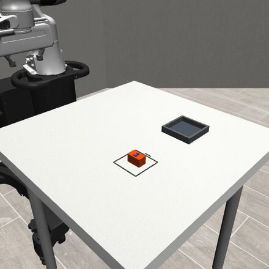
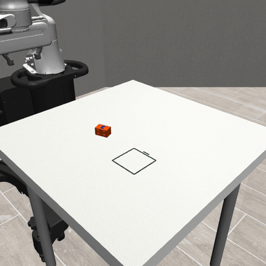
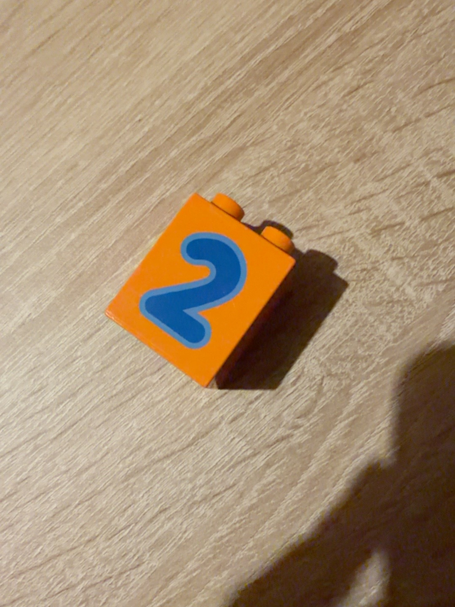
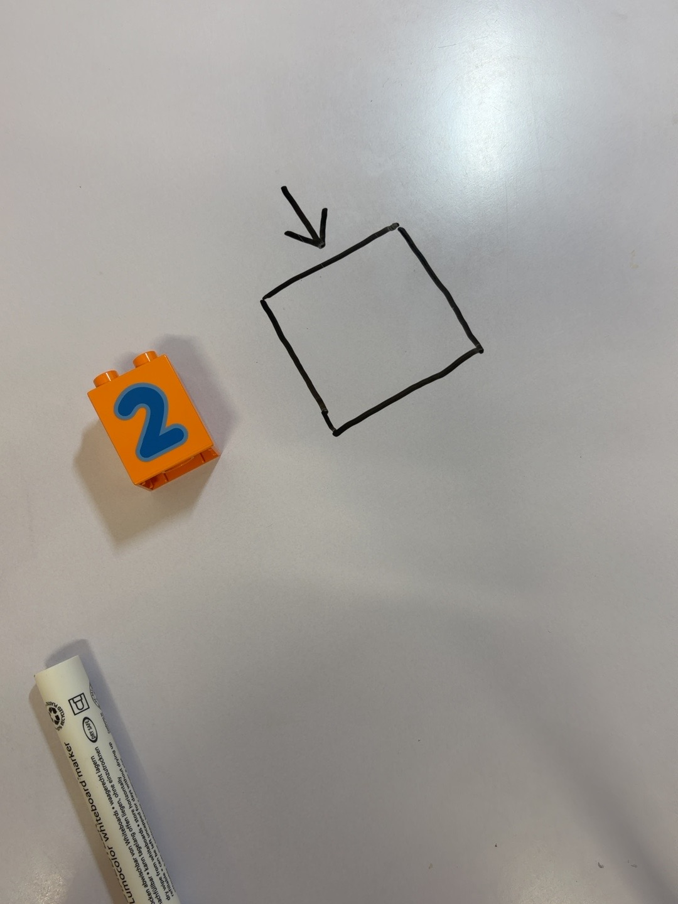
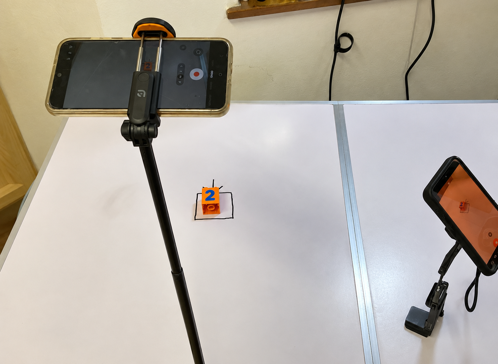
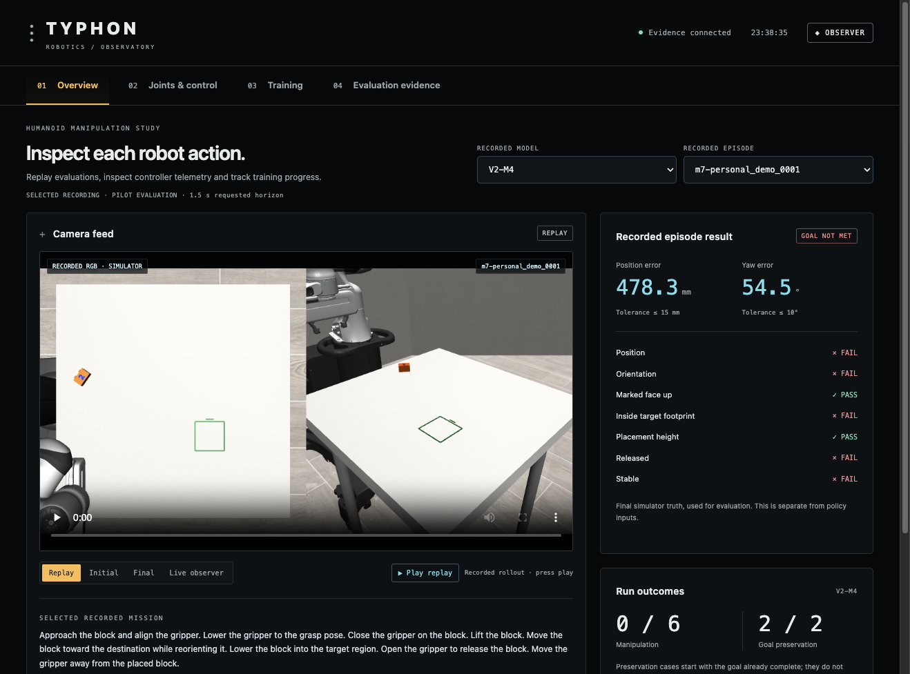
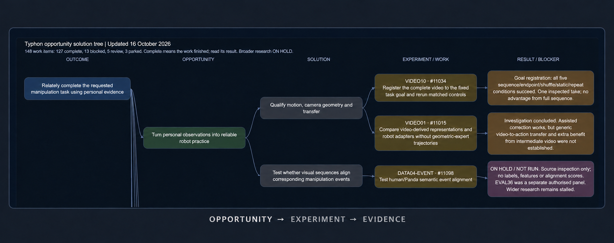
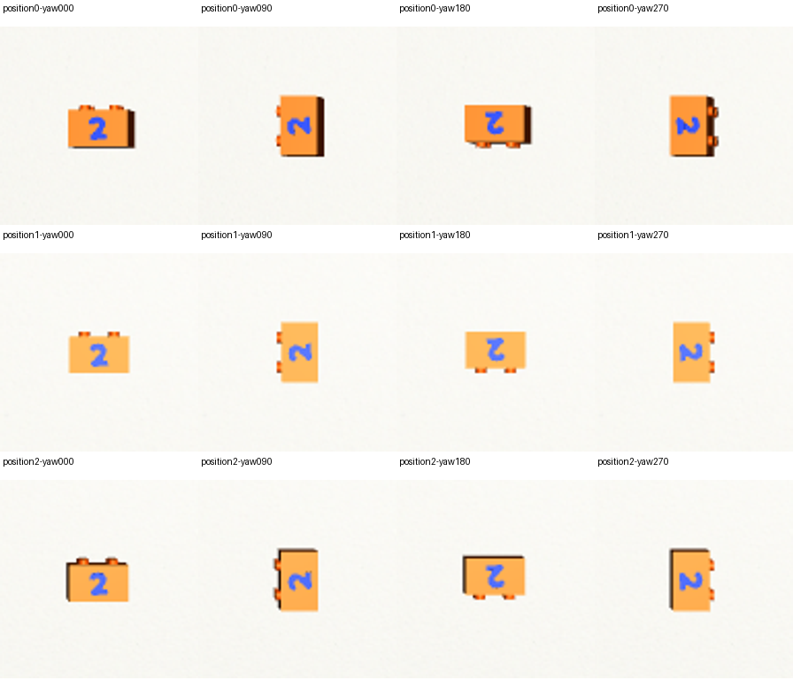

# Video-informed scenario reconstruction for continuous robotic manipulation

How can recorded phone footage contribute to robot learning when it does not contain calibrated robot-action labels? This project reconstructs tabletop scenarios, generates robot supervision in simulation, and tests feeding, fixture loading and continuous execution with a Franka Panda and X-VLA.

## TL;DR

**[Read the seven-page manuscript, 17 October 2026](docs/paper/Typhon_Manipulation_Preprint.pdf)**

The outcomes below summarise the revised manuscript. Earlier pilot results remain documented separately.

| Key outcome | Recorded result | What it supports |
|---|---|---|
| Local manipulation improved after source adaptation | **31/40 pickups, 22/40 operational placements and 17/40 strict completions**, compared with 0/40 for the released native-interface baseline | Useful local adaptation. Both policies remained at 0/20 strict completions on broader starts |
| Goal diversity improved familiar recombinations | **10/12 strict completions**, versus **0/12** with fixed-goal teaching | Better coverage of held-out combinations of familiar starts and destinations. Both remained at 0/12 fixture-loading successes without loading labels |
| Feeding then loading ran in one continuous world | **25/36 qualified workflows without assistance (69.4%)** and **31/36 with controller assistance (86.1%)** | Two frozen policies, an externally timed task switch, and no reset between stages. Exact 95% intervals: 51.9–83.7% and 70.5–95.3% |
| Assistance had a trade-off | Forbidden-contact workflows fell from **6/36 to 1/36**, but one assisted workflow had a negative joint margin | Endpoint placement alone is not enough to qualify an execution |

**The main finding:** video-informed scenarios and robot-specific supervision produced local manipulation and a bounded continuous workflow. Goal diversity, task teaching and grasp acquisition needed separate interventions. Loading received task-specific supervision. Broader transfer and a matched comparison of recorded and synthetic data remain open questions.

The recordings comprise **eight videos, 16 curated examples and 15 reconstructable scenarios**. The 36 paired workflow draws come from two previously inspected scenes with small pose perturbations, fixed cameras and frozen policies. The evaluation uses simulated workflow draws with fixed checkpoints.

[Experiment dashboard](https://www.natslabs.com/typhon-robotics/) · [Video library](https://www.natslabs.com/typhon-robotics/media-library.html) · [Earlier verified results](evidence/m7/) · [Controller audit](evidence/harness/SERVICE_REPORT.txt) · [Dataset provenance](evidence/m0/) · [Experiment history](experiment-history/) · [Reproduction](#reproduce)

### Placement examples

| Correct placement: native loading policy Q1 | Wrong placement: early V4-M6 policy |
|---|---|
|  |  |
| **Strict placement passed:** 6.10 mm position error, 1.03° yaw error. Unassisted development workflow. | **Strict placement failed:** 11.36 mm position error, 85.06° yaw error. |

Recorded simulator footage, cropped to the oblique camera and replayed at **1.5× speed**. The clips illustrate different model versions and task configurations. [Clip provenance](docs/research/media/placement-gifs.json).

## Why feeding and loading

The starting point was a customer problem: a robot becomes more useful if the next workstation can reuse what it has already learned. Repeating a successful motion at one station is only part of that job. The robot also needs to notice when a part has moved, a grasp has failed or someone has already completed a step.

Schaeffler gave this question a concrete setting. Humanoid's published proof of concept describes picking metal bearing rings from cluttered bins, moving them to a buffer table and moving between stations. It identifies reuse across ring types and correcting grasps as intended advantages. That made feeding a useful source task and loading a useful next task to test. [Humanoid's Schaeffler account](https://thehumanoid.ai/humanoid-and-schaeffler-successfully-completed-proof-of-concept-for-bin-picking-with-pre-alpha-robot/)

The tabletop experiment reduces that workflow to one orange block, a staging square and a shallow fixture. It tests a small part of the manipulation problem. It does not reproduce bearing-ring handling, production machinery or Schaeffler's operating conditions.

| Task | Likely repetition | Economic opportunity | Downside of failure |
|---|---|---|---|
| Box and tote handling | High | Medium to high | Dropped loads, delays and possible injury |
| Feeding | High | High | Incorrect parts and production stoppage |
| Part loading | High | High | Machine damage, scrap and downtime |
| Assembly | Medium to high | High | Defective assemblies, rework and potentially latent faults |
| Inspection | High | Depends strongly on defect costs | Missed defects, recalls and possible safety consequences |
| Packaging | High | Medium | Damaged goods and incorrect shipments |

These are qualitative planning judgements. They explain the choice of tasks; they are not measured risk scores or customer ROI. The [research assumptions](docs/research/schaeffler-motivation-and-study-plan.md) retain the original illustrative workstation and value model.

The original opportunity model assumed 25,000 workstations. These figures are illustrative, with no verified Schaeffler operating data or supporting cost model.

| Task | Assumed share | Assumed workstations | Assumed annual operations | Assumed net value per robot per year |
|---|---:|---:|---:|---:|
| Box and tote handling | 30% | 7,500 | 375 million | €13,200 |
| Feeding | 20% | 5,000 | 750 million | €20,000 |
| Part loading | 20% | 5,000 | 500 million | €19,900 |
| Assembly | 10% | 2,500 | 156 million | €9,100 |
| Inspection | 10% | 2,500 | 188 million | −€15,700 |
| Packaging | 10% | 2,500 | 94 million | €13,200 |
| Total | 100% | 25,000 | 2,063 million, approximately 2.06 billion | No aggregate specified |

### The physical reference

The orange DUPLO block and hand-drawn staging target made the task easy to record and inspect. The blue 2 provides a visible direction, so placement means getting both position and orientation right.

| Block reference | Feeding workspace |
|---|---|
|  |  |



Background clutter was removed from this presentation image. The [original recording-setup photo](docs/research/media/recording-setup.png) is retained.

The photos show the source setup; physical scale and material properties were unmeasured.

### The original study plan

The initial collection target was 60 feeding demonstrations: 40 normal examples, 10 with human interference and 10 with other disturbances. The planned transfer test introduced machine loading with a new workstation specification, fixture state, available skills and readiness constraints. A QR code was one proposed way to supply the workstation specification. Loading demonstrations were to remain outside the training set.

The proposed evaluation had 20 unfamiliar feeding layouts, 20 normal loading trials and 20 loading trials with human interference, with a rule-based baseline on the same cases. These are planned counts. Completed data, methods and results are reported below and in the versioned evidence. [Original collection and evaluation proposal](docs/research/schaeffler-motivation-and-study-plan.md)

### A deployment goal: NVIDIA Jetson Thor

The goal was to keep the eventual inference system small enough to run on NVIDIA Jetson Thor. Humanoid reports using Thor in its HMND 01 alpha platforms, which made onboard compute a relevant constraint. Development and evaluation used a Franka Panda simulation and an RTX 4090. Expanded temporal-model training used four NVIDIA H100 80 GB GPUs. [Humanoid's NVIDIA integration](https://thehumanoid.ai/humanoid-deploys-nvidia-technologies-to-power-advanced-humanoid-robots/)

Thor deployment remains a target. This repository does not establish a working Thor build, measured latency, power use or sustained control performance on that hardware. Model weights fitting in memory would be only the first check; camera processing, inference buffers, the controller and other onboard services also need room and time to run.

The [VLA research shortlist](docs/research/pretrained-vla-extensions.md) covers small adaptation modules, corrective data, memory, planning and inference optimisation. It separates ideas for later experiments from components already implemented here.


## What was built

```text
8 phone recordings → 16 curated manipulation examples
   ↓ observed object state, target geometry, category and source timestamps
15 reconstructable simulation scenarios + independent synthetic controls
   ↓ common Panda geometric controller → simulated RGB and robot actions
X-VLA adaptation: dense video / semantic chunks / temporal abstraction / corrections
   ↓ proposed action chunks
Execution service: visual completion → measured-state guards → bounded execution
   ↓ independent simulation scorer, trajectories, video and dashboard
```

Human video contributes task-relevant starting states, goals, disturbance categories and the blue numeral appearance. The action-supervised policies train on **simulated robot camera sequences paired with geometric-expert robot actions**. Phone footage specifies scenarios; the simulator expert supplies the robot-action labels.

Feeding moves a loose block into a marked staging square. Loading moves it from staging into a shallow fixture. A correct outcome requires position, directed orientation, release and stability, rather than merely closing the gripper.

## Earlier pilot evidence

This table preserves the initial October 2026 pilot snapshot. Those models preceded the later source-adaptation, goal-diversity and continuous-workflow experiments reported in the manuscript. Their negative results remain part of the record.

| Experiment | Observed result | Interpretation |
|---|---:|---|
| Source inventory | 8 recordings; 4 matched camera pairs | Originals preserved and checksummed |
| Curated recording examples | 7 normal, 4 pause/resume, 3 correction, 2 already completed | 16 total; excluded example retained separately |
| Scenario reconstruction | 15/16 usable | One initial state insufficiently observable |
| Geometric expert on reconstructed recording-derived scenarios | 13/15 successful | Scenario feasibility, not learned imitation |
| Matched independent synthetic scenarios | 8/15 successful | Same geometric execution layer |
| Common 1.5 s learned-policy pilot, V1/V2/V3 M3 | 0/8 for each | No unfinished manipulation solved |
| Common 1.5 s learned-policy pilot, V1/V2/V3 M4 | 2/8 for each | Only the two already-completed states remained correct |
| Separate 4 s V3 diagnostic | M3: 0/8; M4: 1/8 | Only already-completed preservation; different horizon |
| Early classifier-primary harness on frozen M6 | 3 valid goal cases recognised with zero policy actions | Completion guard working |
| Same harness, unfinished source | Not completed within 500 decisions | Guards do not repair a failing policy |

The six common pilots comprise 48 episodes; the separately labelled two longer-horizon diagnostics add 16. Later results are timestamped under `evidence/m7/`; this table is a frozen initial snapshot and does not imply that training completion means task success. Assisted diagnostics are not included in the unassisted policy results.

### Tiny visual completion classifier

A 111,107-parameter, 414 KB classifier reads rendered RGB, combines learned numeral direction with target-relative geometry, and returns `complete`, `incomplete` or `unknown`. Controller release/stability checks remain separate. It uses no simulator object truth at inference.

On an untouched post-freeze 336-image synthetic confirmation set:

| Ground truth | Complete | Incomplete | Unknown |
|---|---:|---:|---:|
| Valid placement | 101 | 0 | 10 |
| Invalid placement/orientation | 0 | 144 | 9 |
| Occluded | 0 | 0 | 72 |

This is fixed-camera, coloured-brick, overhead **feeding** evidence. Loading returns unknown. Real-camera accuracy and fine tolerance boundaries are unvalidated. The confirmation set contains 288 independent renders plus local occlusion augmentations, not 336 unrelated physical trials. Earlier exploratory retests and their label correction are disclosed in [metadata](evidence/goal-classifier/metadata.json).

### Execution service

The service can sample up to three X-VLA proposals, reject paths outside configured end-effector regions, check measured joint limits/speeds, rank remaining candidates by path length and second-difference cost, and execute a short prefix before observing again. It records measured joint position/velocity, gripper and end-effector state, simulated actuator torque, commands, rejections and image timestamps.

Candidate selection uses bounded path costs. Checks cover end-effector zones; whole-arm collision checking remains unsupported. The simulator pauses during inference. Qwen3-VL integration is available experimentally; the validated completion path uses the small classifier because Qwen produced contradictory outputs in these tests.

## Training matrix

These historical variants use the declared source mixture and sample across trajectories and camera views. Coverage manifests record exposure where available. The manuscript distinguishes the historical temporal models from the later native-interface model families.

| Variant | Observation/action construction |
|---|---|
| V1 | Dense causal simulated video plus geometric-expert action windows |
| V2 | Semantic single/pair/triple/intent chunks, dense simulated video, green held-object cue, expert actions |
| V3 | Semantic chunks, up to 4 s future action windows, up to 30 exact anchors, sparse causal visual history, held cue, expert actions |
| V4 | V3 originals plus one round of successful same-state expert continuations after a matching student's rollout budget expires |

V4 uses DAgger-style corrective imitation: successful expert continuations from states visited by the student policy. Rollout-budget expiry triggers a continuation review. The held-object cue is supplied by the simulator.

In these historical branches, M3/M4 update the active soft prompts. M5 updates LoRA adapters, active prompts, action projections and temporal annotation projections. M6 jointly updates the shared vision-language/action weights and active adaptation parameters. Configurations, optimiser schedules, mixture sizes and checkpoints are recorded in each experiment manifest. Task success is scored from the resulting robot state.

## Typhon: a product concept for managing robotics experiment runs

Typhon is a product concept for a **robotics experiment trial-run manager**. The intended user is a researcher or robotics engineer comparing policies, teaching strategies and controller interventions across repeatable scenarios.

The concept grew out of the practical work in this study: keep model versions and scenario seeds together, run bounded trials, inspect camera footage alongside controller telemetry, and compare outcomes against declared success criteria. A failed grasp, a correctly preserved completed task and an unsafe endpoint placement need different labels.

The implemented research harness and read-only dashboard provide parts of that workflow: recorded replays, model/checkpoint provenance, execution guards and independent scoring. A general platform for launching and managing experiments across robots is still a product concept.



The dashboard shows recorded experiments and controller measurements. Successful completion recognition and successful manipulation are reported separately. Its published October 9 recordings are historical evidence; they are not the later 36-pair workflow panel in the manuscript.

Watch the [privileged expert pick and place](https://www.natslabs.com/typhon-robotics/media-library.html?clip=ge/personal_demo_0001.mp4), [expert orientation-correction reference](https://www.natslabs.com/typhon-robotics/media-library.html?clip=ge/personal_demo_0007.mp4), or [V4-M6 learned pickup and placement attempt](https://www.natslabs.com/typhon-robotics/?run=v4-m6-pilot-v1&case=m7-personal_demo_0006). The V4-M6 attempt verified a lift and reached 11.36 mm position error, but its 85.06° yaw error failed the task. The video library identifies the model version, run, checkpoint update and checksum. The selected [jointed-vortex logo](docs/branding/) represents the experiment manager.

### Agentic research and the opportunity–solution tree

Agent-assisted research helped turn questions into bounded experiments, inspect recorded outcomes and keep follow-up work connected to the evidence. An opportunity–solution tree tracked the desired outcome, candidate explanations, proposed interventions and their results. Completed work, blocked studies and negative findings remain distinct.



This is a cropped, stylised presentation of the research tree. The paper and saved experiment records provide the quantitative evidence; the tree shows how the investigation was organised.

## Reproduce

Python 3.11 and a Linux rendering environment were used. The geometric demonstration needs the simulation environment; X-VLA additionally needs its separately installed dependencies, pinned upstream weights, prepared datasets and a checkpoint.

```bash
python3 scripts/verify_public_results.py
python3.11 -m venv .venv-sim
.venv-sim/bin/pip install -r requirements-sim.txt
MUJOCO_GL=egl PYOPENGL_PLATFORM=egl .venv-sim/bin/python -m supervisor.feeding_loading.runner \
  --task feeding --seed 17 \
  --config configs/feeding_loading/feeding_duplo_v2.json \
  --output results/example-feeding
```

For loading, use `--task loading`, `configs/feeding_loading/loading_duplo_v2.json` and a new output directory. EGL requires compatible graphics drivers; desktop rendering availability depends on the host.

```bash
.venv-sim/bin/python -m unittest discover -s tests -p 'test_feeding_loading.py'
.venv-sim/bin/python -m unittest discover -s tests -p 'test_typhon_service.py'
python3 dashboard/server.py --help
```

The dashboard server observes local experiment directories; an empty checkout does not invent live runs. A portable recorded snapshot is included in `demo/`. The tiny classifier is included at `models/goal-classifier/model.npz`; its interface is documented in `supervisor/planning/simple_goal_classifier.py`.

Full X-VLA checkpoints, raw phone videos and bulk training tensors are not bundled in Git. Scripts preserve the original experiment layout and may require archived inputs; the evidence-only check and geometric demo above are the minimal entry points. Verified public video URLs, checksums, source identities and outcome labels are recorded in [MEDIA_MANIFEST.json](MEDIA_MANIFEST.json). The [video library](https://www.natslabs.com/typhon-robotics/media-library.html) distinguishes phone observations, expert replays and learned-policy evaluations; it retains failed outcomes. The paired phone clips are temporally trimmed takes, with separate marked variants; no spatial-crop or frame-to-robot-action alignment is claimed.

## Data and geometry limitations

Primary-camera image coordinates were mapped using a dimensionless target-square reference. The reconstruction used an explicit virtual scale; pixel distances were not asserted to be physical metres. The reference block is an orange DUPLO piece with a blue 2. A body-attached asymmetric numeral fixes the original 0°/180° ambiguity; the four-orientation check is saved below.



The original simulation proxy and later catalogue-based DUPLO dimensions are different configurations. Proxy dimensions/mass are not physical measurements. Frozen experiments were not silently regenerated after visual or geometry changes. Source observations, generated robot actions and evaluator-only truth remain distinct.

## Repository map

- `supervisor/`: simulation, adaptation, observation contracts and execution service.
- `scripts/`: preprocessing, training, evaluation and audit commands.
- `configs/`, `assets/`: versioned tasks and body-local numeral geometry.
- `dashboard/`, `demo/`: local observer and portable recorded evidence.
- `evidence/`: selected frozen summaries, protocols, provenance and limitations.
- `models/goal-classifier/`: small completion model, independent of X-VLA weights.
- `EXPORT_PROVENANCE.json`, `PUBLIC_SHA256SUMS`: source/export provenance and integrity.

## References and licensing

Built on [X-VLA](https://github.com/2toinf/X-VLA), its [paper](https://arxiv.org/abs/2510.10274), [robosuite](https://robosuite.ai/) and MuJoCo. X-VLA base weights: [`2toINF/X-VLA-Pt`](https://huggingface.co/2toINF/X-VLA-Pt), revision `c1c4a64a7e03ac5b95c468bf1578f3d03651b53b`. Optional planner: [`Qwen/Qwen3-VL-2B-Instruct`](https://huggingface.co/Qwen/Qwen3-VL-2B-Instruct).

Typhon's original software and written documentation are licensed under [Apache-2.0](LICENSE), allowing copying, modification and sharing for education, research and commercial use. Retain the licence and notices. X-VLA and all other upstream components keep their own terms; personal media and third-party artwork are excluded from the blanket grant. See [licence coverage](LICENSE-COVERAGE.md), [NOTICE](NOTICE) and `CITATION.cff`. No endorsement by UCL, Humanoid, NVIDIA, LEGO or the cited authors is implied.
