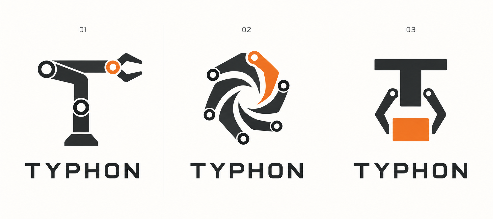

# Typhon logo concepts

1. An articulated arm forming a T.
2. A vortex built from jointed segments.
3. A gripper and orange block beneath a T.

These are exploratory concepts. No final logo has been selected and the live brand is unchanged. Generated with the built-in imagegen tool on 16 October 2026.

Prompt: Create one three-column logo exploration board for TYPHON, a robotics research project about manipulation, learning transfer, corrective actions and reproducible experiments. Show an articulated robot-arm T, a vortex of jointed segments, and a gripper/block monogram. Use vector-friendly flat charcoal shapes with a restrained orange accent, a warm-white background, the exact wordmark TYPHON and concept labels 01, 02, 03. Avoid gradients, stock robot heads, photographs and product mockups.
