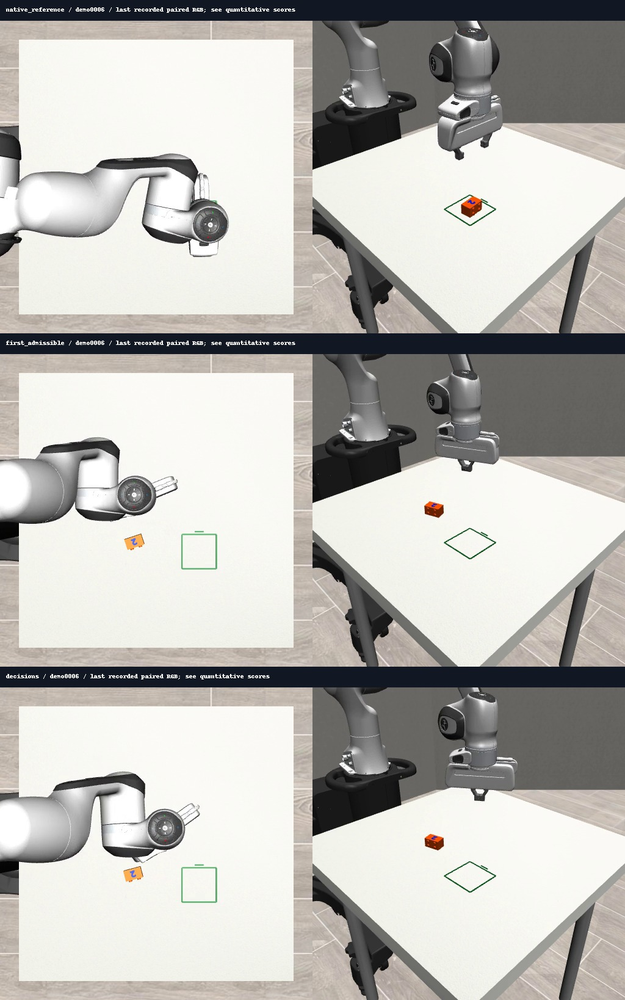

# LIVE04 — Live ranking handoff

The API selected three chunks and 62 targets reached the controller. The fixed two-second boundary scheduler did not improve manipulation: unmodified V4 retained its known grasp and placement; both boundary routes lost that grasp in this small development panel.

[Full report](REPORT.md) · [Per-episode results](comparisons.csv) · [Validation](validation_summary.json)

The already-completed case was preserved by all three routes. This is not a completion-recognition claim. LIVE05 (#11025) separates waiting, sampling and guards before any deployment decision.
