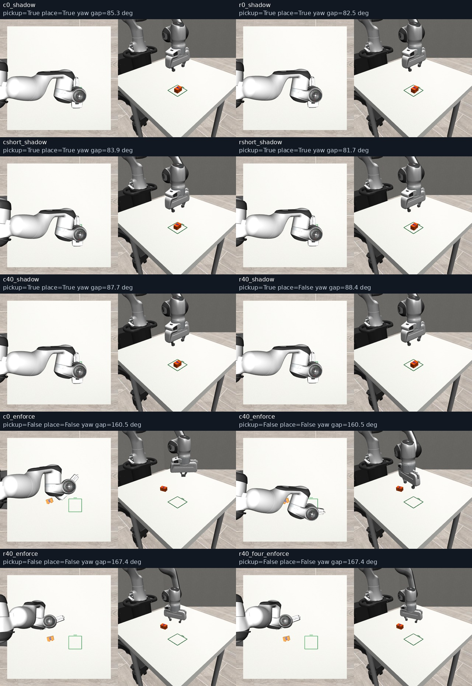

# LIVE05 — Why the live scheduler lost V4

The motion guard removes the known grasp, even without waiting or changed sampling. The original reference still picks up and places the brick with the wrong yaw.

[Read the report](REPORT.md) · [All 30 outcomes](comparisons.csv) · [Guard trace](guard-causal-audit.json) · [Side-by-side video](guard-comparison.mp4)

