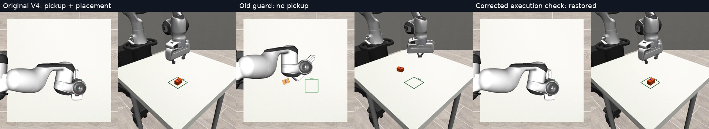

# LIVE06 — Execution guard qualification

The corrected execution check restores the known V4 pickup and placement, while retaining invalid-command rejection. Orientation is still wrong.

[Report](REPORT.md) · [Nine V4 results](comparisons.csv) · [Comparison video](guard-fix-comparison.mp4)

