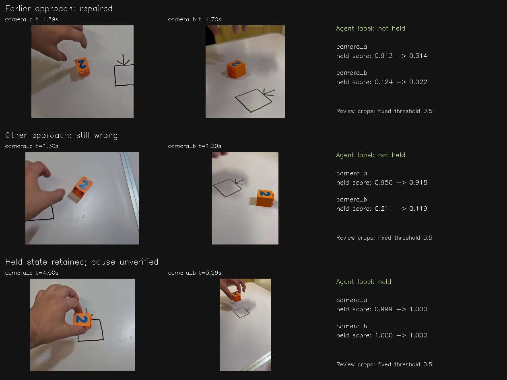

# VIDEO05 — Pre-contact negatives and held-midpoint audit

Thirteen training-only pre-contact frame labels repair the remaining error in the old VIDEO03 challenge. They do not remove the approach failure in demo_0015. Recognition of the available held examples is retained; independent held-pause qualification remains incomplete.

The figure uses enlarged review crops from the actual evaluated frames. These are not replacement model inputs. Before/after values are uncalibrated held scores with a fixed 0.5 threshold. Every frame and score is traceable through case-card-provenance.json.

## Scope

OST #11022 follows VIDEO04 #11021 and VIDEO03 #11020 under the generic video representation experiment #11015. Six small sigmoid observation probes are fitted on the existing frozen X-VLA-Pt descriptors. The comparison concerns whether an image shows a held block.

No VLA action head, backbone, prompt, motor checkpoint, geometric-expert action label or controller changes. There are no new robot episodes and no grant of control authority.

## Selection, annotation and provenance

The protocol and selection implementation were committed before review at `125c282`; the view-specific labels were committed before fitting or individual scores at `8e3939a81746ac150799c9c9f6aca591105a5e3b`. Fitting code was committed at `cff4f8c`.

For each of six P_train takes and two excluded takes, sample five fixed times starting at the last old known-negative endpoint, spaced by 0.3 seconds and capped before the old held interval. This yields forty two-view approach candidates. The earlier VIDEO04 rule often began too late to yield clear approach negatives.

The agent inspected full-frame and enlarged review sheets without prediction scores. Each camera is labelled separately: a visible hand with a clear gap is a negative; possible contact remains unknown. A no-hand frame is kept as an easy-negative annotation but not added to the new hard-negative training data. Views are not forced to have identical labels near contact: frame times and visibility differ, and the original synchronization has uncertainty.

Training review contains thirteen hand-present gap negatives, sixteen no-hand negatives and thirty-one unknown views. Only the thirteen clear hand-present negatives are added, all from the original six P_train takes. These are eight primary and five secondary frames. The fitting set grows from 463 to 476 samples, retaining VIDEO04's twelve withdrawal negatives.

The two excluded takes supply five hand-present negative views, two no-hand views and thirteen unknowns. Four held-midpoint events are also reviewed with ±0.3-second paired context: two from training and two excluded from fitting. These held midpoint labels are audit-only; no positive labels are added to training.

Labels are agent visual annotations, not new human approval, contact sensors or measured support forces. The source remains unmarked phone footage. All 2,644 frame hashes and the corrected dense-v2 source-index hash are verified.

### Splits and repeated evaluation

- Fit: demo_0001, 0002, 0003, 0005, 0012, 0013.
- Original validation: demo_0006, 0014, 0016.
- Extra excluded takes: demo_0004, 0015.
- Excluded held-midpoint audit: demo_0014 and 0015.

The excluded takes and recording sessions have been inspected before. These are new selected frame annotations within known families, not a fresh confirmatory study. Existing challenge panels are explicitly reported as reused diagnostics. No excluded-take label enters fitting.

## Methods

Compare the frozen VIDEO04 heads with new heads using:
1. Current full-image and object-crop descriptors.
2. Those descriptors plus observed hand/object features.
3. The same plus a causal 0.5-second descriptor history.

Each new representation is fitted with original equal take/class/view weights and with equal negative-regime weights within each take/class/view. The latter splits negative weight among old interiors, reviewed withdrawal and new pre-contact samples wherever present. New pre-contact samples receive 1.99% of original total weight or 15.28% in the balanced arm.

All thresholds, L2 regularisation, optimiser settings, training-only standardisation and source splits are fixed. There is no threshold tuning on the remaining failure. Four-second intention windows and motor-policy action horizons are unchanged.

## Results

Counts below are false-held views. The two new weighting schemes yield the same discrete outcomes for each representation; every score and all nine model conditions are saved in metrics.json and event-scores.json.

| Representation | VIDEO04: new pre-contact / 5 | VIDEO05: new pre-contact / 5 | VIDEO04: old challenge / 8 | VIDEO05: old challenge / 8 | VIDEO05: reused extra transitions / 6 |
|---|---:|---:|---:|---:|---:|
| Full + crop | 2 | 1 | 1 | 0 | 1 |
| Current fusion | 2 | 1 | 1 | 0 | 1 |
| Causal-history fusion | 2 | 2 | 1 | 0 | 1 |

Every condition retains all **90/90 labelled held interiors** and **0/155 false positives** on the conservative negative interiors. The 541 unknown interior-panel views remain unscored. All four excluded held-midpoint views remain classified held; these are a subset of the existing conservative positive panel and must not be counted as additional independent successes.

History does not improve the new pre-contact test. Reweighting the same negatives adds no discrete benefit on these panels.

### Physical takes and repeated frames

For current full+crop:
- The new pre-contact panel falls from two to one failing sampled times, out of four sampled times with known negatives.
- The same excluded take remains affected: one of two takes has a false-held prediction before and after fitting.
- The old challenge falls from one to zero failing events out of four.
- The reused VIDEO04 extra panel remains one failing event out of three.

Different camera views and nearby time samples are correlated. The new panel does not demonstrate that a new physical failure family has been solved.

### Two contrasting approaches

At demo_0006's earlier approach, the primary held score changes from **0.913 to 0.314**, correctly recognising the visible hand/block gap. That take supplies no fitting labels.

At demo_0015's reused approach, the primary score changes from **0.950 to 0.918**, still confidently wrong. Its secondary score is correctly low (0.211 to 0.119). At an earlier newly selected time from the same take, the primary error actually becomes stronger (0.838 to 0.879), while a secondary error at another time is repaired.

This is a selective improvement. The remaining failure has a different starting position and hand configuration, but the experiment has not established whether position, appearance, crop quality or another shortcut causes it. Do not assert a causal explanation from this case alone.

## Held-pause audit: incomplete

The review confirms continued finger support at the sampled midpoints. It does not establish an independent held-pause test:

- Training takes demo_0012 and 0013 show little visible motion. Their tracked end-to-end normalized image displacement over the shown 0.6 seconds is approximately 0.0053–0.0078. Exact zero motion is not established.
- Excluded demo_0014 visibly lowers the block. Displacements are 0.0378 primary and 0.0723 secondary. This is held-with-motion, not a pause.
- Excluded demo_0015 initially looked like little motion, but its primary tracked centre moves 0.0537 in normalized image coordinates and the secondary centre is unavailable. The visual impression and measurement cannot certify a pause.

The original blinded review notes are preserved. held-pause-audit.json records the stricter interpretation; no fitted label, threshold, weight or prediction changed.

A valid held-state prediction on these frames is not evidence of stationary-hold robustness. The next motion audit needs to compare tracked centres with actual object pixels through occlusion before using them for a robot adapter. Confidence-filter acceptance is not positional accuracy.

## Decision

**Keep the improved observation probe as an experimental artifact, not an autonomous grasp/release signal.** Small, targeted labels from personal footage can repair a specific error without a larger VLA training run. More weighting or the tested history representation does not solve the excluded-take failure.

Do not keep adding iterations and call the remaining uncertainty resolved. The useful next evidence is:
- whether the remaining false-held prediction is driven by global context, object-local detail or missing/occluded observations;
- verified transition timing and held intervals on independent events;
- accuracy of the observed 2D path while the hand occludes the block.

The direct phone-video representation is still distinct from a Panda action decoder. Metric calibration, supported depth, correction labels, simulator observer qualification and motor retargeting remain separate unresolved work under #11015, #10989, #10991 and #10984. Task B/loading results are unchanged by these observation tests.

## Verification and reproduction

A fresh six-head run reproduces all twelve saved prediction/label arrays bit-for-bit. The six new heads independently reload in NumPy within 8.35e-7 of CUDA probabilities. Frozen VIDEO04 scores reproduce within 1.20e-6. Exactly thirteen previously unknown training rows change to negative; no positive or excluded-take label changes. Source hashes, fitting indices, weight sums and complete-take exclusion pass. Full and focused sheets use identical source frames.

The initial six fits took 2.83 seconds using precomputed descriptors. This excludes video decoding/feature extraction and is not a new motor-policy training-time estimate.

From `research/video05-precontact-pause`, choose a fresh output root:

~~~sh
VIDEO_PYTHON="$HOME/Projects/typhon-harness-20261010/.venv-xvla/bin/python"
VIDEO_OUTPUT=/var/tmp/video05-reproduction
"$VIDEO_PYTHON" scripts/video05_fit.py \
  --protocol configs/experiments/video05/protocol.json \
  --output "$VIDEO_OUTPUT/fit-v1"
"$VIDEO_PYTHON" scripts/video05_fit.py \
  --protocol configs/experiments/video05/protocol.json \
  --output "$VIDEO_OUTPUT/fit-reproduction"
"$VIDEO_PYTHON" scripts/video05_verify.py --root "$VIDEO_OUTPUT"
~~~

The committed view-specific labels and selection are fixed inputs. scripts/video05_select.py regenerates the score-blind review in a fresh --output directory; --focus produces enlarged review crops from the same selected indices. Model features always come from the unchanged dense-v2 descriptor file.

Restore dense-v2 at the protocol's input_data path, or record a location-only change in a copied protocol. The source review, VIDEO03/04 heads and prior scores are versioned on this branch. Raw recordings remain in their existing archive.

Powerglide outputs: `/var/tmp/typhon-video-precontact-20261012`. Scripts, protocols, review sheets, small heads, scores, the case card and report are versioned privately. The complete output is archived on Mint Fast Drive with a checksum manifest; a separate receipt records verification.
