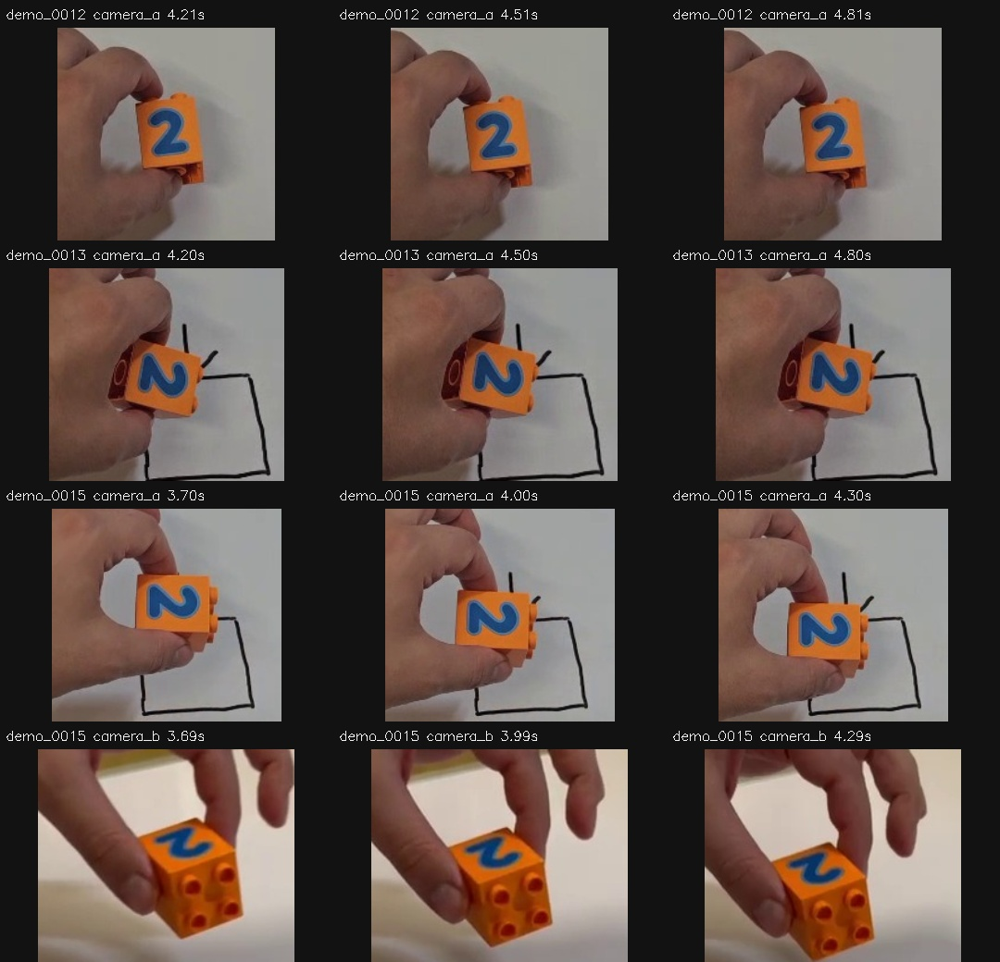

# VIDEO06 — Motion audit before phone-video retargeting

The large movement previously reported around demo_0015's held midpoint is supported by visible numeral features in both cameras. It is not explained by an orange-contour-centre jump in the primary view. The old side-camera contour detector returned no position throughout this held interval even though the numeral remained visible. Tracking that numeral supplies useful additional **image motion**, but does not recover a physical object centre, depth, contact, or a Franka action.

**Decision:** keep glyph-feature motion as an additional observable channel. Do not replace unknown robot poses/actions with these pixel paths. Proceed to VIDEO07 (#11024): compare native video cadence with10Hz at identical source times, and inspect phase timing. No model training or controller change was made.

## Scope and frozen inputs

OST #11023, parent #11015; follow-up to VIDEO05 #11022. Private branch: research/video06-motion-audit. Interval/criterion freeze:9f29c1c; motion implementation:cdf67ef; final failed-status serialization fix:87dc88c.

- Six existing personally recorded takes, two cameras each: normal controls0001/0004 and awkward/pause-resume0012–0015.
- Original held interiors plus fixed0–0.8s stationary controls:24 sequences,342 unique verified source JPEGs.
- Source sampling is approximately10Hz, using actual decoded-frame PTS. The primary view is the user-confirmed90° counterclockwise canonical image. Secondary remains its original portrait view. Images have an850-pixel long edge.
- VIDEO02 dense-v2 source-index SHA256: a7f7afafe32ac33ebdce29f8ee84846bd97e12e497c2047b738665ee1e34a370.
- Train-family takes0001/0012/0013 and previously excluded takes0004/0014/0015 retain their roles. Nothing was fitted. These sessions have already been inspected; this is an exploratory measurement audit, not a new independent evaluation set.
- Original raw recordings, M0–M1.6, VLA checkpoints, previous classifications and old review labels were unchanged. Intentional human pauses remain intentional pauses; the audit distinguishes them from exact image/3D stillness.

## Method

Compare the existing visible-orange centroid with independently selected blue-glyph corners. The new selector searches a frozen, broad workspace region; it does not use the old centre, old bounding box, old orientation estimate, predicted grasp score, or geometric-expert trajectory.

Pyramidal Lucas–Kanade tracks corners between frames, with forward/backward error<=1px, image error<=25, at least3 retained points and at least50% support. A visible-blue support mask guards against drift onto the hand/background. Persistent0.6s windows never reseed lost points. A separate static-background region checks camera motion. This follows the [OpenCV optical-flow interface](https://docs.opencv.org/4.13.0/d4/dee/tutorial_optical_flow.html); flow measures apparent2D feature motion.

The source feature identity and the old orange centroid are different quantities. Agreement cannot prove true object-centre accuracy. Rotation, perspective and partial visibility can move them differently.

The final strict low-motion screen requires every window step supported, maximum individual feature displacement<=3px, maximum feature path<=5px and qualified background path<=2px. The individual-point check prevents rotation cancelling into a small group-average translation. These are declared engineering thresholds, not a definition of an intentional human pause.

All rolling windows are retained, not just quiet-looking examples. Adjacent frames, windows and camera views are correlated.

## Results

| Measurement | Held intervals | Stationary controls |
|---|---:|---:|
| Source frames |234|108|
| Adjacent pairs |222|96|
| Qualified glyph-flow pairs |194/222|96/96|
| Old contour position available at both frames |161/222|72/96|
| Qualified glyph flow when old pair position unavailable |53|24|
| Both methods available |141|72|
| Delta disagreements above5px in common pairs |0/141|0/72|
| Persistent0.6s windows |162|36|
| Windows with sufficient persistent glyph support |104/162|35/36|
| Windows with sufficient background support |81/162|22/36|
| Windows passing final strict low-motion screen |0/162|22/36|

These are **coverage/consistency counts, not motion accuracy or robot success rates**. The glyph method also rejected20 pairs for which the old contour had positions, and8 pairs lacked both methods. It should complement the old channel, not silently replace it.

The maximum common held-pair disagreement was4.784px. No large>5px contour jump was demonstrated in the141 common pairs. This says nothing about the pairs where either method failed.

### The previously questioned midpoints

Values below are maximum displacement of the median tracked-feature translation during the approximately0.6s midpoint window. They are pixel measurements in each camera's own image, not comparable physical distances or recovered depth.

| Take | Primary glyph motion | Secondary glyph motion | Interpretation |
|---|---:|---:|---|
|0012|5.60px|4.86px|Small held sway/micro-adjustment; sufficient persistent feature support.|
|0013|4.69px|4.69px|Small held motion; sufficient support.|
|0014|Unknown|Unknown|Visible lowering, but insufficient persistent feature survival. Do not print a recovered motion as if qualified.|
|0015|28.36px|36.38px|Clear held movement in both views. Primary old-centre displacement28.34px agrees closely. Old secondary centre was absent.|

For0015,27/30 primary and25/26 secondary seed features survive. Secondary background path is0.344px while glyph path is38.350px. The paired frames visibly show movement relative to the marked target. The primary background mask is unreliable, so a precise primary camera-motion subtraction is not claimed.

For0012/13, the largest individual feature movements are about5.1–5.9px, not zero. Stationary-control midpoint median translations are0.032–0.471px. That supports distinguishing small held motion from the stationary controls, but does **not** invalidate the user's pause/resume demonstration category.

No independent strict stationary-held panel is qualified. This does not prove that the recordings lack useful task pauses.

### Tracking limitations

- Fast normal transport/rotation fails the10Hz persistent tracker. Primary demo0004 has0/7 qualified adjacent pairs; normal0001 also loses substantial long-window support. The accepted slow-window result cannot be generalized to every manipulation phase.
- The old contour lacks all21 side-view positions in0015 and all8 side-view held positions in0001. Glyph visibility is not the same as orange-detector success.
- The fixed primary background region is weakly textured and often loses points; its support is a limitation of the audit, not evidence that the camera or object moved.
- Blue-glyph tracking depends on this object, lighting and view. Complete occlusion, changed face visibility and rapid perspective changes remain unknown.
- The short2D similarity fits in window-measurements.json report apparent angle/scale only. They are not physical yaw estimates or an inference that X-VLA understands the number2.
- Inter-camera synchronization uncertainty remains inherited; paired views are supporting evidence, not calibrated stereo reconstruction.

## Validation and reproducibility

- All342 selected JPEG hashes match the frozen source index on both runs.
- After failed-status serialization was corrected, all28 summary, source, configuration and detailed trace JSON files reproduce byte-for-byte.
- All12 preview videos decode successfully, totaling234 held source frames.
-36 known digital image-shift checks:35 accepted,1 explicitly rejected at an image boundary. Maximum accepted error0.000557px. All12 identity shifts are supported. This is an implementation check on rewarped images, **not** real-video accuracy.
-12 artificial blank/occluded follow-up images correctly produce unknown motion.
- Primary audit completed in about5.10s on CPU using cached verified frames. No4090/VLA training was needed for this classical image-processing audit.

Two implementation issues are preserved transparently:
1. analysis-v1 initially asserted that every planted image shift must remain supported. An image-boundary shift was rejected by the forward/backward guard. analysis-v2 records that rejection, while still requiring accurate accepted measurements and valid identity controls. No tracking threshold changed.
2. Four discarded background-point LK errors differed in the first reproduction because OpenCV does not define those errors for failed tracking status. Final code stores them as null and preserves status flags. All accepted motion and summaries are unchanged. audit-v1, its initial reproduction and the issue record are retained. Authoritative outputs are audit-v2 and analysis-v3.

## Evidence and commands

Full-frame videos have source-time labels, cyan visible-glyph corners and magenta old visible-centre markers. They play at nominal10fps; source-provenance.json and trace timestamps are authoritative. Crops are review-only; they are not substituted into a VLA.

Powerglide bulk root: /var/tmp/typhon-video-motion-20261012  
Mint backup destination: /media/nm/Fast Drive/Typhon/research-20261012/video06

From this branch, with dense-v2 restored at the protocol's input_data path:

~~~sh
VIDEO_PYTHON="$HOME/Projects/typhon-harness-20261010/.venv-xvla/bin/python"
VIDEO_ROOT=/var/tmp/video06-reproduction
"$VIDEO_PYTHON" scripts/video06_select.py \
  --protocol configs/experiments/video06/protocol.json \
  --output "$VIDEO_ROOT/review-v1"
"$VIDEO_PYTHON" scripts/video06_motion.py \
  --protocol configs/experiments/video06/protocol.json \
  --selection "$VIDEO_ROOT/review-v1/selection.json" \
  --output "$VIDEO_ROOT/audit-v2"
"$VIDEO_PYTHON" scripts/video06_analyze.py --root "$VIDEO_ROOT"
~~~

The output directory must be new. These commands use the frozen input index and check each selected frame hash. environment.json records OpenCV/NumPy versions and source/script hashes. Raw trace JSON and all previews are retained on Mint; compact quantitative outputs and review evidence are on this private Git branch.

## What to do next

Proceed with VIDEO07 #11024. Test whether native cadence fixes the observed temporal correspondence failures, retaining all rejected phases. Annotate task pauses and teaching phases without pretending human timing is a robot action. Physical scale,3D/height, contact and a constrained robot adapter remain separate prerequisites under #11015/#10989/#10991. Do not feed incomplete pixel tracks to Franka as metres, or silently use geometric-expert actions as if they were recovered human trajectories.
