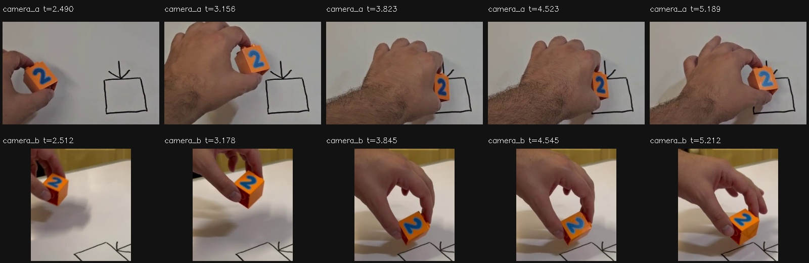

# VIDEO07 — Track before temporal downsampling

Keeping the native camera frames improves held-object feature correspondence over the same query intervals. Supported pairs increase from **194/222 to212/222**, and supported0.6s tracks from **104/162 to138/162**. This is evidence for extracting motion before reducing the temporal representation to sparse intention anchors. It is not evidence that a robot policy improved.

The benefit is incomplete:10 held pairs and24 longer held windows still fail, and one stationary-control pair/window loses support with native propagation. Preserve missing-state masks and phase uncertainty.

## Frozen comparison

OST #11024, parent #11015; follow-up to VIDEO06 #11023. Private branch: research/video07-native-cadence. Protocol freeze:a24d066. Identical-gap correction:0350253.

- Same six takes, two cameras and24 held/control sequences as VIDEO06: normal0001/0004, awkward/pause-resume0012–0015.
- Four raw recordings reverified by SHA-256. Native PTS match their frozen frame manifests. Sequential decoding from frame zero; no seeking, interpolation, duplicate-frame filling or smoothing.
-969 native frames; all342 common frames have byte-identical JPEGs and decoded pixels compared with VIDEO02 dense-v2.
- Median native frame spacing is about0.03333s in both cameras. One source begins with a genuine0.1554s gap; native decoding does not invent frames to fill it.
- Identical common start/end frames, feature seeds, blue mask, image resolution, JPEG quality92, Lucas–Kanade, forward/backward guard, support threshold and maximum observed-step gap. Native propagation adds actual intermediate frames and never reseeds inside a compared interval.
- Original frozen M0, M1–M1.6, VLA weights, annotations and earlier evaluation outputs remain unchanged. No geometric-expert actions or simulator truth were used.

## Quantitative result

| Interval type |10Hz supported|Native supported|Gained|Lost|
|---|---:|---:|---:|---:|
|Held adjacent query pairs|194/222|212/222|18|0|
|Held0.6s windows|104/162|138/162|34|0|
|Stationary-control pairs|95/96|94/96|0|1|
|Stationary-control0.6s windows|35/36|34/36|0|1|

Held pair support increases from87.4% to95.5%; longer-window support from64.2% to85.2%. These are coverage rates on correlated intervals from six previously inspected takes. They are not pose accuracy, independent trial success, statistical generalisation, grasp success or VLA performance.

Among jointly supported held pairs, median endpoint disagreement between sparse and native propagation is0.023px, p95 is0.280px and maximum0.849px. Consistency on this subset cannot validate newly supported intervals on its own.

### Where native cadence helps and where it does not

|Take/view|Pair support:10Hz → native|Window support:10Hz → native|
|---|---:|---:|
|0001 primary|4/7 →7/7|0/2 →2/2|
|0001 secondary|5/7 →5/7|0/2 →0/2|
|0004 primary|0/7 →5/7|0/2 →0/2|
|0004 secondary|7/7 →7/7|1/2 →2/2|
|0012 primary|20/20 →20/20|15/15 →15/15|
|0012 secondary|20/20 →20/20|13/15 →15/15|
|0013 primary|24/30 →26/30|10/25 →11/25|
|0013 secondary|28/30 →30/30|16/25 →25/25|
|0014 primary|21/27 →25/27|10/22 →16/22|
|0014 secondary|25/27 →27/27|12/22 →22/22|
|0015 primary|20/20 →20/20|15/15 →15/15|
|0015 secondary|20/20 →20/20|12/15 →15/15|

Shorter inter-frame motion helps normal transport and lowering. It does not solve every rapid appearance/view change: primary0004 still has no qualified full0.6s track despite recovering five shorter pairs. The remaining held rejections are in0001 secondary and0004/0013/0014 primary. All raw traces and rejected points are retained.

The genuine stationary loss occurs in0012 secondary near the left image boundary: five seed features survive the sparse hop but all are lost at the first intermediate native frame. Native density can expose an intermediate support failure that a longer hop skips. No fallback interpolation was added.

## Separately tested background reference

The original overhead reference covered weakly textured tabletop. A frozen replacement covers the visible right-hand table/window edge, outside the manipulation area; the secondary reference is unchanged.

|Held0.6s windows with supported background tracking|Count|
|---|---:|
|Old reference,10Hz|81/162|
|Old reference,native|81/162|
|Edge reference,10Hz|158/162|
|Edge reference,native|162/162|

This is an ancillary region-selection effect, separate from the glyph-cadence result. It does not turn image flow into calibrated3D motion or object-centre truth.

## Human-video phase review

Five exact native samples per interval/view were inspected in fixed crops. Notes in phase-review.json are post-hoc agent observations with source-frame keys; they are **not training labels or new human approval**. Transition times are coarse brackets between inspected samples, inheriting at least0.25s synchronization uncertainty.

-0001/0004: held transport and lowering. Contact/release onsets are not established inside these selected intervals.
-0012: little task progress with small held adjustments around3.51–5.01s, followed by resumed transport by5.51s.
-0013: transport/tilt, reduced progress around4.50–5.27s, then further lowering/reorientation.
-0014: transport/lowering, reduced progress around3.82–4.52s, then further lowering/reorientation.
-0015: movement/reorientation throughout the inspected panel; no long pause established in this selected interval. Brief slowdowns may still occur.

These observations preserve the user's intentional awkward/pause-resume categories. A pause in task progress need not be exact image stillness. Human pause timing is not automatically a robot motor command. Exact grasp, support transfer, release, depth and metric motion remain unqualified.

## Verification and preserved correction

- All four source-video hashes and raw PTS verified;342 common images byte-identical; all969 exported JPEGs reverified before measurement.
- Existing VIDEO06 results reproduced exactly for all318 raw adjacent pairs and198 windows.
-28 summary, measurement, configuration and detailed-trace JSON files reproduce byte-for-byte across fresh comparison runs.
- All12 native preview videos decode, totaling678 held source frames. Source timestamps are authoritative; MP4 playback uses median native frame cadence.
- Native extraction took9.16s and comparison-v2 took16.29s on CPU using existing environments. No GPU policy training or new model fitting occurred.

The first comparison preserved an inherited adjacent-pair check that lacked a max-gap guard, while native persistent propagation enforced it. This falsely counted raw frame0→1 across0.1554s as a cadence-related stationary loss despite identical images and no intermediate frames. The corrected version applies the same0.15s observed-step guard to both arms. Held results do not change. The stationary baseline becomes95/96 rather than96/96; one actual native support loss remains.

comparison-v1 and comparison-correction.json are preserved. **Authoritative results: comparison-v2 and summary-v1.** Existing VIDEO06 files were not modified. Two-frame inputs are explicitly checked to give identical qualification under the matched rules.

## Reproduction and artifacts

Powerglide worktree: ~/Projects/typhon-experiments/video07-native-cadence  
Bulk root: /var/tmp/typhon-video-native-20261012  
Mint archive: /media/nm/Fast Drive/Typhon/research-20261012/video07

Restore the input paths specified in configs/experiments/video07/protocol.json, including the verified source videos, dense-v2 index and VIDEO06 audit-v2. Use a new output directory:

~~~sh
VIDEO_PYTHON="$HOME/Projects/typhon-harness-20261010/.venv-xvla/bin/python"
VIDEO_ROOT=/var/tmp/video07-reproduction
"$VIDEO_PYTHON" scripts/video07_extract.py \
  --protocol configs/experiments/video07/protocol.json \
  --output "$VIDEO_ROOT/native-v1"
"$VIDEO_PYTHON" scripts/video07_compare.py \
  --protocol configs/experiments/video07/protocol.json \
  --data "$VIDEO_ROOT/native-v1" \
  --output "$VIDEO_ROOT/comparison-v2"
"$VIDEO_PYTHON" scripts/video07_summarize.py \
  --root "$VIDEO_ROOT" \
  --phase-notes experiment-history/2026-10-12-video07/phase-notes.json
~~~

Raw native frames, all comparison versions, full traces and videos stay in the Mint archive. This branch retains compact measurements, source hashes, configuration, reviewed contact sheets, phase notes and reproduction verification. Dependencies remain the existing Python/NumPy/OpenCV environment.

## Decision and remaining work

**Proceed:** retain native observations for feature tracking, then consider temporal abstraction of the resulting supported observations. Keep masks for lost support, observed time and viewpoint. The current result justifies this preprocessing order on the tested object/videos.

**Do not claim:** calibrated object pose, exact contact timing, recovered Franka actions, a generic robot decoder, or better robot-policy performance. Those remain under #11015/#10989/#10991. Native cadence alone does not remove those prerequisites.

The next independent unfinished harness experiment is LIVE04 #11014: repair the delayed candidate handoff and test its live behavior. The video-derived robot adapter remains unresolved rather than being silently replaced with geometric-teacher actions.
