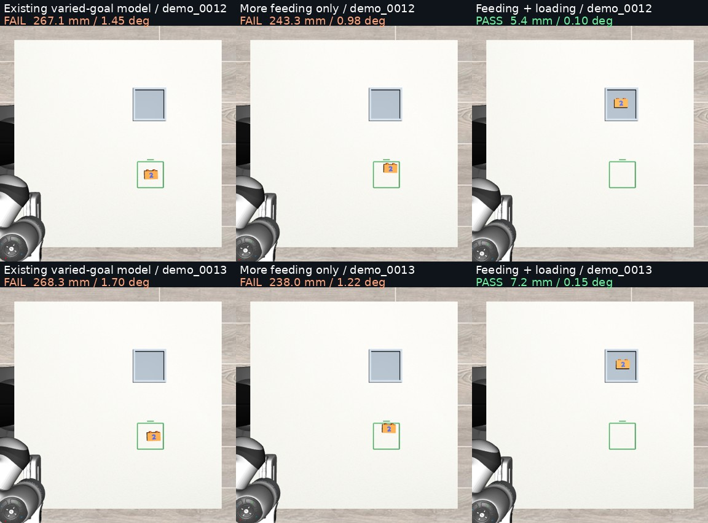

# LOAD01: loading-specific supervision establishes fixture placement

Adding verified loading examples enabled fixture placement on this small matched panel. An equal amount of additional feeding-only training did not. The new model also incurs one additional strict feeding failure, while preserving the same number of stable in-square placements.

All 36 policy rollouts completed without runtime errors. The models received identical physical starts and byte-identical first RGB policy inputs for every matched case. All inference checkpoints reproduced their saved probes exactly.

## Strict outcomes

| Model | Loading source | Loading combinations withheld from loading training | Feeding retention |
|---|---:|---:|---:|
| P: existing varied-goal checkpoint | 0/4 | 0/2 | 5/6 |
| F: P + 3,000 feeding-only updates | 0/4 | 0/2 | 5/6 |
| FL: P + 3,000 mixed feeding/loading updates | **3/4** | **2/2** | **4/6** |

These three panels must remain separate. The two loading-development cases were historically inspected and their families appeared in feeding training; they are task-combination holdouts, not unseen people or a broad loading benchmark. There is one training seed. No significance test or pooled success/12 endpoint is claimed.

P is the prior varied-goal continuation of broad Pt12k, not vanilla X-VLA or V4. The exact three identities and hashes are in the training records and [reproduction note](REPRODUCTION.md).

## What changed physically

On both loading-development cases, every model picked up the block. P and F then placed it at or near the old feeding square. FL transported it to the requested fixture, seated it, oriented it correctly and released it.

| Loading-development measurement | P | F | FL |
|---|---:|---:|---:|
| Supported pickups | 2/2 | 2/2 | 2/2 |
| Stable released fixture placements | 0/2 | 0/2 | 2/2 |
| Mean distance to requested fixture | 267.69 mm | 240.67 mm | **6.30 mm** |
| Mean distance to old feeding square | **6.89 mm** | 31.84 mm | 275.23 mm |
| Mean final yaw error | 1.57° | 1.10° | **0.12°** |

[Watch the first matched loading-development comparison](qa/load01-development-demo_0012-matched-overhead.mp4).

The unchanged expert succeeded on both development cases. These were two separately frozen, evaluation-only feasibility controls, outside the 36 policy rollouts. Their actions never entered training. The [prospective supplement](expert-feasibility-supplement.json) documents why it was added while preserving the original protocol bytes.

## Remaining failures

**Source 0001: grasp-and-hold stall.** FL lifts the block 151.8 mm and maintains supported contact for 66.7 seconds, but transports it horizontally by at most 15.3 mm. It ends holding the block near the pickup point, 436.34 mm from the fixture, with 54.58° yaw error. Late predicted XYZ targets span only 7.8/9.8/7.8 mm; the gripper remains commanded closed. Median tracking error is 2.76 mm, so the controller closely follows these local requests. A near-limit joint is observed, but its causal role is not established. This is not an early-release or lost-grasp failure.

[Watch the source-0001 comparison](qa/load01-source-demo_0001-matched-overhead.mp4). [Raw-derived diagnostic](analysis/held-state-diagnostic.json).

**Feeding 0003: strict centre-accuracy miss.** FL finishes inside the square, upright, released and stable, with 0.073° yaw error. Its centre error is 15.854 mm against the unchanged 15 mm limit, so the result remains a strict failure. P and F have 8.473 and 8.692 mm error on the same case. FL is 0.854 mm beyond the threshold and 7.162 mm worse than F on this example; neither number establishes catastrophic forgetting or a general trade-off from one training seed. All three models retain 5/6 stable released in-square placements, but FL has 4/6 strict feeding successes.

[Watch the feeding-precision comparison](qa/load01-retention-demo_0003-matched-overhead.mp4).

The source-0001 family also fails feeding for all three models. That shared problem predates the loading gain.

## Physical subgoals

| Panel / model | Supported pickup | Stable released placement | Strict success |
|---|---:|---:|---:|
| Loading source / P | 4/4 | 0/4 | 0/4 |
| Loading source / F | 3/4 | 0/4 | 0/4 |
| Loading source / FL | 4/4 | 3/4 | 3/4 |
| Loading development / P | 2/2 | 0/2 | 0/2 |
| Loading development / F | 2/2 | 0/2 | 0/2 |
| Loading development / FL | 2/2 | 2/2 | 2/2 |
| Feeding retention / P | 6/6 | 5/6 | 5/6 |
| Feeding retention / F | 5/6 | 5/6 | 5/6 |
| Feeding retention / FL | 6/6 | 5/6 | 4/6 |

Supported pickup requires simultaneous bilateral contact and at least 10 mm lift for three consecutive 20 Hz samples. Stable placement requires the full footprint, correct height, upright marked face, release and stability; it does not replace the stricter 15 mm centre and 10° yaw requirements. Full component scores and initial-to-final yaw-error changes are in [episodes.csv](analysis/episodes.csv).

## Interpretation and limits

Retain FL as a checkpoint with demonstrated additional task capability and an observed strict-feeding precision regression. It is not a universal replacement for P. The matched control supports a benefit from loading-specific supervision under this recipe, beyond simply spending another 3,000 updates.

The data is personally derived scene initialization paired with generated expert robot actions. This does not show direct learning of robot commands from phone video. Task text, fixture imagery and demonstrated destination vary together, so successful loading does not by itself prove numeric-language understanding or semantic recognition of the blue numeral.

The planner ranks a separate fixed-scene instruction-switching test next: keep both destinations, physical state and model inputs identical, and change only the complete feeding/loading instruction. This tests whether the new capability is instruction-selectable or tied to scene context. It requires its own frozen protocol; no such results are included here. The source-0001 held-state stall remains a distinct follow-up. More undirected training or a longer rollout is not justified by the current traces. See the [planner review](PLANNER_REVIEW.md).

## Evidence and execution

- Four new loading teacher episodes passed the original scorer and exact action replay.
- Sixteen training episodes provide 1,165 complete action windows. Both continuations used 12,000 presentations; actual sample IDs match the frozen plan for every update.
- F trained in 926.6 seconds; FL in 923.4 seconds. Both changed shared VLM/core parameters and the active prompt/head rows, with inactive domain rows unchanged.
- Thirty-six policy rollouts completed in three parallel lanes, averaging approximately 20 seconds wall time each. Simulated time pauses for inference, so these are not real-time throughput measurements.
- The source panel completed before any development/retention panel began. All 12 physical starts and first policy-input RGB arrays match exactly across models. One separately rendered initial preview differs at five pixels by one colour level; this does not occur in the model inputs, and the original preview is retained. Expert-control starts also match their policy counterparts.
- Raw RGB inputs, model chunks, actual actions, joint/contact traces, score components and videos remain preserved. Three representative 73.4-second comparison videos were selected post hoc for inspection; all outcomes remain in the tables.
- [Validation](analysis/validation.json), [paired outcomes](analysis/paired-outcomes.json), [file hashes](analysis/episode-evidence-integrity.json), [reproduction commands](REPRODUCTION.md), [frozen protocol](protocol.json).
- Old experiment outputs were not overwritten. One inactive old checkpoint was offloaded only after byte-for-byte verification on Mint.
- Private branch: research/load01-loading-supervision. All 550 raw artifact files, totaling 8,837,130,076 bytes, are independently SHA-256 verified on Mint Fast Drive, including both final model checkpoints, probes, source arrays, exact inference inputs, actions and videos. Existing parent-model and feeding-data dependencies are independently verified in the adjacent archive. See [raw archive verification](archive/raw-backup-verification.json) and the separate checkpoint receipts.
