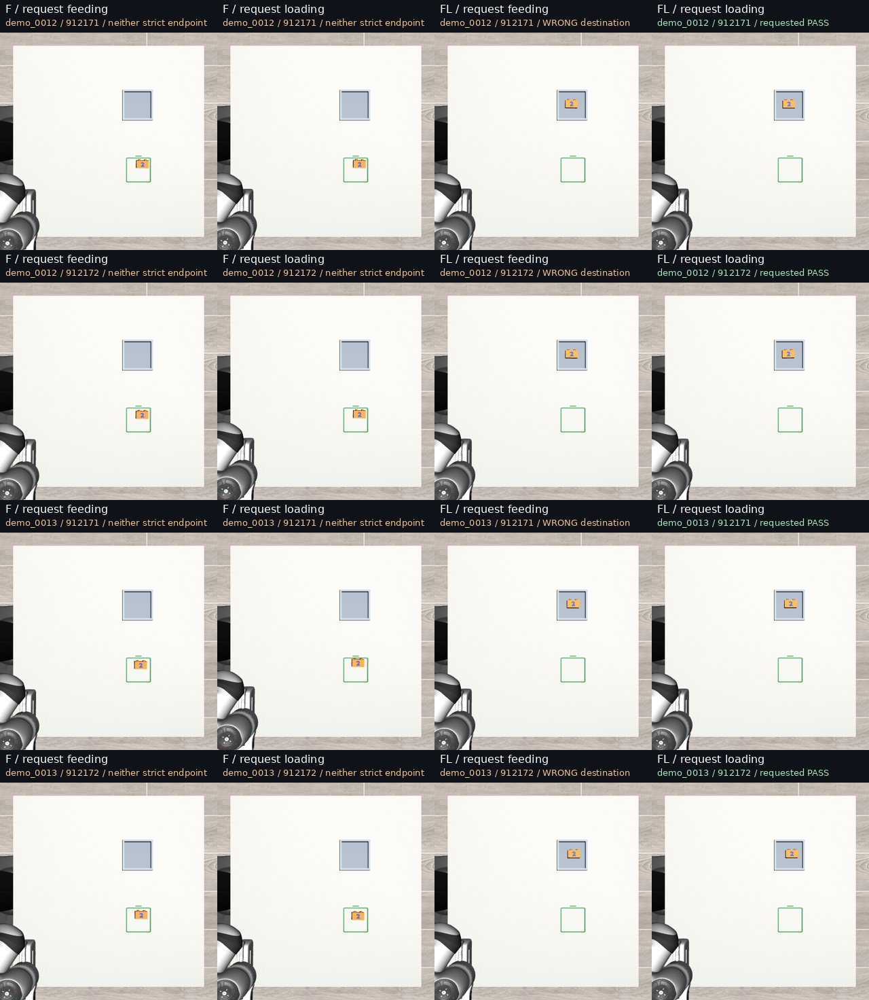

# LOAD02: changing the instruction did not switch the destination

The mixed feeding/loading model completed loading under both instructions: 4/4 when asked to load and 4/4 when asked to feed. It therefore has useful loading execution in these scenes but has not demonstrated instruction-selectable feeding versus loading.

This was a separate, frozen 16-rollout experiment following [LOAD01](../2026-10-13-load01/REPORT.md). No additional training, harness, candidate selection or recovery controller was introduced.

## What each model actually did

| Model | Requested task | Requested endpoint | Wrong endpoint | Neither strict endpoint | Supported pickup |
|---|---|---:|---:|---:|---:|
| F: feeding-only continuation | Feeding | 0/4 | 0/4 | 4/4 | 4/4 |
| F: feeding-only continuation | Loading | 0/4 | 0/4 | 4/4 | 4/4 |
| FL: mixed continuation | Feeding | 0/4 | **4/4 loading** | 0/4 | 4/4 |
| FL: mixed continuation | Loading | **4/4** | 0/4 | 0/4 | 4/4 |

F transported toward the feeding square under both instructions but failed strict centring; these are not eight successful feeds. FL seated, oriented and released the block correctly in the fixture under both instructions. Each model had **0/4 pairs where both requested tasks succeeded**.

| Model / instruction | Mean distance to feeding square | Mean distance to loading fixture |
|---|---:|---:|
| F / feeding | 27.10 mm | 245.87 mm |
| F / loading | 28.64 mm | 244.02 mm |
| FL / feeding | 275.12 mm | **6.56 mm** |
| FL / loading | 275.32 mm | **7.55 mm** |



[Watch the four-condition comparison](qa/instruction-switch-demo_0012-seed912171.mp4). This representative scene/seed was selected after execution; all 16 trials remain in the tables. The source videos and derivative fully decode, with 367 frames at 5 fps, or 73.4 seconds.

## The controlled comparison

Two previously inspected loading-development scenes, demo_0012 and demo_0013, were run with paired policy seeds 912171 and 912172, both exact final LOAD01 checkpoints, and the existing full feeding versus loading instruction templates.

Both destinations remained visible. The physical environment stayed in its original **loading configuration for every rollout**. The only intervention was the complete model language string, including the matching destination coordinates and yaw. No task flag changed the simulator, crop, domain, action conversion, controller or stopping behavior.

Before execution, saved parent trajectories passed the original feeding scorer in both scenes, and the previously qualified expert trajectories passed loading in both scenes. This uses complete pose, footprint, height, release and stability criteria, not distance alone. No new expert execution or privileged rescue was used.

All actual first prepared RGB tensors, image masks, domain IDs and proprioception exactly match the prequalified input packets. The reset qpos, qvel, mocap state and evaluator truth also match. Tokens differ as intended and retain the complete supplied goal. Actual generation-noise arrays and CPU/CUDA RNG states match all 48 inference chunks within every instruction pair.

After actions diverge, later camera images may diverge naturally. Initial input isolation does not mean all later observations were forced to remain identical.

Execution used the unchanged O2 input path, domain 29, H30 at 20 Hz, ten denoising refinements, 1,500 total control-step budget including reset/settling, and the native action adapter. Simulation pauses during inference; no real-time speed claim is made.

## Text sensitivity is not task selection

Changing text changes the first action proposal slightly: XYZ RMS differences are 0.357–0.675 mm for F and 0.341–0.960 mm for FL. These differences do not produce useful destination switching.

The supported conclusion is specific: **the mixed model does not follow the feeding-versus-loading choice in these two physical scenes under these tested instructions and seeds**. It does not establish that language has no influence everywhere, or identify which visual cue drives the choice. It also does not isolate understanding of numerical coordinates.

The result narrows LOAD01's positive finding. Loading supervision established an additional executable behavior; the ability to select that behavior by instruction remains unqualified. One training seed and two inspected scene families do not establish broad reliability.

## Scoring and repeatability

Every episode is scored offline against both destinations with the unchanged original evaluator, including their different support heights and containment geometry. Only the requested endpoint counts as task success. The unmodified benchmark's episode.json still contains the loading-configuration score; **dual-scores.json and analysis/episodes.json carry the requested-task and opposite-task outcomes**.

Three of four loading conditions with seed 912171 reproduce LOAD01 action chunks and final truth exactly, including both FL scenes. The F/demo_0012 repeat agrees for twelve chunks, then the secondary image differs in 13 channel values by one 8-bit level at zero-based chunk 12. The first changed command follows that observation; the physical trace first differs at control step 401. Its strict loading outcome remains failure. Both records are preserved. Universal bitwise renderer reproducibility is not claimed.

One pre-execution token-count logger assumed an attention_mask key that this processor does not supply. Its failed code and error record were retained; counting non-padding input_ids corrected metadata only before any model inference or policy action. The experiment clock and conditions were unchanged. All 16 actual rollouts completed without runtime errors or input-isolation failures.

## Reproduction and evidence

- [Frozen protocol](protocol.json), [input qualification](input-qualification.json), [endpoint feasibility](feasibility.json).
- [All outcomes](analysis/episodes.json), [summary](analysis/summary.csv), [instruction pairs](analysis/pairs.csv), [validation](analysis/validation.json), [native parity diagnostic](analysis/native-parity-diagnostic.json).
- Raw directory on Powerglide: /var/tmp/typhon-load02-20261013.
- Independent archive on Mint: /media/nm/Fast Drive/Typhon/research-20261012/load02-instruction-switching.
- Exact weights are retained in the adjacent LOAD01 archive; LOAD02 does not create or modify weights.
- Private branch: research/load02-instruction-switching. Frozen execution commit: a0f90914ebfd5ca137e0570623f87e0ccbb402c7.
- First qualification and all executions completed within the separate 60-minute window. All 1,805 raw artifact files, totaling 457,887,901 bytes, are independently SHA-256 verified on Mint. See [archive verification](archive/raw-backup-verification.json). The [planner review](PLANNER_REVIEW.md) accepts the interpretation and keeps both reporting caveats.

From this branch in the qualified Powerglide environment, use a fresh output namespace and the original recorded assets:

```bash
.venv-sim/bin/python - <<'PY'
import json, time
from pathlib import Path
root = Path('/var/tmp/typhon-load02-20261013')
root.mkdir(exist_ok=False)
t = time.time()
(root / 'clock.json').write_text(json.dumps({
    't0_unix': t, 'qualification_deadline': t + 600,
    'execution_deadline': t + 3000, 'closeout_deadline': t + 3600
}, indent=2))
PY
.venv-sim/bin/python scripts/load02_common.py
.venv-xvla/bin/python scripts/load02_input_gate.py
# Freeze the protocol and implementation commit before starting policy execution.
.venv-sim/bin/python scripts/load02_run.py
.venv-sim/bin/python scripts/load02_analyse.py
.venv-sim/bin/python scripts/load02_media.py
```

The scripts refuse to overwrite trial directories. Existing M0–M7, prior benchmarks and LOAD01 outputs are unchanged. Reproduction requires the manifest's exact checkpoints, processor cache and simulator environment; a clean-host rerun has not been claimed.

## Next bounded diagnostic

The planner ranks fixture-appearance removal next: retain physical fixture collisions and all model/controller settings, suppress only the rendered fixture in the policy images, and repeat the two instructions. This would test whether visible fixture appearance is necessary for the loading preference. It is a separate proposed LOAD03 experiment, not a deployment fix or an additional LOAD02 condition. No fixture-suppression results are claimed here.
