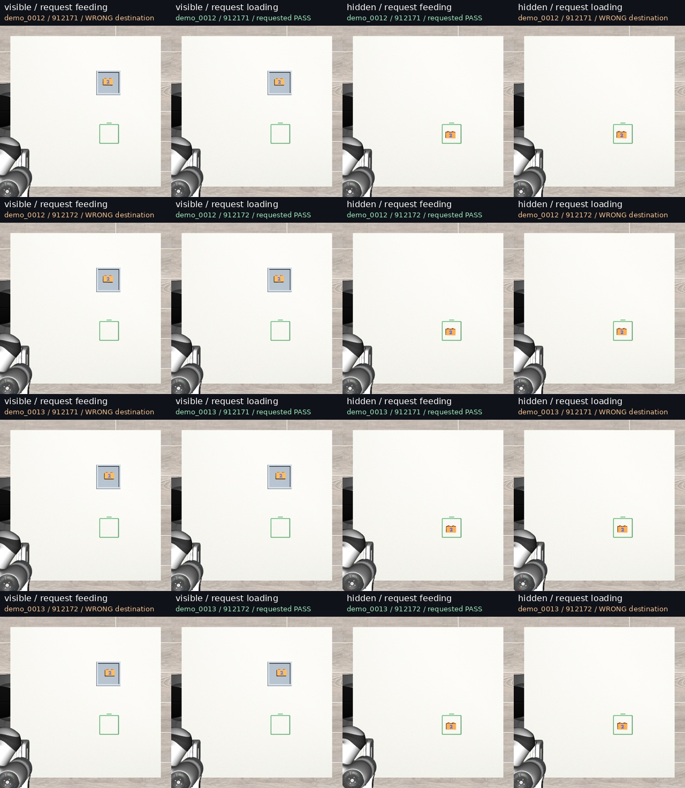
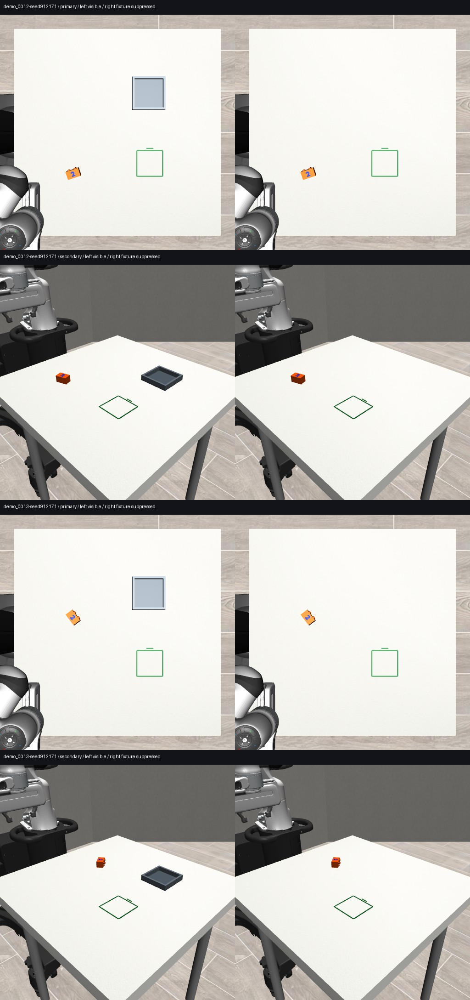
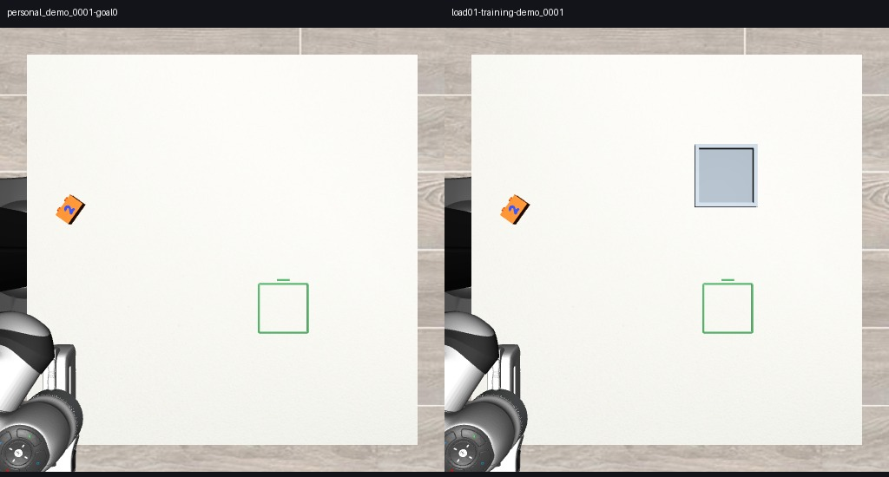

# LOAD03: fixture appearance switches the chosen destination

In this 16-rollout diagnostic, the same mixed feeding/loading checkpoint loaded whenever the fixture was visible and fed whenever its appearance was suppressed, under either instruction. Fixture physics stayed unchanged.

The model can execute both movements in these scenes. The visible fixture controls the observed task preference; changing the instruction does not establish reliable task selection.

## Physical outcomes

| Policy view | Requested task | Strict feeding placements | Strict loading placements | Requested-task successes |
|---|---|---:|---:|---:|
| Fixture visible | Feeding | 0/4 | **4/4 wrong destination** | 0/4 |
| Fixture visible | Loading | 0/4 | **4/4** | 4/4 |
| Fixture appearance suppressed | Feeding | **4/4** | 0/4 | 4/4 |
| Fixture appearance suppressed | Loading | **4/4 wrong destination** | 0/4 | 0/4 |

All 16 trials include a supported pickup and a strict physical placement at one of the two destinations. This is **8/16 requested-task success**, not 16/16 task success. There are no neither-endpoint outcomes. Both visibility conditions have **0/4 scene/seed pairs that follow both instructions correctly**.

Under each instruction, all four matched scene/seed pairs change destination when the fixture appearance is removed. This is an effect of the declared visual intervention in these conditions, not merely a changed predicted action or failed grasp.

| View / instruction | Mean distance to feeding square | Mean distance to fixture |
|---|---:|---:|
| Visible / feeding | 275.12 mm | **6.56 mm** |
| Visible / loading | 275.32 mm | **7.55 mm** |
| Suppressed / feeding | **7.20 mm** | 273.39 mm |
| Suppressed / loading | **7.11 mm** | 273.06 mm |



[Watch the matched four-condition comparison](qa/fixture-appearance-demo_0012-seed912171.mp4). The representative video was selected after execution; all cases remain reported. Its four source videos and derivative fully decode, with 367 frames at 5 fps.

## What changed

The experiment uses the exact final LOAD01 FL checkpoint, loading-development configurations demo_0012 and demo_0013, paired seeds 912171 and 912172, and the exact complete LOAD02 feeding/loading instructions. No training, harness, candidate selection, expert rescue, new scene or additional seed was introduced.

Only five rendered geometries were suppressed: fixture_floor and fixture_wall_0 through fixture_wall_3. During each render, their visual RGBA alpha is temporarily set to zero and restored before returning. The renderer reveals the table behind them; no pixels are painted over and no foreground robot or object pixels are erased.

The fixture remains physically present, including its collision geometry, floor height, walls, friction and contact behavior. No forward(), physics step, geometry reconstruction or controller change is introduced by the renderer wrapper. Both current camera images and their native O2 crop pass through the same rule.



Qualification checks passed before policy execution:

- Native no-op rendering reproduces the original RGB exactly.
- Model XML and physical-state fingerprints are unchanged before/after rendering, including qpos, qvel, qacc_warmstart, act, ctrl, mocap and time.
- Initial protected robot/block foreground pixels remain unchanged. Differences lie at the fixture rendering footprint.
- Initial crop metadata, crop pixels and image masks remain identical.
- Task tokens, domain and proprioception match across each visible/suppressed pair.
- Every actual first prepared policy packet exactly matches its qualified fixture.
- Actual generation-noise arrays and CPU/CUDA RNG states match all 48 query indices in each visual pair.
- All 16 policy episodes complete without runtime or input-isolation errors.

This tests **fixture-appearance removal**, including its shape and rendering footprint. It is not an isolated test of gray colour or evidence of human-like fixture recognition. The invisible-but-physical fixture is a diagnostic intervention, not a proposed deployment configuration.

## Why this shortcut was available

The training audit finds 12 feeding configurations without the fixture and four loading configurations with it. The scene builder adds fixture geometry only for loading. Representative actual training frames confirm this visible distinction.



Task instruction and fixture appearance were correlated in this continuation data. LOAD03 establishes that changing fixture appearance changes the executed destination in the tested scenes. It does not recover the entire learning mechanism, prove which individual visual feature was learned, or imply that every hidden-fixture image equals the feeding training distribution.

## Relation to LOAD01 and LOAD02

[LOAD01](../2026-10-13-load01/REPORT.md) showed that qualified loading supervision adds executable loading behavior beyond an equal amount of additional feeding training. It also recorded a small strict-feeding precision regression.

[LOAD02](../2026-10-13-load02/REPORT.md) showed that swapping only the complete instruction did not switch between feeding and loading in the identical scene.

LOAD03 now demonstrates a specific visual dependence: removing fixture appearance flips the destination under either instruction, while physical dynamics and paired sampling remain fixed. The useful next training comparison should break that correlation by supplying both requested goals in the same visible scene; it is a separate experiment.

These are two previously inspected scene families, two policy seeds and one trained FL checkpoint. They do not establish broad instruction-following failure or generalisation to new people or workspaces.

## Repeatability and scoring

All eight native-visible repeats preserve their corresponding LOAD02 strict outcomes and final block positions/yaws exactly. Only one of eight repeats has every predicted chunk and the entire final truth dictionary bit-identical; later arm-command/state differences remain recorded. Native action differences begin after the initial matching proposals. No reseeding or replacement runs were performed.

Scoring uses the original independent physical evaluator against both endpoints, including their distinct support heights, footprint, uprightness, yaw, release and stability. The native benchmark's episode.json retains the physical loading-configuration score. Requested-task outcomes are in dual-scores.json and analysis/episodes.json.

The model receives camera RGB, the supplied instruction and its usual robot/action-history inputs. Simulator geometry identifiers are used to construct and audit the visual intervention, not as added policy features.

## Reproduction and evidence

- [Frozen protocol](protocol.json), [render qualification](render-qualification.json), [prepared-input qualification](visual-input-qualification.json), [training context](training-context.json).
- [All episodes](analysis/episodes.json), [summary](analysis/summary.csv), [matched visual pairs](analysis/visual-pairs.csv), [instruction-switch pairs](analysis/instruction-switch-pairs.csv), [validation](analysis/validation.json), [native-repeat diagnostic](analysis/native-repeat-diagnostic.json).
- Powerglide raw root: /var/tmp/typhon-load03-20261013.
- Mint archive: /media/nm/Fast Drive/Typhon/research-20261012/load03-fixture-appearance.
- Private branch: research/load03-fixture-appearance.
- Execution freeze: 3e78aeda8dcebaf20fecee42f9e7c95d3ce2a0ec.
- Existing checkpoint and original datasets are unchanged. No new model weights were produced.

From this branch and the qualified simulator/model environments, in a fresh namespace with the manifest's original assets:

```bash
.venv-sim/bin/python - <<'PY'
import json, time
from pathlib import Path
root = Path('/var/tmp/typhon-load03-20261013')
root.mkdir(exist_ok=False)
t = time.time()
(root / 'clock.json').write_text(json.dumps({
    't0_unix': t, 'qualification_deadline': t + 1200,
    'execution_deadline': t + 3000, 'closeout_deadline': t + 3600
}, indent=2))
PY
.venv-sim/bin/python scripts/load03_prepare.py
.venv-xvla/bin/python scripts/load03_input_gate.py
.venv-xvla/bin/python scripts/load03_input_isolation.py
# Inspect saved qualification images and freeze the implementation before execution.
.venv-sim/bin/python scripts/load03_run.py
.venv-sim/bin/python scripts/load03_analyse.py
.venv-sim/bin/python scripts/load03_media.py
```

Qualification finished in 6.2 minutes and the 16 rollouts in approximately 9.8 minutes from the separate 60-minute clock. Reproduction requires the exact recorded environments/checkpoints; no clean-host replay is claimed. Simulation pauses for inference, so wall time is not a real-time controller benchmark.

All 1,860 raw artifact files (463,148,537 bytes) are independently SHA-256 verified on Mint. The [archive receipt](archive/raw-backup-verification.json) covers raw RGB inputs, action predictions, noise/RNG arrays, physical traces, outputs and qualification artifacts. The unchanged FL checkpoint remains in the independently verified LOAD01 archive.
