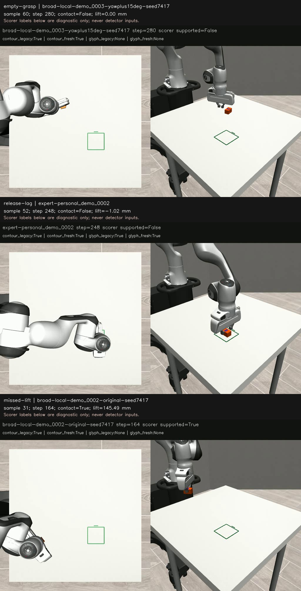

# OBS05 — Fresh motion and numeral features do not qualify the grasp observer

The proposed repair is rejected on this development panel. Requiring recent motion removes useful detections without eliminating the false-contact samples. Tracking blue numeral features avoids the empty-grasp false positive, but loses about half the contact detections. No observer gained control authority.

## Frozen comparison

Question: does expiring stale evidence, or tracking features on the blue numeral instead of the orange outline, improve the held-state detector?

Protocol frozen: 2026-10-12 23:32:07 UTC. Runner commit: 68681a95dde86e9ce452c257611769f62df0fcd7.
Protocol SHA-256: 51aa379a36f8113f18755510ced2ce51ea29b8881a5b12358269f3c7bd671557.

Eight archived action traces were replayed unchanged: six P_train experts (personal_demo_0001,0002,0003,0005,0012,0013) and two previously inspected broad-Pt12k episodes (demo_0002/original and demo_0003/yaw+15°, seed7417). Four observers and two counterfactual input controls were scored on the same 1,219 observations at 5 Hz. This is eight physical replays, not 96 independent episodes.

- Contour legacy: original orange-centroid co-motion and accumulating proximity latch.
- Contour fresh: same signal; two consecutive positive pairs; expire after 0.5 s without confirmation.
- Glyph legacy: blue-feature forward/backward optical flow with old latch.
- Glyph fresh: feature flow with fresh rule.

The old counter can accumulate nonconsecutive positive pairs and retain held while nearby. Both motion methods share projection, proximity and motion thresholds. Feature tracking uses the previously frozen VIDEO06 implementation, full-frame colour masks and no task-labelled crop. See [OpenCV sparse optical flow](https://docs.opencv.org/4.13.0/dc/d6b/group__video__track.html) and the saved protocol.

## Results

Contact means simultaneous bilateral simulator contact. Supported lift additionally requires the object centre at least 10 mm above its initial centre. Neither alone establishes completed placement or secure physical grasping outside this simulation.

| Observer | Contact precision | Contact recall | Supported-lift precision | Supported-lift recall |
|---|---:|---:|---:|---:|
| Contour legacy | 184/192 =95.8% | 184/192 =95.8% | 158/192 =82.3% | 158/159 =99.4% |
| Contour fresh | 161/169 =95.3% | 161/192 =83.9% | 138/169 =81.7% | 138/159 =86.8% |
| Glyph legacy | 98/103 =95.1% | 98/192 =51.0% | 84/103 =81.6% | 84/159 =52.8% |
| Glyph fresh | 74/79 =93.7% | 74/192 =38.5% | 60/79 =75.9% | 60/159 =37.7% |

All four fail the unchanged supported-lift gate: precision ≥95%, recall ≥90%. NEXT02 also requires reliable pose and transitions; OBS05 produces no new poses. Frames are correlated within eight reused trajectories. These are descriptive sample-level diagnostics, not test-set generalisation or independent-trial confidence estimates.

## What the errors mean

Of the legacy detector's 34 supported-lift false positives, **26 have bilateral contact but less than 10 mm lift**. Calling all 34 failed grasps would be incorrect. The remaining eight have no bilateral contact:

- **Five contact-loss samples:** one each in expert0002,0003,0005,0013 and broad0002. The preceding sample has contact; the next correctly reports not held. At the error the aperture remains within the 8–60 mm “closed” heuristic. All four observers retain held=True. Expiration does not repair this short release delay.
- **Three empty-grasp samples:** broad0003 at steps 280–288. This episode never establishes bilateral contact; the brick stays still. Two overhead contour-centroid changes satisfy the permissive motion test, followed by latch persistence. Oblique glyph features stay approximately stationary. Feature tracking avoids this false positive; fresh contour does not.
- **Missed real lift:** broad0002 step 164 shows the brick carried about 145.5 mm above its initial centre. Contour reports held; glyph reports unknown. The numeral is small/partly occluded. This illustrates lost coverage, not one universal cause for all missed detections.

Frames were decoded sequentially and tied to exact trace indices. The coding agent visually inspected them. They are post-hoc diagnostic examples, not a human-labelled validation set.

## Verification and boundaries

Every sampled object position, final position and final yaw matches historical execution exactly. No action changed. Legacy held predictions and supported-lift labels match all 1,219 historical observations. An independent audit recalculates the confusion counts and labels. All eight videos decode completely.

Known image-translation selfchecks have maximum error below 0.00007 px; blank occlusion is rejected. Frozen-initial-RGB and fixed-initial-EEF controls each produce zero held positives in every observer. These are implementation controls, not extra physical episodes.

Detector inputs are RGB, measured EEF/aperture telemetry and camera projection. Scoring truth is read after predictions. Expert actions are replay inputs, never detector labels. Existing provisional geometry/mass and all M0–M6 results remain unchanged. No training, new recovery demonstration or policy improvement was performed.

Two workers took 24.44 and 24.49 seconds for four replays each. These are replay wall times, not live inference latency or a throughput benchmark.

## Decision

Do not deploy either repair as a grasp/release gate. Separate contact evidence, supported lift, unknown, and verified completed placement. Explicit aperture-change/release handling and object–gripper relative motion are next hypotheses requiring new tests. They are not established fixes.

NEXT02 (#10984) remains blocked. VIDEO01 (#11015) still lacks measured scale, qualified held-object pose and a video-to-Panda action adapter.

## Reproduction

Private branch: research/obs05-feature-motion.
Bulk archive: /media/nm/Fast Drive/Typhon/research-20261012/obs05/.

Archive includes protocol, raw observation traces, eight videos, source actions and historical observer traces. portable_protocol.template.json changes only input paths to an archive-root placeholder. The original frozen protocol remains unchanged. From the branch with its existing simulation environment:

~~~bash
python3 - /path/to/obs05 /tmp/obs05-protocol.json <<'PY'
import pathlib, sys
root = pathlib.Path(sys.argv[1]).resolve()
template = (root / 'portable_protocol.template.json').read_text()
pathlib.Path(sys.argv[2]).write_text(template.replace('__OBS05_ARCHIVE__', str(root)))
PY

.venv-sim/bin/python scripts/obs05_feature_motion.py check --protocol /tmp/obs05-protocol.json

# Workers can run concurrently; use a fresh output directory.
.venv-sim/bin/python scripts/obs05_feature_motion.py run --protocol /tmp/obs05-protocol.json --out /tmp/obs05-new --part 0 --parts 2
.venv-sim/bin/python scripts/obs05_feature_motion.py run --protocol /tmp/obs05-protocol.json --out /tmp/obs05-new --part 1 --parts 2

.venv-sim/bin/python scripts/obs05_feature_motion.py analyze --protocol /tmp/obs05-protocol.json --out /tmp/obs05-new
.venv-sim/bin/python scripts/obs05_audit.py --out /tmp/obs05-new
~~~

For saved-result auditing, use the archive directory with the last command. The selfchecks, source hashes, environment versions, metric CSV and independent audit JSON accompany this report. Archive checksum and Git restore receipts remain on Mint.
