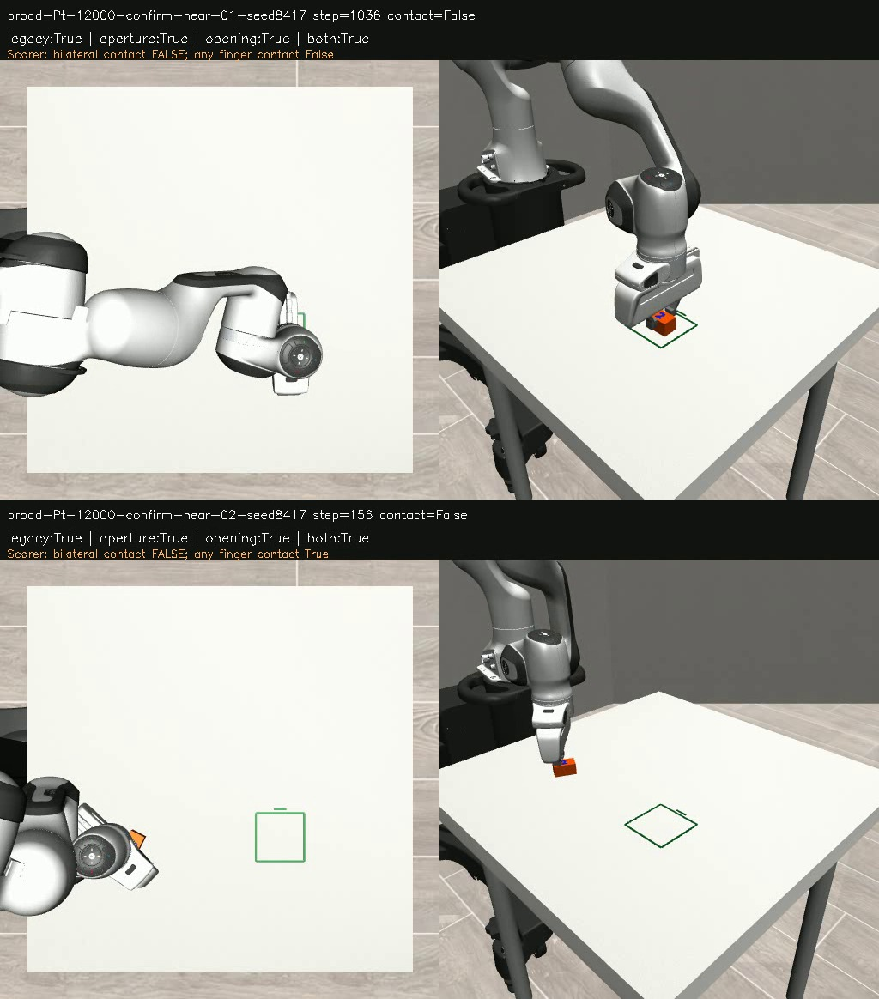

# OBS06 — Aperture and opening cues improve contact detection, but do not qualify the observer

**Decision: retain the hypothesis for further testing; do not deploy it.** On 24 additional archived episodes, combining an aperture floor and an opening-rate check reduced false bilateral-contact detections from 108 to 20 (81.5% fewer), while recall changed from 96.0% to 93.7%. All 314 sampled supported lifts remained detected. Contact precision 94.65% is still below the frozen 95% gate; supported-lift precision 83.96% also fails. The threshold was not relaxed.

## Protocol

The separate branch research/obs06-aperture froze code and selection in commit f9025c613b37df3a1bd2c74a0520d010cd64dab3 before execution. It compares the unchanged contour latch, aperture floor alone, opening check alone, and both. The aperture floor is 24 mm (80% of the declared 30 mm minimum proxy dimension); opening is measured aperture growth above 25 mm/s (5 mm per 0.2 s). These are supplied engineering priors motivated by OBS05, not measured human-object dimensions or universal grasp criteria.

The panel uses the first three near-personal layout IDs, first two broader-start IDs and first already-completed ID from confirmatory-v2, both model recipes and both seeds:6 layouts ×2 models ×2 seeds =24 replays / 8,784 sampled observations. Selection did not use outcomes. Aggregate results from that earlier suite were already known, so this is additional development evidence, not a pristine confirmatory test or 24 independent human demonstrations.

RGB and measured EEF/aperture telemetry feed the detector. Simulator truth is consulted after predictions for scoring. No action, model weight, simulator geometry or prior result was changed.

## Results on the additional panel

| Variant | Contact TP/FP/FN | Contact precision / recall | Lift TP/FP/FN | Lift precision / recall |
|---|---:|---:|---:|---:|
| Original |363 /108 /15|77.07% /96.03%|314 /157 /0|66.67% /100%|
| Aperture |354 /30 /24|92.19% /93.65%|314 /70 /0|81.77% /100%|
| Opening |362 /43 /16|89.38% /95.77%|314 /91 /0|77.53% /100%|
| Both |354 /20 /24|94.65% /93.65%|314 /60 /0|83.96% /100%|

Supported lift means bilateral contact plus at least 10 mm height increase. Of the combined rule's 60 lift false positives, 40 have contact below that height and 20 lack bilateral contact. The additional nine missed-contact samples, compared with the original, do not include supported lifts. This distinction prevents confusing contact, lifting and completion.

Residual false positives occur in five broad-Pt near-personal episodes. Of these 20 samples, 18 have some gripper contact without bilateral support; two have no gripper contact. This follows the separate contact-geometry and bilateral-grasp scorer fields. Saved per-sample diagnostics distinguish them. The detector still cannot establish a secure grasp or authorize a release transition from co-motion and aperture alone.

On the previously inspected OBS05 panel, the combined rule removes all 8 no-contact false positives, retaining 184/192 contact detections. That attractive result does not transfer perfectly: 20 false positives remain on the additional panel. No subsequent threshold adjustment was made.

## Verification

Every sampled object position and final yaw reproduces archived execution exactly. All 24 previews decode: 8,784 frames. A separate audit recomputes all TP/FP/FN counts from traces. A simulator-free replay of the actual observer classes also reproduces all four predicted state records on all 8,784 samples, and reproduces the original legacy observer on all 1,219 OBS05 samples. The raw archive contains 159 files, 136,353,841 bytes; every SHA-256 was checked after copying directly to Mint.

This is a passive component test. It neither improves the robot's executed actions nor qualifies pose estimation, overall task completion, generalisation or a live safety function. Existing frozen proxy geometry remains unchanged. NEXT02 remains unresolved.

## Reproduce

Checkout the private branch research/obs06-aperture and use its existing simulation environment. The archive is /media/nm/Fast Drive/Typhon/research-20261012/obs06/.

Substitute that location for __OBS06_ARCHIVE__ and the OBS05 archive location for __OBS05_ARCHIVE__ in portable_protocol.template.json. Save the resolved JSON outside the archive. Run:

~~~bash
.venv-sim/bin/python scripts/obs06_aperture.py run --protocol /tmp/obs06-protocol.json --out /tmp/obs06-new --part 0 --parts 4
# Repeat with --part 1, 2 and 3; workers may run concurrently.
.venv-sim/bin/python scripts/obs06_aperture.py analyze --protocol /tmp/obs06-protocol.json --out /tmp/obs06-new
~~~

Source action files, scenarios, original episode records, observation traces, full previews, frozen protocol and development-panel diagnostics are archived. The audit script documents its existing evidence paths. The separate private branch preserves OBS05 and all earlier experiments.

Saved-evidence state validation (standard-library Python only):

~~~bash
python3 scripts/obs06_replay_validation.py --old /path/to/obs05 --new /path/to/obs06 --out /tmp/obs06-replay-validation.json
~~~
