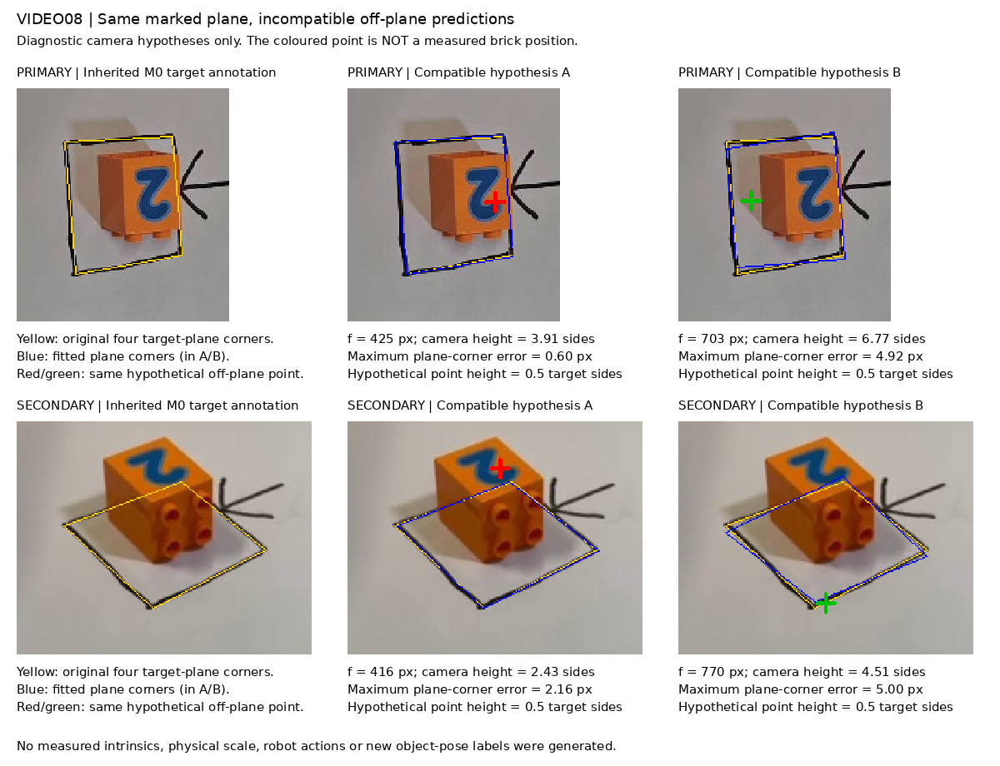

# VIDEO08 — Can the current camera annotations support a 3D robot adapter?

**Decision: do not turn the current M0 target homographies into 3D action labels.** They do not identify a unique camera geometry under the assumptions tested. This is a calibration sensitivity result, not a failed robot rollout or a proof that video-based retargeting is impossible.

Parent: VIDEO01 #11015. Calibration dependency: DATA06 #10991. Bounded experiment: #11032. No model training, robot actions, geometric-expert trajectories or edits to frozen M0/M1/M1.5 artifacts.

## What was tested

M0 supplies four agent-marked target corners for each view, a 5 px corner uncertainty assumption and the original image sizes. It does not supply measured intrinsics, lens distortion, target dimensions or a precise calibration board. The hand-drawn outline was treated as an ideal unit square **only for this diagnostic**.

The protocol was committed before numerical execution: 3935d826be30905267846c51554b76fc7428f93e. The implementation was committed before execution: 1d9529a.

For each camera independently:

- Zero skew, square pixels and no distortion were assumed.
- 33 focal lengths from 0.5 to 3 times the longer image dimension were combined with nine principal points within ±5% of image dimensions: **297 intrinsic settings**.
- Both planar PnP branches were refined. A fit was retained only with positive camera depth and maximum target-corner error ≤5 px.
- A separate 1,000-draw, seeded ±5 px corner perturbation tested the analytic focal constraints. These draws are sensitivity inputs, not independent observations or a statistical confidence interval.

The primary image's confirmed CCW90 transform was inverted before using raw-image corner coordinates. Original image hashes were checked. Two source frames from correction demo_0007 provide visual reference, not new training labels.

## Observed results

| Quantity | Primary | Secondary |
|---|---:|---:|
| Intrinsic settings with at least one compatible fit | 297/297 | 297/297 |
| Compatible refined pose-branch fits | 525/594 | 501/594 |
| Camera height range, in hypothetical target-side units | 3.91–23.77 | 2.42–14.65 |
| Camera height range with principal point fixed at image centre | 4.00–23.73 | 2.45–14.64 |
| Compatible tilt range from plane normal | 23.53–35.21° | 33.70–62.95° |
| Smallest maximum corner discrepancy | 0.15 px | 1.54 px |
| Perturbations giving two positive focal-squared constraints | 288/1,000 | 206/1,000 |
| Perturbations with positive focal estimates agreeing within 10% | 16/1,000 | 20/1,000 |

Pose branches sometimes converge to the same solution. **These are camera hypotheses, not hundreds of independent experiments or unique physical cameras.** All tested focal lengths remain compatible with the inherited corner-error allowance. This finite range was declared in advance; values outside it were not tested.

At the unperturbed, centred-principal-point annotations, one of the two analytic focal-squared constraints is negative for each view. The assumptions and exact marked corners therefore cannot all hold simultaneously. This does not isolate whether annotation, hand-drawn shape, lens model or another assumption is responsible.

## Why an excellent plane fit is insufficient

For a hypothetical point half a target side above the plane, the complete compatible pose families disagree by up to **55.12 px primary / 101.03 px secondary**. These extrema include alternative planar-pose branches. If only the lowest-error branch per intrinsic setting is retained, the spreads are **4.95 / 11.48 px**. Both figures are reported to avoid attributing all disagreement to focal uncertainty.

The saved contact sheet deliberately displays the pair with greatest disagreement. Its red and green crosses represent an invented diagnostic point, **not a measured brick centre, lift or hand position**. Blue outlines are projected target corners; yellow outlines are the original annotations.

Low residual on four fitted corners is not independent calibration validation. The existing data have no additional surveyed points or measured lift heights with which to select a physical camera model. This test does not fit a fundamental matrix, establish cross-view point correspondences or triangulate the block.

## What this means for the project

Missing physical scale alone does not make retargeting impossible: a dimensionless representation can be mapped into a declared virtual workspace. Here, however, the current annotations also leave camera geometry and off-plane interpretation ambiguous.

Proceed with the supported image-space object motion, directed glyph orientation and explicit unknown intervals. A future robot adapter may supply robot kinematics, calibrated simulator cameras and task-independent feasibility constraints, while stating clearly which quantities came from the video and which came from the adapter.

Do not silently promote a projected tabletop centroid during a lift into metric XYZ; do not use existing expert waypoints to fill the gap and call them recovered human motion. A shape prior, additional calibration evidence or a normalized image-space controller is a separate test. The present result does not rule those approaches out.

The planner was asked for one bounded execution-level experiment using the actual sequence, with endpoint-only, temporal-shuffle and static controls. Its recommendation is pending at report time. VIDEO01 remains in progress; the generic robot decoder is not claimed complete.

## Verification and reproduction

An exact synthetic pinhole construction recovers its supplied focal length and camera pose. Independent matrix projection agrees with OpenCV projection; the primary rotation/pixel-coordinate round trip passes. A fresh second execution reproduces **all ten analysis artifacts byte-for-byte**, including candidates, perturbations, source hashes and annotated reference images.

This lightweight CPU audit used the existing Mint environment while Powerglide's expired reservation was renewed. No new dependencies, GPU workload or policy fitting ran on Mint.

~~~sh
# From this research worktree, with archived inputs mounted:
PYTHON=/home/nm/Projects/humanoid-task-supervisor/.venv-sim/bin/python
"$PYTHON" scripts/video08_calibration.py \
  --protocol configs/experiments/video08/protocol.json \
  --output "/media/nm/Fast Drive/Typhon/research-20261012/video08/fresh-analysis"
"$PYTHON" scripts/video08_summarize.py \
  --root "/media/nm/Fast Drive/Typhon/research-20261012/video08" \
  --protocol configs/experiments/video08/protocol.json
~~~

The summary command reads the frozen analysis-v1 directory; for an independent reconstruction, place the new analysis at analysis-v1 under a new root. Set source_root in a copied protocol if restoring elsewhere; preserve the original protocol/hash. Full numeric candidates, perturbed corners, raw source references and reproduction evidence are archived on Mint Fast Drive under research-20261012/video08. Compact evidence and both scripts are committed on the private research/video08-calibration-identifiability branch.

## Method references

[Zhang's planar calibration method](https://www.microsoft.com/en-us/research/publication/a-flexible-new-technique-for-camera-calibration/) uses different pattern orientations for camera calibration. Two different uncalibrated cameras are not interchangeable with multiple calibrated-pattern views from one camera. Pose fitting here uses [OpenCV's PnP implementation](https://docs.opencv.org/4.11.0/d9/d0c/group__calib3d.html) and its [IPPE method](https://github.com/tobycollins/IPPE). These references support the method; they do not validate the supplied phone-camera calibration.
