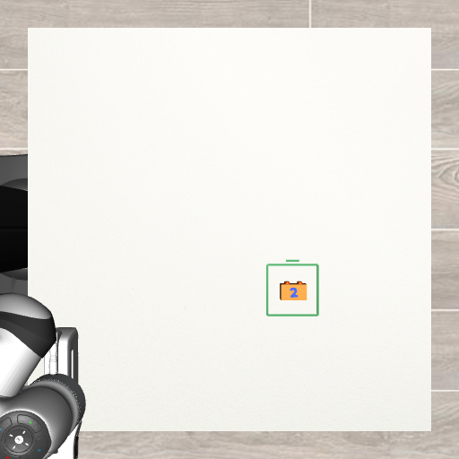
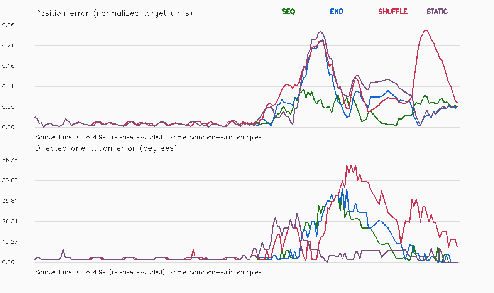
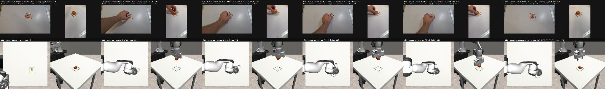

# VIDEO10 — Goal-registered human-video execution

**The repaired feature contract made the assisted robot execution succeed on this correction take, but it did not establish that the full video sequence produces a physically better path than simpler controls.** All four conditions and the exact repeat passed the unchanged placement criteria. The preregistered camera-feature position screen favored the ordered sequence; an independent projection of the simulated asset did not corroborate that advantage. This disagreement remains a research finding, not a reason to omit the diagnostic.

Ticket: #11034. Parent: VIDEO01 #11015. Date: 13 October 2026.
Private branch: `research/video10-goal-registration`.
Physical execution implementation: `97aa8eca1792be5f3285551af05d1c47b15ae872`.
Analysis implementation: `0f2e329`.
Planner: [Hm challeng p2](https://chatgpt.com/c/6ac8f7df-fef0-83eb-98c3-48bd796980a1).

## Question and experiment unit

Does an ordered sequence of human image observations improve pre-release motion fidelity beyond endpoints, after the reference and robot goal agree?

This is **one previously inspected R_train correction demonstration, demo_0007**, observed through 228 original native frames from each camera. It is not five independent demonstrations or a held-out success-rate estimate. The initial simulated centre is already about 10.7 mm from the target; its roughly -84° yaw needs correction. Success here does not establish long-distance feeding or loading generalisation.

This experiment uses a supplied RGB visual-servo controller with a blue-numeral detector. **No X-VLA checkpoint was trained, changed or evaluated in VIDEO10.** The human supplies an image-feature path; the robot's grasp, height schedule and release routine remain supplied robot assistance.

## What changed from VIDEO09

1. Rendered one offline image of the unchanged proxy resting at the original simulation goal [0.125, -0.12] m, yaw 0. The same RGB detector supplied the desired glyph descriptor. Current actor object truth remains prohibited.
2. Applied one scale-1 rotation and translation to the whole native source descriptor curve, using the exact original first and last rows. The rotation is 4.20281°. No per-frame warp, chosen alternative endpoint, endpoint blend or expert finish was added.
3. Kept the original reset byte-for-byte. After the same supplied acquisition/lift prefix, added RGB-only alignment to the registered first descriptor. This required 14 of the allowed 100 extra control ticks. Error was 0.026474 target units and 1.85385°, within the frozen 0.05-unit/10° bounds for three consecutive feedback observations. The complete 142-command prefix was then replayed identically in all five runs.
4. At the first OPEN request, disabled the carried-object EEF-depth conversion from the secondary camera. Raw detections remain logged. A directly visible primary glyph may still produce a coordinate; otherwise it is unknown. OPEN never implies “resting on the table.”

Gains, action bounds, cameras, proxy, goal, seed, fourfold slowdown, lowering at source time 4.3–4.9 s, release at 4.9 s, retreat at 5.4–5.9 s and settling remain unchanged. All original source rows, times, masks and shuffle assignment are preserved. Registration inverse error was at most 1.11e-16, with effectively zero terminal agreement error.

The proxy is still provisional: 50 × 35 × 30 mm and 80 g. These are not newly measured physical DUPLO dimensions. Human coordinates are normalized apparent projections, not recovered metric 3D.

## Physical outcomes

Strict success requires centre error ≤15 mm, directed yaw error ≤10°, marked face up, entire footprint inside the target, correct placement height, release and stable settling.

| Condition | Meaning | Centre error (mm) | Final yaw error (°) | Full footprint inside | Strict success |
|---|---|---:|---:|---|---|
| SEQ | Ordered complete human descriptor sequence | 10.891 | 2.105 | Yes | Yes |
| END | Supplied interpolation between observed endpoints | 11.133 | 0.715 | Yes | Yes |
| SHUFFLE | Same four intermediate blocks, fixed shuffled order | 9.109 | 9.355 | Yes | Yes |
| STATIC | Initial descriptor then final descriptor | 10.938 | 0.404 | Yes | Yes |
| SEQ_REPEAT | Exact repeat of SEQ | 10.891 | 2.105 | Yes | Yes |

All runs grasped bilaterally, lifted, released and settled. No forbidden static contacts or joint-limit violations were recorded; minimum joint margin was 0.34767 rad. Grasp/lift success comes from the shared supplied prefix and does not show that intermediate human frames were necessary.

Compared with VIDEO09's 0/5 strict completions, this package of registration, initial alignment and observation-validity repairs made these five executions feasible. It is **not an isolated causal test of any one repair**, and the controls also succeed. Final position error vectors are retained in `analysis.json`; scalar error magnitudes have not been subtracted to attribute causes.

## Pre-release path comparison and its contradiction

The frozen primary window is 0 ≤ source time <4.9 s, including initial stillness. All methods are scored on the **same 184/196 common-valid timestamps (93.88%)**, above the declared 90% coverage floor. Individual coverage was SEQ 195/196, END 196/196, SHUFFLE 196/196 and STATIC 185/196. Missing measurements were not scored as zero or interpolated.

| Condition | Camera-observer position RMSE (target units) | Camera-observer yaw RMSE (°) | Scorer-only projected-asset position RMSE | Scorer-only projected-asset yaw RMSE (°) |
|---|---:|---:|---:|---:|
| SEQ | 0.038529 | 13.533 | 0.092892 | 12.364 |
| END | 0.062204 | 14.524 | 0.090762 | 13.468 |
| SHUFFLE | 0.092193 | 21.127 | 0.126047 | 20.523 |
| STATIC | 0.074291 | 8.025 | 0.084365 | 9.193 |
| SEQ_REPEAT | 0.038529 | 13.533 | 0.092892 | 12.364 |

The observer-based position screen passes: SEQ RMSE is **38.06% lower than END and 48.14% lower than STATIC**. This is a surrogate image-feature result. The independent projected-asset diagnostic reverses that ordering: SEQ is slightly worse than END and STATIC. The observer-to-projected-asset position RMSE is approximately 0.0756–0.0763 normalized units across conditions. These apparent-plane distances must not be presented as measured human millimetres.

The two measurements may differ because of landmark correspondence, detector bias or the carried-depth conversion; their precise decomposition has not yet been established. Even the scorer's projected landmark must be checked against the rendered glyph before treating it as an exact visual reference. Do not promote the 20% screen into a verified physical-fidelity benefit.

Static gives the lowest yaw RMSE under both observers. Thus there is no general orientation advantage for the full sequence on this take.

## Observation validity, assistance and timing

After release, **all 108/108 feature coordinates in every condition were unknown**. Secondary raw detections are preserved; no EEF-plane coordinates were fabricated as the empty gripper rose. No post-release XY or yaw servo was applied. Physical completion is established by the independent simulator scorer, not by a qualified camera-only completion detector.

Regression tests vary EEF height at fixed images: a direct-primary feature stays unchanged, and secondary-only evidence stays coordinate-unknown after OPEN. Actor classes cannot access object truth. The same code, configuration, reference, protocol and qualified prefix hashes were checked across all runs.

The source clock starts after a 7.1 s supplied grasp/lift/alignment prefix. The human image timeline runs fourfold slower, with shared robot height/lowering/release actions. This is not time-aligned human-to-Franka motor-action recovery. Five episodes completed in 13.276 s batch wall time using three parallel simulator processes; each had 38.5 s of simulated actions after reset. This is simulation throughput, not a real-robot latency claim.

The exact repeat has byte-identical decompressed action and observation logs. The raw video frame clock is retained. Each robot and paired comparison video contains 193 frames at 5 fps. The qualification clip contains 36 frames. An agent inspected the supplied goal image and SEQ comparison contact sheet.

## Interpretation and next decision

- **Supported:** a complete personal-video descriptor curve can condition this assisted simulated correction execution once the goal/reference contract is consistent.
- **Supported:** shuffling and simplifying the reference change motion, and simple controls remain credible competitors.
- **Not established:** unique full-sequence success, physically better intermediate paths, camera-only completion verification, policy learning, accurate human 3D reconstruction, or held-out generalisation.
- **Next recommendation:** audit image-landmark correspondence and depth conversion using frozen replay evidence before changing any controller or starting another training run. The planner has been given the full measurement disagreement.

Keep VIDEO09's failures and invalidated post-release metric record intact. M0, M1, M1.5 and later frozen training/evaluation artifacts were not modified.

## Evidence and reproduction

Powerglide evidence: `/var/tmp/typhon-research-20261013/video10`.
Mint archive: `/media/nm/Fast Drive/Typhon/research-20261012/video10/data`.

Mint verification: **552 files, 49,527,849 bytes, zero checksum mismatches**. Original primary/secondary recordings and source orientation-template hashes were independently rechecked. The full videos stay on Mint/Powerglide; lightweight reports, checks, configuration and selected images are in this private branch.

Four original-human-versus-Panda videos:
- `comparison_videos/SEQ-human-vs-Panda.mp4`
- `comparison_videos/END-human-vs-Panda.mp4`
- `comparison_videos/SHUFFLE-human-vs-Panda.mp4`
- `comparison_videos/STATIC-human-vs-Panda.mp4`

Run the commands in [reproduction_commands.txt](reproduction_commands.txt) with the existing `.venv-sim` environment and a fresh output directory. Check `registration_validation.json`, `contract_code_checks.json` and qualification success before launching conditions. Artifacts include the unchanged reset config, registered/unregistered source reference, one offline goal reference, qualified prefix, every requested action, independent truth diagnostics, raw image detections, missingness, source frame clock, per-condition results, common-timestamp CSV and independent validation.

The first analysis attempt stopped on a helper-module filename import error. That analysis-only import was corrected; the original error log is retained. No physical outcome was rerun or tuned to address it.
