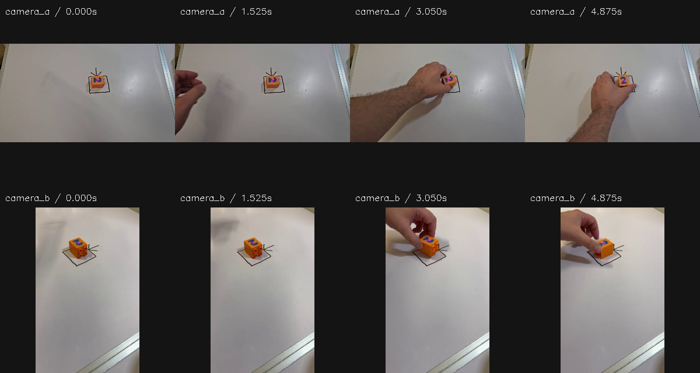

# VIDEO11 — Why the path scores disagree

**The camera-observer advantage is largely consistent with a depth-conversion bias; it does not establish that the full human sequence produces a better physical path.** The fixed-point scorer also had a small, independently verified height error. Correcting that error leaves the ranking unchanged. Exact rendered-support correspondence cannot be qualified from the saved RGB/state evidence, so this measurement branch stops here.

Ticket #11035; parent VIDEO01 #11015; follows VIDEO10 #11034.
Private branch: `research/video11-feature-correspondence`.
Audit implementation: `288dbe9`; independent verification: `957bea2`.
Protocol window: 02:21–03:06 UTC, 13 October 2026. Numerical work, verification and bulk backup finished by 02:35 UTC.
**No actor execution, new physics rollout, controller tuning or training occurred.**

## What was requested and what the archive supports

The planner requested a capped offline audit of whether the human reference, runtime detector and scorer measure the same glyph landmark. It specified four evenly spaced indices from the existing common-valid set, for each of four conditions, plus all 736 numerical records.

Frozen indices [0, 61, 122, 183] correspond to source times [0, 1.525, 3.05, 4.875] s and control steps [182, 304, 426, 572] in SEQ, END, SHUFFLE and STATIC.

| Evidence | Available |
|---|---:|
| Predetermined robot states | 16 |
| Matching compressed video frames | 8/16 |
| Matching saved native RGB frames or hashes | 0/16 |
| Complete cached render-state snapshots | 0/16 |
| Independent visible/full-glyph geometry masks qualified | 0/16 |
| Corresponding original human frames redecoded and hash-verified | 8/8 |
| Common condition/timestamp records reconciled | 736/736 |

The observer runs every second control tick; the display video records every fourth tick. Steps 182 and 426 have no archived video image. The others have lossy H264 frames. Object pose and joint positions alone do not attest an unchanged full rendered scene. No replacement timestamps, fresh full `sim.forward()`, or newly generated trajectories were substituted.

Eight selected-state images carry explicit compressed-evidence labels; eight missing-state cards document absent images. Geometry-based visible-support masks and complete-support comparisons remain unavailable. These are a deliverable limitation, not completed mask comparisons.

The video frame's source-time label refers to the preceding command; the observation row refers to the next command. Matching was done by **control step**, preserving both original clocks.

## The features are different

See [FEATURE_CONTRACT.md](FEATURE_CONTRACT.md) for the exact transformations and code definitions.

- Human reference: centroid of the accepted visible blue component, detected in native phone RGB, transformed through the annotated target homography and VIDEO10 registration.
- Runtime observer: visible blue-component centroid in primary RGB or in the secondary RGB after an assumed-depth warp to primary coordinates.
- Asset diagnostic: one fixed, complete-mask area centroid attached to the object, projected with known camera geometry.

A visible-part centroid is not automatically a rigid-object landmark. The four corresponding human instants include fingers near the printed face; no complete-glyph or human metric-3D reconstruction has been established.

## The depth assumption explains most of the numerical discrepancy

Every one of the 736 common records used the secondary-rectified route. The assumed carried plane was, on average, **about 2.949 mm above the logged printed-face centre in the simulator**.

The audit holds a native secondary pixel fixed and compares its mapping through the assumed plane with its mapping through the logged printed-face plane, including its orientation. That pixel is obtained by inverting the existing warp at the recorded rectified centroid. It is not relabelled as a newly measured native-image centroid.

| Condition | Observer vs fixed-landmark RMS (normalized units) | Same-pixel plane-change RMS | Remaining vector RMS | Mean direction cosine |
|---|---:|---:|---:|---:|
| SEQ | 0.076262 | 0.075195 | 0.003718 | 0.999341 |
| END | 0.075919 | 0.075078 | 0.003646 | 0.999286 |
| SHUFFLE | 0.075699 | 0.075245 | 0.003488 | 0.999363 |
| STATIC | 0.075636 | 0.074997 | 0.003628 | 0.999221 |

This agreement in size and direction strongly supports the carried-plane conversion as the main source of the **recorded geometric discrepancy**. It is an offline analytical decomposition, not a fitted offset, a corrected controller, or proof that visible-support correspondence has been rendered and validated. These normalized apparent-plane units are not measured human millimetres.

The offset does not cancel fairly between conditions. For observer output o, fixed-point projection p and source reference r:

`||o-r||² = ||p-r||² + ||o-p||² + 2(p-r)·(o-p)`

The mean cross-term is -0.012960 for SEQ, -0.010132 for END, -0.013119 for SHUFFLE and -0.007319 for STATIC. Its direction-dependent cancellation can reverse rankings despite similar bias magnitudes. The identity is independently verified on all 736 records, with maximum residual 1.39e-17.

Signed residuals and the predeclared still/manipulation/pre-release intervals are saved. No favorable visibility subset or fitted subtraction was used to produce a new performance score.

## A real scorer defect, too small to rescue the claim

The old point projection uses body top +0.0002 m. The actual numeral comprises 56 decorative scanline boxes whose top is body top +0.00008 m: a **0.12 mm discrepancy**.

Independent construction of those XML geoms confirms that the scorer's x/y area centroid matches their weighted local centroid. A new, separate diagnostic corrects only the z coordinate:

| Condition | Original projected-path position RMSE | Height-corrected diagnostic RMSE |
|---|---:|---:|
| SEQ | 0.092892 | 0.093020 |
| END | 0.090762 | 0.090872 |
| SHUFFLE | 0.126047 | 0.126140 |
| STATIC | 0.084365 | 0.084454 |

The ranking remains unchanged. Both original outputs and the versioned corrected diagnostic are retained. No actor receives the logged object pose or actual plane.

## Decision

**Close this measurement branch without another controller run.** Retain the valid VIDEO10 result: all four conditions and the exact repeat successfully executed the assisted correction. Endpoint and static references were sufficient for completion in this one previously inspected take.

Do not claim an established full-sequence physical-path advantage. Do not turn these observations into calibrated human 3D or direct Franka action labels. A future substantive test should require intermediate information absent from its endpoints, and should record native RGB plus its matching render cache from the outset. It requires a separate protocol; this audit does not authorize another observer-tuning cycle.

The unresolved part is exact rendered support/occlusion attribution. The available data already establishes the feature-definition differences, the numerical rank reversal, a small scorer defect and the strong analytic depth-bias explanation. That is sufficient to stop promoting the favorable surrogate metric.

## Preservation and reproduction

All 552 VIDEO10 files, 49,527,849 bytes, were independently rehashed unchanged. Original phone recordings were read-only; the eight selected raw decoded frames match the hashes established during source extraction.

VIDEO11 evidence:
- Powerglide: `/var/tmp/typhon-research-20261013/video11`
- Mint: `/media/nm/Fast Drive/Typhon/research-20261012/video11/data`
- Verified backup: **75 files, 6,388,929 bytes, zero mismatches**.

Use [reproduction_commands.txt](reproduction_commands.txt) with the existing `.venv-sim`. The scripts only read saved trajectories and source videos, construct local decorative geometry and perform numerical/image audits. No simulator stepping is invoked.

Key artifacts: `audit_summary.json`, `independent_verification.json`, `residuals.csv`, `residual_groups.json`, `selected_states.json`, `human_selected_frames.json`, source checksums, feature contract and explicitly qualified/unqualified image evidence.
