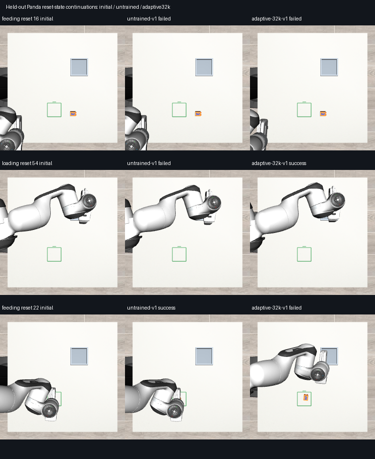

# ALPHA01: AlphaNIST-inspired Panda feasibility pilot

This prototype runs sparse-reward PPO on the existing physical Panda simulator. It **has not learned to complete feeding or loading from the initial states**. Adaptive reset sampling produced more successes under its own training distribution, but did not outperform uniform sampling on the fixed development states.

The policy here is a **new small point-cloud PPO actor/critic**. The baseline is that network's random initialization. Existing X-VLA, V1–V4, LOAD and M0–M6 artifacts were not changed.

## What was implemented

- Real MuJoCo/robosuite Panda physics, orange DUPLO visual v2, feeding and loading destinations. Both stations remain present for both tasks, avoiding the fixture-visibility shortcut identified in LOAD03.
- Eight actions: seven relative joint targets, each limited to 0.04 rad per 25 Hz command, and gripper control. Existing robosuite joint-position impedance gains are used.
- Three simulator-derived surface point-cloud groups (part, goal region, robot), 96 points each; joint positions/velocities, gripper positions and previous action. No task ID or reset phase enters the actor.
- Separate compact residual actor and critic with point-cloud encoders. Train-reset-only observation normalization stays fixed, preserving consistent PPO likelihood ratios.
- PPO with 5 epochs / 4 minibatches per 256-step rollout, Adam 3e-4, gamma 0.99, GAE 0.95, ratio clip 0.2, gradient norm 0.5.
- A single binary reward for existing strict completion, plus 0.0001 times normalized quadratic action/velocity/torque costs. No approach, grasp, distance-progress or orientation-progress rewards.
- Success-guided reset sampling: weight 0.05+sqrt(p*(1-p)), where p is the mean of the latest 32 outcomes for that reset. An identical-bank uniform sampler is the comparison.

Existing strict completion means position within 15 mm, yaw within 10 degrees with 180 degrees distinct, marked face up, full footprint inside the destination, correct placement height, released, and physically stable over at least 0.4 seconds. This is our DUPLO task definition, not AlphaNIST's 1 mm assembly criterion.

## Data and boundaries

The reset bank contains 64 physical states from 8 controller-generated simulator rollouts: 32 training states from source seeds 601/602 and 32 development states from 1701/1702, across both tasks. Seven of the eight source rollouts passed strict completion; the failed source was retained. Reset states carry qpos, qvel, actuation and mocap data, source task/seed/control-step provenance and contact diagnostics.

The controller generated the reset states only. Its actions were **not** used as imitation targets. Already released, goal-satisfying states were excluded when selecting resets. Some remaining states nevertheless begin already grasped or just before release, which makes simple continuations possible without learning pickup.

There are only four development source trajectories. Their 32 states are correlated, not 32 independent demonstrations. One learning seed was used. The 32k extension was exploratory and was declared after looking at the 4k pilot; no confirmatory significance claim is made.

## Measured results

| Network / reset sampler | Training steps | Feeding continuation | Loading continuation | Total continuation | Full initial states |
|---|---:|---:|---:|---:|---:|
| Untrained small PPO network |0|4/16|2/16|6/32|0/4|
| Adaptive |4,096|4/16|4/16|8/32|0/4|
| Uniform |4,096|3/16|4/16|7/32|0/4|
| Adaptive |32,768|3/16|3/16|6/32|0/4|
| Uniform |32,768|4/16|4/16|8/32|0/4|

Each trial allows 100 commands at 25 Hz: four simulated seconds. This is a short continuation horizon and is not evidence of failure under longer budgets. Full initial-state results are separately identified in the table.

The 4k training loops took 21.5/22.0 seconds and the 32k loops 171.2/167.7 seconds for adaptive/uniform, respectively, with the two conditions running concurrently on Powerglide. These exclude imports and environment startup. The 32k adaptive run had 190 successes in 470 training episodes versus 42/369 for uniform. **These training rates are not comparable policy-performance estimates:** the samplers chose different states. The fixed-state evaluation is the relevant comparison.

## Verification and examples

Regression checks passed for split separation, sampler behavior, binary reward, exact reset restoration, actual positive/negative joint motion, finite gradients, terminal reward protection and fixture presence in both tasks.

Six videos replay saved actions for three states, comparing the untrained network and32k adaptive network. All six reproduced logged final positions and quaternions with zero measured difference:

- Reset 16: initial feeding state; both fail.
- Reset 54: near-placement loading state; untrained fails and adaptive succeeds.
- Reset 22: near-placement feeding state; untrained succeeds and adaptive regresses.

The screenshots illustrate those same states. Some overhead views occlude the brick; numeric outcomes come from the independent physical scorer, not visual inspection alone.

Machine-readable results: [comparison.json](comparison.json), [comparison.csv](comparison.csv), [regression checks](regression-validation.json), [replay checks](replay-validation.json). Raw states, checkpoint files, per-action logs and videos are under the archive paths below.

## Relation to AlphaNIST

Primary source: [AlphaNIST, arXiv 2610.13354v1](https://arxiv.org/html/2610.13354v1). Its paper says the training implementation is planned for release following review and revision.

This is an **inspired mechanism test**, not the paper's implementation. Differences include two DUPLO tasks rather than 20 NIST assemblies; a small controller-derived state bank rather than OmniReset; CPU MuJoCo rather than massively parallel Isaac; a compact network and fixed normalization rather than the exact published architecture; existing robosuite gains; and our task tolerances. Inputs are privileged simulator geometry, not RGB or sensor-derived point clouds. This does not establish recognition of the blue 2, direct learning from phone video, or real-world performance.

The preliminary result supports keeping reset distribution separate from measured competence. Before spending substantially more PPO compute, validate broader physical reset coverage and a longer full-task horizon, and report fresh-start results separately from near-goal continuation. This pilot does not justify replacing the existing VLA or claiming adaptive sampling improves it.

## Reproduce

Use a fresh output directory for every run. The entrypoint reuses installed Python environments without modifying them.

~~~bash
cd ~/Projects/typhon-experiments/alphanist-pilot
ALPHA_PY=~/Projects/humanoid-task-supervisor-m2/.venv-xvla/bin/python
ALPHA_OUT=/var/tmp/typhon-alphanist-reproduction
$ALPHA_PY scripts/alphanist_pilot.py bank --output "$ALPHA_OUT/bank"
$ALPHA_PY scripts/alphanist_pilot.py train --bank "$ALPHA_OUT/bank" --output "$ALPHA_OUT/adaptive" --steps 32768 --sampling adaptive --seed 314
$ALPHA_PY scripts/alphanist_pilot.py train --bank "$ALPHA_OUT/bank" --output "$ALPHA_OUT/uniform" --steps 32768 --sampling uniform --seed 314
$ALPHA_PY scripts/alphanist_pilot.py evaluate --bank "$ALPHA_OUT/bank" --output "$ALPHA_OUT/eval-adaptive" --checkpoint "$ALPHA_OUT/adaptive/latest.pt" --episodes 32 --seed 314
$ALPHA_PY scripts/alphanist_pilot.py evaluate --bank "$ALPHA_OUT/bank" --output "$ALPHA_OUT/eval-uniform" --checkpoint "$ALPHA_OUT/uniform/latest.pt" --episodes 32 --seed 314
$ALPHA_PY scripts/alphanist_pilot.py evaluate --bank "$ALPHA_OUT/bank" --output "$ALPHA_OUT/eval-untrained" --episodes 32 --seed 314
~~~

Powerglide raw evidence: `/var/tmp/typhon-alphanist-20261014/`.
Mint archive destination: `/media/nm/Fast Drive/Typhon/research-20261014/alphanist-pilot/`.
Code branch: `research/alphanist-20261014`. Ticket: ALPHA01 / 11041.
