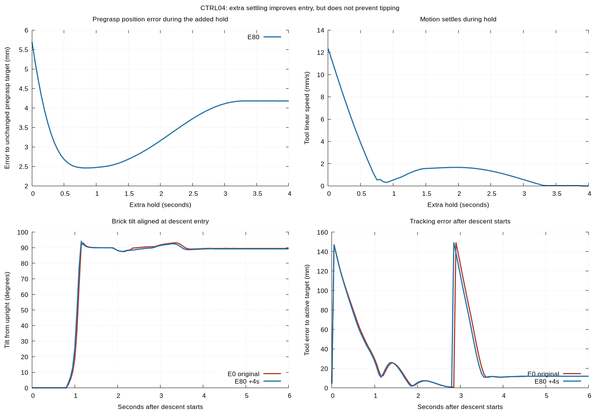

# CTRL04: fixed pre-descent dwell

**Decision: do not extend the dwell. Settling alone did not repair acquisition in this training state.** Both conditions grasped a brick that had already tipped and failed the original full-task criteria. This is a controller diagnostic using privileged simulator state, not learned-policy performance or evidence of numeral recognition.

Two new expert continuations, zero new VLA queries, zero training, no holdout access. E0 reproduced DATA07-GE's 753 recorded physical/controller rows within the existing tolerances and its exact failure events. E80 shared the same tick 510 integrated/controller state before adding 80 ticks. Four seconds counted against the original 1,500 tick episode budget.

## Matched results

| Measurement | E0 original | E80 extra 4s |
|---|---:|---:|
| Descent-entry position error | 5.688 mm | 4.178 mm |
| Descent-entry full rotation error | 1.258° | 1.217° |
| Descent-entry linear speed | 12.329 mm/s | 0.0073 mm/s |
| First open-finger contact after descent | 17 ticks / 0.85s | 16 ticks / 0.80s |
| Tool XY error at first contact | 40.116 mm | 41.523 mm |
| First tilt above 15° after descent | 20 ticks / 1.00s | 20 ticks / 1.00s |
| Tilt when closure starts | 88.242° | 88.986° |
| Upright bilateral lift samples >=10 mm | 0 | 0 |
| Full strict success | No | No |
| Final position error | 1.217 mm | 3.402 mm |
| Final planar yaw error | 0.0157° | 0.2230° |

The pause reduced entry position error 26.55% and nearly removed approach velocity. Error briefly reached 2.46 mm, then settled near 4.18 mm; convergence was not monotonic. The subsequent descent still produced a large lateral error. In both conditions the first contact was the **finger 2 collision shell against the brick's upper face**, while the grip command was open. The brick was almost 90° sideways before closure. Close final XY and planar yaw therefore do not constitute a correct placement.

Both pass position, planar orientation, footprint-inside-target, released and stable checks. Both fail marked-face-up, placement-height and seated checks. No successful recovery labels or correction dataset were generated.



[Descent-aligned comparison video](descent-aligned-comparison.mp4) starts two control ticks after each descent begins: E0 tick 512 and E80 tick 592. Top is E0, bottom is E80; within each row primary and side cameras are retained. Playback is 5 fps, matching recorded camera cadence. Full original videos remain in the verified raw archive.

## Joint and actuator diagnostics

The known tick 510 joint-range excursion was preserved: minimum signed margin −0.0001030628 rad. The original teacher has no M7 zero-tolerance joint guard. The planner clarified this before execution; no guard, tolerance, clamp, gains, joint ranges or solver settings were added.

E80 remained outside the nominal joint range at all 80 sampled hold ticks; maximum added-hold excursion 0.000160561 rad. Across teacher-phase samples, E0/E80 maximum excursions were 0.00302452/0.00303794 rad and sampled outside-range durations 4.85/8.90 s. Entire recorded traces, including the common VLA prefix, had maximum excursion 0.00503672 rad and durations 6.70/10.75 s. These are 20 Hz sample counts, not substep-integrated time.

Recorded controller torque demand exceeds the applied actuator range on some channels: joint 2 peaks near 85.34 vs 80, joint 7 near 35.63 vs 12. Applied controls remain within their recorded ranges. This supports investigating control-path limits; it does not establish that torque clipping caused the collision. No joint-safe or hardware-safe claim is made.

## Interpretation and limits

This paired intervention rules out insufficient pregrasp settling as a complete explanation for this state's failure. It does not establish impossibility of the grasp. The next candidate is a separately preregistered test of descent path/reference progression, after inspecting actual target updates and actuator limits. Do not add more waiting or loosen success thresholds.

Only one training-family state was tested: demo_0001 loading, simulator seed 131902, policy-prefix seed 912171. Original B prefix to 460 and the unchanged DATA07-GE nominal teacher were used. RGB remains a recorded diagnostic during cached-prefix/expert execution; physical/controller and command parity qualify this teacher test. No conclusion about visual recognition follows.

The intervention only wraps the second move_to call, holds the original absolute pregrasp target with the gripper open, and then resumes the same expert. No controller reset or extra simulation forward call. Contact, tipping, active runtime termination or nonfinite state during the added hold would stop that condition; none occurred. Downstream convergence-based move durations remain governed by the original code, so a phase can take a different number of ticks.

## Reproduction and archive

Worktree: /var/tmp/typhon-worktrees-20261015/ctrl04-fixed-dwell

Raw evidence: /var/tmp/typhon-ctrl04-20261015

Backup: /media/nm/Fast Drive/Typhon/research-20261015/ctrl04-fixed-dwell

Recorded commands, environment alias, frozen protocol/source checksums, planner clarification, original full traces, frame videos and state snapshots are retained. The existing canonical interpreter alias is required because XML mesh paths depend on it.

```bash
SIM=/cs/student/msc_rai/2026/ndossant/Projects/typhon-experiments/data07r-training-repairs/.venv-sim/bin/python
# Exact execution command used; frozen output directories prevent accidental reruns.
$SIM /var/tmp/typhon-worktrees-20261015/ctrl04-fixed-dwell/scripts/ctrl04_run.py
# Offline recomputation of tables from saved traces:
$SIM /var/tmp/typhon-worktrees-20261015/ctrl04-fixed-dwell/scripts/ctrl04_analyse.py
cd /var/tmp/typhon-ctrl04-20261015
gnuplot comparison.gnuplot
```

A fresh physical replication must use a new worktree/output directory and timestamped protocol/clock; never remove the original outputs to bypass the two-execution cap. This report provides the actual executed command, not a promise that expired experiment clocks can be rerun.

Earlier M0/M1/M1.5/M1.6, trained models and frozen experiment results are unchanged. AlphaNIST remains parked.
