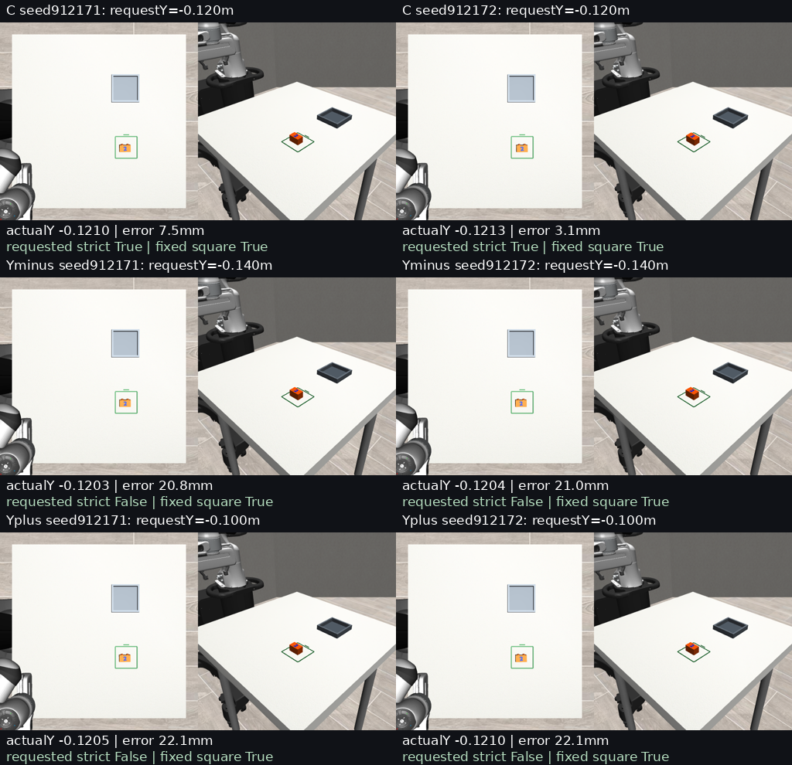

# EVAL02-XY: numerical goals within a fixed feeding square

The counterbalanced LOAD04-B checkpoint reproduced familiar-centre placement in both seeds. None of four requests for a 20 mm Y offset reached the requested point. All six episodes grasped, transported, released and stably placed the brick inside the original square. The offset failures concern requested position, not grasp acquisition.

This supports a narrow result: local numerical steering is not demonstrated through the native prompt interface in this familiar scene. It does not establish that numbers are globally ignored.

## Frozen comparison

Ticket #11059; parent EVAL02-GOAL #11058. One training-family scene, demo_0002, simulator seed131902; no holdouts.

Exact LOAD04 counterbalanced B step3000, SHA256 de861da493be2a851e2fae5289f798cd34ff714e120f974f9c2197847732e379. This is the feeding/loading continuation, not vanilla, V4 or new training. O2, domain29, H30, 10 denoising steps, native controller;1500 total ticks including40 reset and24 passive settle;48 queries/1460 post-reset records.

Both stations remain visible in the same physical loading configuration. Feeding wording, yaw0 and serializer fixed; only requested numeric XY varies. C=[0.125,-0.120], Yminus=[0.125,-0.140], Yplus=[0.125,-0.100] metres. Two paired seeds912171/912172. Extreme goals are40mm apart, exceeding twice the15mm centring tolerance; nominal yaw0 footprint has12.5mm Y and25mm X clearance within the fixed100mm square.

Frozen proxy50×35×30mm,80g, not measured real DUPLO geometry. Centre controls passed before offsets. No outcome retries, training, harness, TTC, expert intervention or marker movement.

## Results

| Condition | Seed | Requested Y (m) | Actual Y (m) | Requested error (mm) | Requested strict | Original square strict |
|---|---:|---:|---:|---:|---|---|
| C | 912171 | -0.120 | -0.120990 | 7.451 | True | True |
| C | 912172 | -0.120 | -0.121327 | 3.108 | True | True |
| Yminus | 912171 | -0.140 | -0.120348 | 20.815 | False | True |
| Yplus | 912171 | -0.100 | -0.120537 | 22.122 | False | True |
| Yminus | 912172 | -0.140 | -0.120401 | 20.968 | False | True |
| Yplus | 912172 | -0.100 | -0.121012 | 22.094 | False | True |

Requested ±20mm Y changes produced only0.315–0.926mm Y displacement relative to the paired centre trial, always toward +Y. Both negative-Y requests therefore moved in the wrong relative direction. First-query XYZ proposal RMSE changes were0.272–0.564mm despite matched inputs/noise. Changing a proposal does not establish useful coordinate control.

| Seed | Requested delta Y (mm) | Actual delta Y (mm) | Signed Y gain |
|---|---:|---:|---:|
| 912171 | -20 | 0.642 | -0.0321 |
| 912171 | 20 | 0.453 | 0.0227 |
| 912172 | -20 | 0.926 | -0.0463 |
| 912172 | 20 | 0.315 | 0.0158 |

## Scoring and qualification

The original scorer centres both its distance test and footprint boundary on its goal. Moving that goal would silently move the evaluated square. This experiment recomputes original fixed-region feeding/loading scores, then replaces ONLY the feeding position criterion with distance to the requested point<=15mm. Footprint, yaw<=10deg, marked-face-up<=10deg, height<=2mm, release and stability remain unchanged. Requested strict success requires all criteria.

A runnable preflight verifies: a valid offset passes the requested point but misses the old centre; a requested point outside the fixed square still fails; one extreme cannot satisfy the other. Simulation configuration is identical across trials.

All6 initial available physics/controller/Python/NumPy states, native camera bytes and actual prepared nontext inputs match exactly. Actual generation noise matches all48 queries per paired condition (4 comparisons ×144 arrays). Scores independently recomputed; no controller, artifact or evaluation exceptions. Fresh-process checkpoint probe action error0. Simulator truth is evaluator-only.

Historical reproduction: both centre endpoints exactly match previous FF endpoints. Seed912172 has identical full action tensors; seed912171 does not. historical-reproduction-detail.json retains the difference; no claim of universal cross-session bitwise equivalence. Current-panel initial/nontext/noise qualifications pass. No outcomes were rerun.

## Visual evidence

All six endpoint panels visually inspected: the brick rests in the original feeding square and the unchanged loading tray is visible. Endpoint inspection does not establish numeral understanding. Six native videos and two original-time three-condition movies are in the Mint archive; presentation labels never enter policy input.

## Implementation and reproduction

scripts/eval02_xy.py reuses the frozen worker/execution instrumentation and scorer. protocol.json hashes the source dependencies. First preparation failed because the extracted native serializer required a NumPy namespace; no protocol or rollout existed. Source/log/error retained in preparation-attempt01. Fixed before freeze, with original clock unchanged.

Parent commit7dd94ef447b144575fbe50482c68d11ca766e1ed. See REPRODUCE.md. Code/reports use a private branch; raw tensors, per-query noise, state/controller traces and videos are archived on Mint with SHA256 verification.

## Interpretation

Counterbalanced supervision makes trained feeding/loading behaviour selectable through wording locally. Within-square numerical steering remains unsupported under this interface. One familiar scene and two seeds do not support a generalization estimate or claims about internal representations.

This contributes zero to the68 pending EVAL02 intervention trials. The broader programme stays active; bounded experiments end with review and next-task selection.

## Follow-up qualification details

The unchanged native wording says 'Target centre in robot world metres'. It does not explicitly distinguish requested block-centre position from the visible target's centre. Offsets therefore test numerical requests against a fixed visual-centre cue; the negative result does not isolate numerical representation from visual cue competition.

Extreme-to-extreme Y response is-0.00472 for seed912171 and-0.01528 for912172 (ideal1): observed separations-0.189mm and-0.611mm for requested+40mm. These are descriptive paired finite differences, not population estimates.

Additional post-run scorer checks reject sideways, elevated and unreleased states at the requested point and verify that requesting the original centre reproduces its predicate on all6saved episodes. No actor or frozen protocol changed.

Historical seed912171 first diverges in secondary camera pixels at query9 (13elements), then in raw predictions. At its query9 boundary, tick310, the brick is already released and stationary at the exact final position; both sessions end at identical brick states. The cause of the cross-session pixel discrepancy remains unresolved. Current-panel initial input and paired-noise checks remain exact.

All8saved videos decode through frame366:367frames at5fps. The next preselected branch is EVAL02-SPATIAL: vary numeric point and decorative marker position separately, with a15min renderer-isolation gate and no new training.
