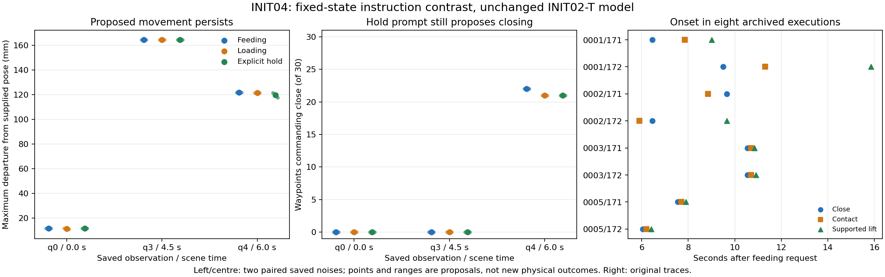

# INIT04 — unwanted initiation and same-state prompt contrast

The feeding request did not change before the unwanted grasp in any of the eight saved failures. In the selected later state, explicit instructions to hold position and keep the gripper open still produced approach and closing commands. This local prompt change did not repair the proposal; it does not prove that the model ignores all language.

## Execution and qualification

The unchanged INIT02 T checkpoint was used: 4d7a4a2547f084b6026164f27a6b7d43b5cb4d3b83ee4875343d108908f35636. Current O2 views and native command-history proprioception were retained. There is no temporal image stack or elapsed-time input. No physics rollout, optimizer update or R model load was performed.

Three packets (queries 0, 3 and 4) × three instructions × two saved noises produced 18 distinct outputs: 16 fresh calls, including one exact original-condition replay, plus two qualified archived reuses. The fresh replay had zero maximum absolute action error. Full parameter/buffer hashes matched before and after inference, and the checkpoint file hash was unchanged. Both gripper input channels still undergo native zeroing; output probabilities retain the native sigmoid and >0.5 closing threshold.

The deterministic post-hoc mechanistic selection chose demo_0001, seed 912171: the lowest parent and seed with verified supported lift. This is a diagnosis of an inspected failure, not an independent held-out success estimate.

## Onset in all eight preservation runs

Times below are relative to the feeding request and taken from post-step samples at 20 Hz. Query and waypoint indices are zero based. Lift time is the start of the first ≥3-sample run with bilateral contact and block centre ≥10 mm above its initial resting height; the third sample confirms it.

| Parent | Seed | First executed close (s; query) | First contact (s; query) | Supported-lift run begins (s) |
|---|---:|---:|---:|---:|
| demo_0001 | 912171 | 6.45; q4 | 7.85; q5 | 9.00 |
| demo_0001 | 912172 | 9.50; q6 | 11.30; q7 | 15.85 |
| demo_0002 | 912171 | 9.65; q6 | 8.85; q5 | absent |
| demo_0002 | 912172 | 6.45; q4 | 5.90; q3 | 9.65 |
| demo_0003 | 912171 | 10.55; q7 | 10.70; q7 | 10.85 |
| demo_0003 | 912172 | 10.55; q7 | 10.70; q7 | 10.90 |
| demo_0005 | 912171 | 7.55; q5 | 7.70; q5 | 7.90 |
| demo_0005 | 912172 | 6.05; q4 | 6.20; q4 | 6.40 |

All eight retain the same full serialized feeding instruction and token hash through initiation. Input reconstruction exactly matches the saved hash of every field at every inspected query. The only task-related scalar is the unchanged domain ID 29; the task goal is serialized in the text. No default loading request or truncated relevant suffix was found.

The selected run makes a small initial departure, then the proposed maximum departure from supplied pose grows from 11.6 mm at q0 to 127.4 mm at q1, 310.9 mm at q2 and 164.4 mm at q3. At q3 it proposes getting within 25.1 mm of the block; q4 first commands closing at waypoint 8 (6.45 s). Contact follows at 7.85 s and the first supported-lift run begins at 9.00 s.

The object crop becomes invalid at q3, after the larger q1–q2 approach proposals; this timing does not establish the crop loss as the cause of initiation. The supplied-versus-measured wrist gap is 0.64 mm at q1, 20.90 mm at q2, 8.12 mm at q3 and 10.41 mm at q4. The gap may matter, but no history or measured-pose substitution was tested.

## Same-state instruction comparison

F-original and L-original are the exact archived feeding and loading requests. H-explicit is:
> Maintain the currently supplied end-effector position and orientation. Keep the gripper open. Do not approach, touch, grasp or move the block.

H-explicit supplies a no-motion primitive; it does not supply a completion label or demonstrate autonomous recognition of task completion. The original protocol has no duration field to preserve. All nontext inputs, including command history, image masks and current camera views, are identical across the three conditions at each query. The two noises are the original query noise and the corresponding query-index noise from the other original seed.

Ranges below span the two paired noises. Distances are proposed targets, not newly executed motions. The block location is used only by the offline scorer.

| Query / scene time | Instruction | Max XYZ departure from supplied pose | Max departure from measured pose | Min proposed block distance | First close waypoint |
|---|---|---:|---:|---:|---:|
| q0 / 0.0 s | F-original | 11.6 mm | 11.6 mm | 485.7 mm | none |
| q0 / 0.0 s | L-original | 11.1–11.6 mm | 11.1–11.6 mm | 485.7 mm | none |
| q0 / 0.0 s | H-explicit | 11.6 mm | 11.6 mm | 485.7 mm | none |
| q3 / 4.5 s | F-original | 164.4 mm | 167.1 mm | 25.1–25.2 mm | none |
| q3 / 4.5 s | L-original | 164.4 mm | 167.0 mm | 24.5–25.1 mm | none |
| q3 / 4.5 s | H-explicit | 164.4 mm | 167.0 mm | 25.2–25.5 mm | none |
| q4 / 6.0 s | F-original | 121.7 mm | 113.1 mm | 20.1 mm | 8 |
| q4 / 6.0 s | L-original | 121.5 mm | 112.9 mm | 20.7–21.4 mm | 9 |
| q4 / 6.0 s | H-explicit | 117.6–121.5 mm | 109.1–112.9 mm | 21.4 mm | 9 |

At q3, all three requests still propose about 164 mm of movement toward the block with no closing yet. At q4, F closes for 22 of 30 waypoints, while L and H close for 21 of 30, beginning one waypoint later. H has peak closing probability approximately 0.998 under both noises. Stronger wording did not suppress acquisition in this local contrast.

The instructions produce measurable numerical differences above the zero replay-error floor. For H versus F at q4, mean XYZ difference is 7.18–7.60 mm and mean absolute gripper-probability difference is approximately 0.0387. Those differences do not amount to the requested hold behaviour. At q0 every condition has roughly 11–12 mm maximum departure and no close: closer to a hold label does not mean stationary. Full wrist-rotation measurements and first/last/max values are retained in measurements.csv.

## Coverage and interpretation

Each preservation demonstration contains 60 control ticks (3 s), 15 saved observations, and zero supplied-XYZ range. Query0 has an exact processed-image and pose match in that reference. In the selected run, later effective inputs differ: nearest recorded hold-pose distance is 9.80 mm at q1, 117.0 mm at q2, 397.3 mm at q3 and 471.3 mm at q4. Processed-image RMSE to the nearest hold frame is respectively 0.173, 0.425, 1.373 and 1.081 in the processor’s normalized tensor units. These are descriptive input differences, not physical calibration or an OOD threshold.

Elapsed time alone is not the mismatch: time is not an actor input. The actual images and supplied poses evolve away from the stationary hold data. This supports state-dependent initiation while leaving the separate causal contributions of imagery, command-history feedback and learned conditioning unresolved.

No request-interface defect was found and the explicit hold prompt did not repair the tested late response. Native conditional fitting remains the next unresolved diagnostic; INIT03 Part B is still unexecuted. This work makes no new physical-success, release-repair, deployment, blue-2 recognition or general language-capability claim.

## Reproduction and retained evidence

The frozen execution code is in commit 6eb9897c7a4b1d3ebb33fe0082d7ab8d0a976296. Raw packets, source/noise hashes, exact prompts, all outputs, per-query onset records and replay arrays are archived together. Original INIT01/INIT02 outputs remain unchanged.

Recompute this report and its checks into a new directory without any model or physics execution:
~~~sh
.venv-xvla/bin/python scripts/init04_report.py /var/tmp/typhon-init04-report-reproduced
~~~
The original bounded preparation and native generation commands were:
~~~sh
.venv-xvla/bin/python scripts/init04_prepare.py
.venv-xvla/bin/python scripts/init04_infer.py
~~~
Those commands enforce the recorded original time gates; they are not a request to rerun or overwrite the frozen experiment. A new execution requires a fresh output root and explicit recorded clock.

The numerical contact sheet is generated from saved outputs only, using a separate plot dependency directory. Its pinned dependencies are recorded in plot-requirements.txt; inference environments were not modified. Recreate it with:
~~~sh
.venv-xvla/bin/python -m pip install --no-cache-dir --target /var/tmp/typhon-plotdeps-20261015 -r experiment-history/2026-10-15-init04-initiation-onset/plot-requirements.txt
.venv-xvla/bin/python scripts/init04_plot.py /var/tmp/typhon-init04-20261015
~~~

