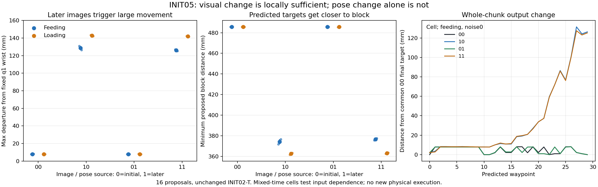

# INIT05 — first-step image/proprioception factorial

Changing the q0 visual block to q1 is sufficient locally to reproduce the large approach proposal. Changing only the effective proprioception leaves the output close to its initial response. Both trained instruction forms still initiate approach. This identifies visual-block dependence at one inspected failure, not the specific visual cue or a validated repair.

## Contract and qualification

The unchanged INIT02-T checkpoint 4d7a4a2547f084b6026164f27a6b7d43b5cb4d3b83ee4875343d108908f35636 was used. All16 cells were generated: four I/P combinations × feeding/loading × the same two saved q1 noise tensors. The first 11/F/noise0 call reproduced the original q1 output exactly (maximum error0). Actual effective tensors were captured at the native transformer boundary; native preprocessing ran ten times per output and only zeroed the existing gripper inputs. Model parameters/buffers and source records remain unchanged. No new physics or training was performed.

The selected episode is demo_0001/seed912171, carried forward from the frozen INIT04 post-hoc selection. q0 is task start and q1 the next observation after30 control actions. The two mixed-time cells10 and01 are synthetic input interventions, not physically validated states or deployable policies.

q0→q1 supplied position changes9.801mm and decoded rotation2.042°. q1 differs from measured wrist by0.643mm and0.114°. Raw6D column norms change from approximately1/1 to1.004892/1.003903; their condition number changes1.000000→1.001020. These differences were retained without normalization or repair. Both image masks are [true,true,true], and the crop bounding boxes agree; image-block effects do not include a validity-mask change.

## Absolute proposals and common physical reference

Distances below use the same measured q1 wrist and q1 block for every cell. Ranges are the two paired saved noises, not uncertainty intervals. Absolute first/final targets, full XYZ/rotation sequences and gripper probabilities are retained in outputs.npz and measurements.csv.

| Image / pose cell | Instruction | Max departure from measured q1 wrist | Minimum proposed block distance | Close waypoints |
|---|---|---:|---:|---:|
| 00 | F-original | 7.67–7.97mm | 485.68mm | 0.00 /30 |
| 00 | L-original | 7.67–7.78mm | 485.68mm | 0.00 /30 |
| 10 | F-original | 126.33–130.85mm | 371.87–376.51mm | 0.00 /30 |
| 10 | L-original | 142.20–143.28mm | 361.67–363.32mm | 0.00 /30 |
| 01 | F-original | 7.67–7.90mm | 485.68mm | 0.00 /30 |
| 01 | L-original | 7.67–7.97mm | 485.45–485.68mm | 0.00 /30 |
| 11 | F-original | 125.21–126.88mm | 375.70–377.50mm | 0.00 /30 |
| 11 | L-original | 141.63–142.17mm | 362.64–363.47mm | 0.00 /30 |

00 and01 remain about7.7–8.0mm from the common wrist reference, and roughly485–486mm from the block. With later images, 10 and11 propose approximately125–143mm of motion and reach roughly362–378mm from the block. These are actual changed absolute XYZ predictions, not merely a moving relative-error origin. No cell proposes closing yet; this is the onset of approach, before the later unwanted grasp documented in INIT04.

## Prespecified finite contrasts

The primary metric here is maximum proposed departure from fixed measured q1 wrist. Image effect=m10−m00; pose effect=m01−m00; interaction=m11−m10−m01+m00. The complete prespecified scalar contrasts and full sequence vector contrasts are also saved.

| Instruction | Noise | Image effect at P0 | Pose effect at I0 | Interaction | Mean absolute XYZ image-effect norm | Mean absolute XYZ pose-effect norm |
|---|---:|---:|---:|---:|---:|---:|
| F-original | 0 | 123.179mm | 0.000mm | -3.970mm | 32.275mm | 1.571mm |
| F-original | 1 | 118.361mm | -0.070mm | -1.048mm | 31.104mm | 0.960mm |
| L-original | 0 | 135.608mm | 0.294mm | -1.399mm | 35.999mm | 2.278mm |
| L-original | 1 | 134.420mm | -0.107mm | -0.457mm | 34.640mm | 1.239mm |

The small interaction and pose-only effects do not establish that proprioception never matters. They concern this q0/q1 pair, these prompts and two fixed noises. Feeding and loading proposals differ numerically under later images, but neither selects preservation. No percentage of causal responsibility or population success rate is inferred.

## Which visual inputs changed?

| Processed view | RMSE in normalized tensor units | Fraction of unequal scalars | Exact equality |
|---|---:|---:|---|
| primary | 0.273788 | 0.057458 | False |
| secondary | 0.123345 | 0.035841 | False |
| crop | 0.000000 | 0.000000 | True |

These are descriptive differences, not a per-camera causal ablation, pixel localization, recognition result or out-of-distribution threshold. The test swaps the complete visual block; it does not establish whether the arm appearance, a particular camera or another image feature drives the response. It also does not test blue-2 recognition.

## Next qualified repair direction

The result meets the planner’s visual-block sufficiency pattern. The next step is to qualify paired preservation and loading labels at a physically valid learner-reached precontact state: holding measured pose with open gripper must preserve the arrangement, while a teacher must still load from that same state. Both records must share the actual aligned initial observation and eligible training-family provenance. This experiment supplies no such new labels itself.

Do not freeze images online, clamp proprioception, force the gripper open or call this a repaired policy. Native conditional fitting (INIT03 PartB) remains unexecuted; this result does not settle capacity, teacher-forcing or training adequacy.

## Reproduction

Frozen execution commit: 4cd96f35e374794dee260206ce6c7cf1162549bd. Recompute all numerical checks/report without model or physics calls:
~~~sh
.venv-xvla/bin/python scripts/init05_report.py /var/tmp/typhon-init05-report-reproduced
~~~
Original bounded execution commands (original clocks enforced; do not overwrite frozen outputs):
~~~sh
.venv-xvla/bin/python scripts/init05_prepare.py
.venv-xvla/bin/python scripts/init05_infer.py
~~~
The figure uses the separate pinned plotting environment already recorded by INIT04:
~~~sh
.venv-xvla/bin/python scripts/init05_plot.py /var/tmp/typhon-init05-20261015
~~~

