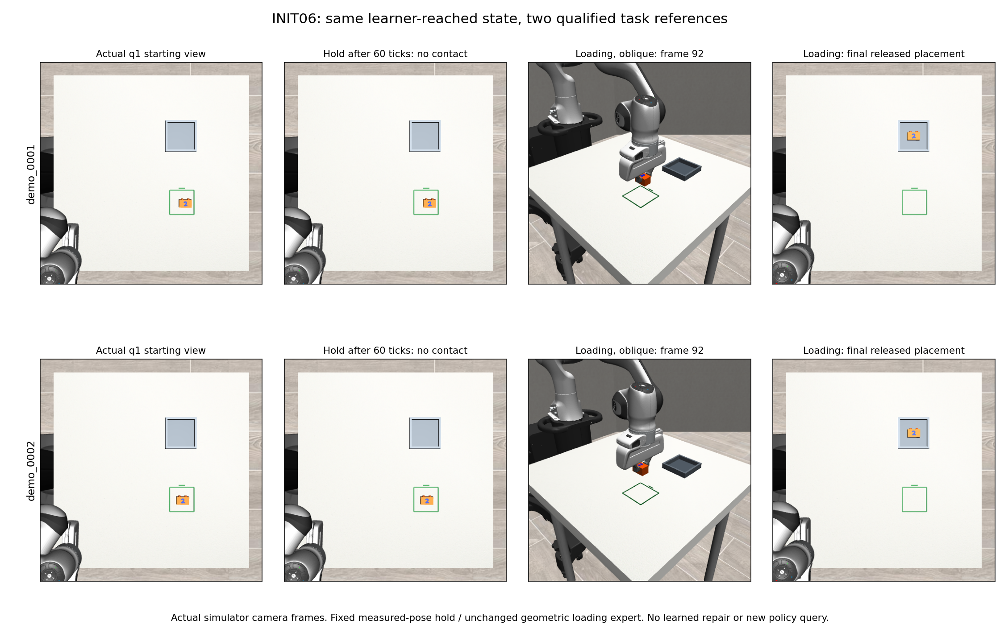
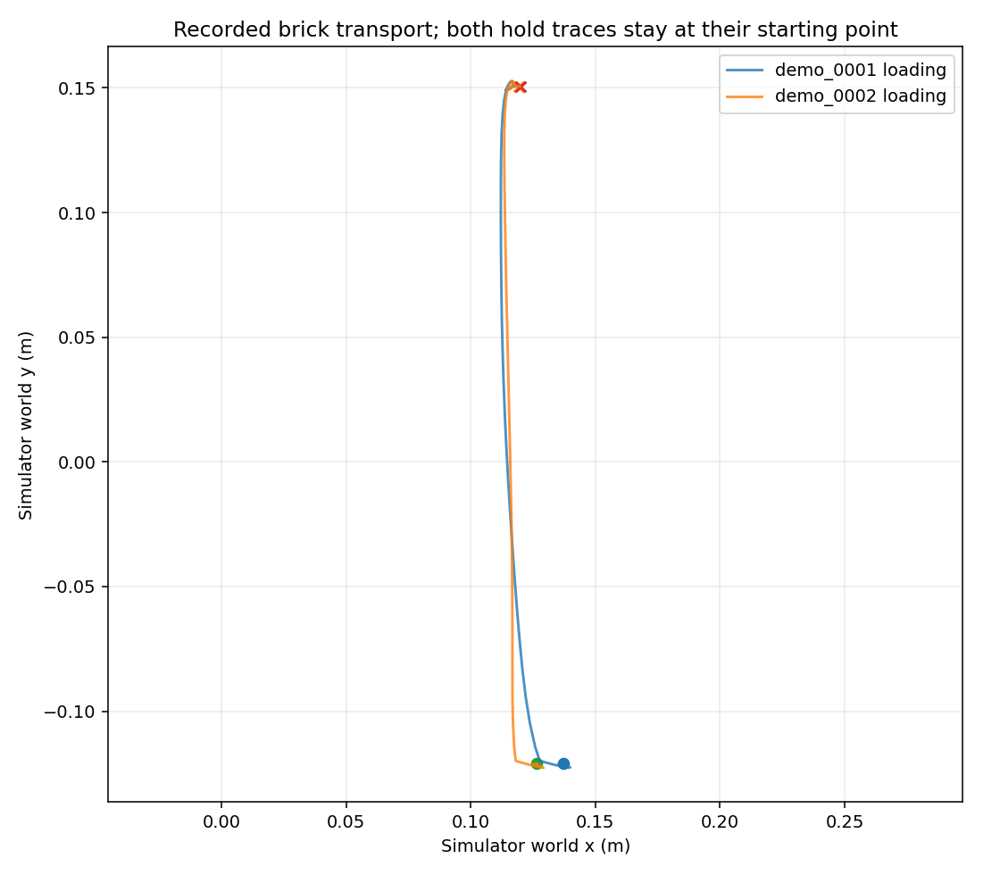

# INIT06 — two instructions at the actual learner-reached state

2 of 2 prescribed parent pairs qualified; 4 continuations were executed. This qualifies candidate supervision, not a trained repair.

| Parent | Branch | Qualified | Endpoint | H30 windows | Position mm | Yaw deg | 70mm lift | Min joint margin rad |
|---|---|---|---|---|---|---|---|---|
| demo_0001 | F-preserve | True | True | 8 | 12.068 | 0.338 | False | 0.366838 |
| demo_0001 | L-teacher | True | True | 54 | 1.019 | 0.333 | True | 0.249717 |
| demo_0002 | F-preserve | True | True | 8 | 1.812 | 0.466 | False | 0.367430 |
| demo_0002 | L-teacher | True | True | 54 | 0.713 | 0.347 | True | 0.249739 |

## What was compared
Each branch independently replayed the original qualified feeding prefix and the same archived T first30 commands, stopping before query1. No poses were injected, controller reset, new policy query made, or online image/pose clamp applied. Both available archived rich traces and raw RGB pixels reconstructed exactly. Actual prepared O2 inputs matched original hashes. First recorded proprioception retained the actual previous predicted target; later records use the existing command-history convention.

The q0 complete semantic state was archived and matched exactly. Full internal state at historical q1 was not separately saved: historical qualification uses deterministic replay plus all available rich fields and actual model inputs. Complete newly recorded q1 states match exactly across paired branches, including velocity, controller, warm-start and contacts under the existing comparator.

Feeding uses the measured full pose captured once and open gripper for60ticks. Loading uses unchanged nominal expert from that physical state, at most1430remainingticks including24settle. Original instructions are retained. Hold success is a3second teacher reference, not full-horizon learned preservation.

## Data contract
Each trajectory contains real rendered robot observations, exact executed normalized commands, qualified absolute EEF targets, previous-target proprioception, source identity and full diagnostic traces. Complete H30 windows only; no terminal padding or shifted labels. Simulator object truth is used for the declared loading expert and independent scorer, never added to learner images, prompt or proprioception. Hidden-camera arrays inherited from the recorder are retained for audit but the candidate manifest selects visible views only.

Both parents belong to the eligible training families. Their geometry is tightly concentrated and they are not independent broad scene diversity. Personal footage supplied scenario provenance, not measured Franka action labels.

## Failures and limitations
One preparation attempt stopped on a rotation diagnostic difference8.503e-8degrees caused by reconstructing its target asfloat64. A saved offline calculation reproduced that discrepancy and showed the archived target wasfloat32. Restoring that dtype left commands and thresholds unchanged. Failed attempt remains archived. No continuation outcome was retried.

Any missing parent after a failed admission gate remains unexecuted, not an unsuccessful rollout. Candidate admission requires strict endpoint, clean phase convergence, no observed joint-limit excursion and three consecutive upright bilateral70mm lift samples for loading; preservation requires no contact and <=1mm maximum block movement.

## Reproduction
Frozen executable commit: 3f15dfa7ddd6183cfab20bc372d4e3378d3032ad.
Environment: existing .venv-sim for physics and scoring; .venv-xvla only for CPU native preprocessing. No weights loaded.
Commands used:
```sh
.venv-sim/bin/python scripts/init06.py prepare
.venv-sim/bin/python scripts/init06.py run
.venv-sim/bin/python scripts/init06_report.py
```
Physics commands deliberately refuse existing episode directories. Preserve the frozen outputs and use a separately declared fresh root for an actual rerun. The report command rechecks saved outputs without physics or model calls.




