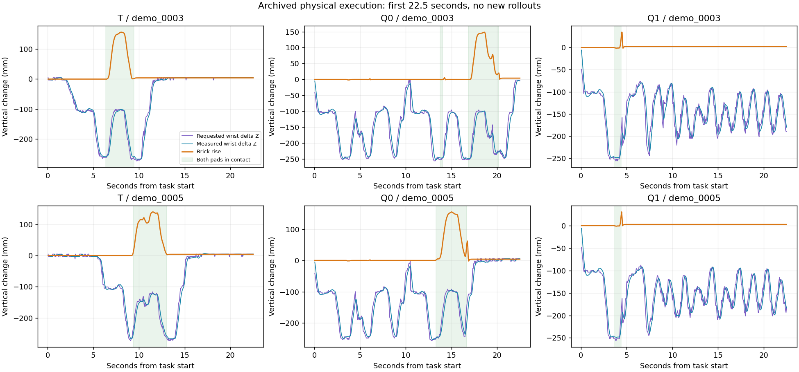
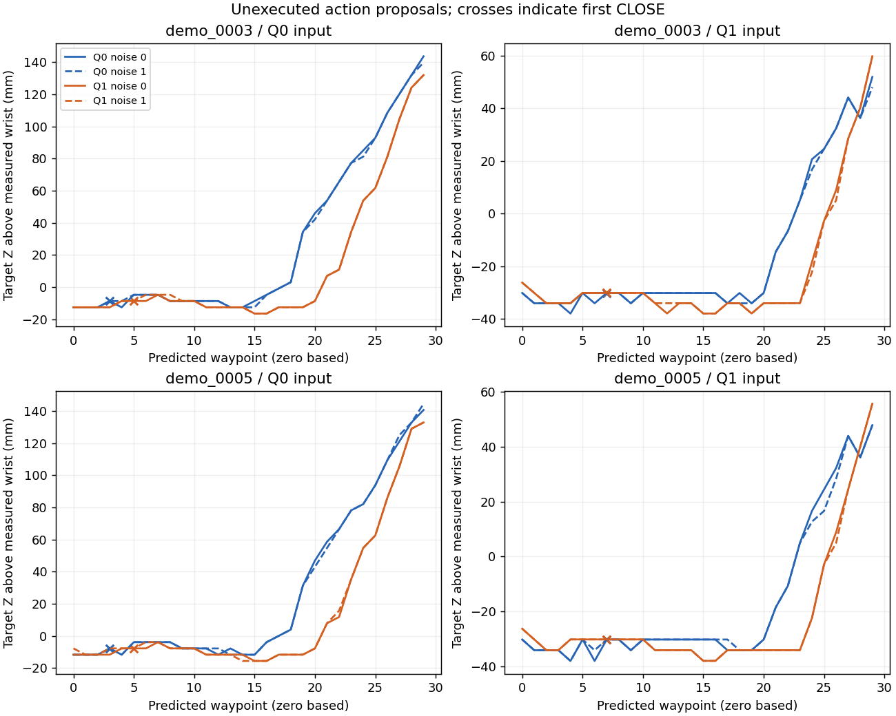
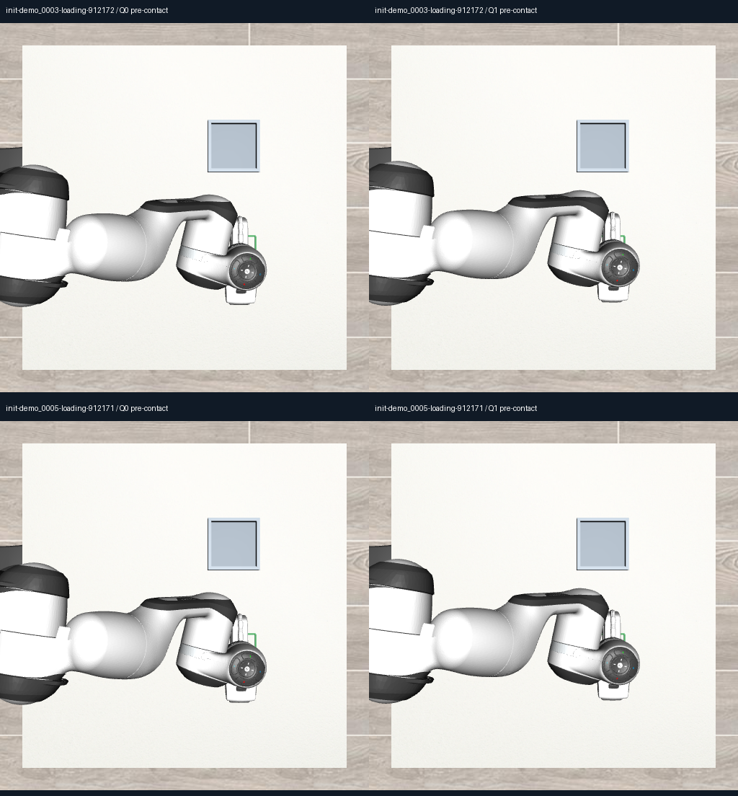

# INIT08 — acquisition loss and matched pre-contact inputs

Q1's two lost loading successes were acquisition failures: it commanded and achieved wrist lift, briefly elevated the brick, then lost support while the gripper was still commanded closed. The comparison also finds changes in both the reached input state and the conditional action output. It does not establish which change caused the loss, and Q0's later successful retries are outside the one-query counterfactual comparison.

This is a diagnostic of two deliberately selected source-evaluation failures, not a new generalisation benchmark. No new physical episode or training update was run.

## Provenance and qualification

- Case 1: `init-demo_0003-loading-912172`.
- Case 2: `init-demo_0005-loading-912171`.
- Models: INIT07-Q0 and INIT07-Q1, both 3,000-update continuations from the same immutable INIT02-T parent. The two parents investigated here are outside the 0001/0002 new q1 correction subset, but received common q0 rehearsal.
- Historical T, Q0 and Q1 executed traces were inspected for each case: six existing executions.
- Pre-contact selection was frozen at query 2 in both cases: ticks 403 and 396, respectively, before first Q0/Q1 gripper contact at ticks 413 and 406.
- The complete actual input packets were reconstructed and matched to their archived input hashes. Each includes current O2 camera tensors, masks, instruction, domain and native previous-target proprioception. Measured wrist pose was retained only as an offline geometry reference.
- Two archived initial-noise tensors were used at that query index, corresponding to seeds 912171/912172.
- Four original-noise diagonal calls reproduced their archived action arrays exactly, maximum absolute difference zero. These calls are included in the total of 16.
- All 16 outputs used identical actor input tensors across checkpoints within each donor state/noise cell. Every resident model's state hash remained unchanged. There was no optimizer, new camera rendering or simulator reconstruction.
- Both checkpoints and the selected input records were independently SHA-verified on Mint before inference.
- Inference finished at 2026-10-15 23:04:19 UTC, before the immutable 23:24:58 inference deadline. The archive deadline is 23:34:58 UTC.

## What physically happened in the saved runs

The existing supported-pickup diagnostic requires bilateral pad contact while the block is at least 10 mm above its initial height for three consecutive recorded control ticks. One control tick is 0.05 s. These criteria were not changed after seeing these failures.

| Case | Model | Strict loading | First close duration, ticks | Requested wrist rise, mm | Achieved wrist rise, mm | Brick rise in that close segment, mm | Longest supported-lift streak, ticks |
|---|---|---|---:|---:|---:|---:|---:|
| 0003 / 912172 | T | Pass | 66 | 157.3 | 156.8 | 156.3 | 49 |
| 0003 / 912172 | Q0 | Pass after later attempts | 27 | 149.7 | 120.7 | 0.0 | 60 |
| 0003 / 912172 | Q1 | Fail | 53 | 148.2 | 143.3 | 34.7 | 2 |
| 0005 / 912171 | T | Pass | 78 | 147.9 | 141.9 | 140.1 | 71 |
| 0005 / 912171 | Q0 | Pass after later attempt | 27 | 149.7 | 120.7 | 0.0 | 59 |
| 0005 / 912171 | Q1 | Fail | 53 | 143.6 | 140.7 | 30.4 | 2 |

Requested and achieved wrist rise above use the measured wrist at the first closing tick as reference. Brick rise uses its initial episode height. The final column describes the whole saved execution, so Q0's supported lift comes from a later attempt.

Q1 recorded 15 consecutive bilateral-contact ticks in each case, but only two ticks also satisfied the 10 mm lift criterion. Bilateral support was lost at tick 432 for 0003 and 425 for 0005. At those loss ticks the raw closing probabilities were 0.99848 and 0.99838. First opening came at ticks 464 and 457: 32 ticks, or 1.6 seconds, after the loss. **An opening command did not initiate these two support losses.**

Object tilt at the first bilateral loss was 5.1 degrees for 0003 and 17.8 degrees for 0005. By the first opening both bricks were lying at 90 degrees. This records the sequence; it does not establish whether pad placement, slip, contact forces, tilt or tracking was the primary cause.

Q0's first contact/close episode also failed to acquire the brick. Its later retries reached a qualifying supported lift at ticks 688 and 612 and ultimately completed loading. Therefore the selected first-attempt Q0 proposals are not verified expert grasp labels. T completed an earlier supported lift at ticks 477 and 524.



The plot shows the first 22.5 seconds from each saved task start. Requested/measured wrist changes are relative to the initial wrist height; brick rise is relative to initial brick height. Shading denotes recorded bilateral pad contact. The full 1,460-tick traces remain in the immutable upstream archives.

## Same-input model and state comparison

Each row below contains four unexecuted outputs: two selected cases times two archived noise tensors. Close waypoint indices are zero based. Distances refer to raw predicted targets and the donor state's fixed measured geometry; they are not achieved robot positions.

| Donor input | Checkpoint | First CLOSE waypoint | Minimum target-to-object XY distance, mm | Maximum target Z above measured wrist, mm |
|---|---|---:|---:|---:|
| Q0 state S0 | Q0 | 3 | 1.40–2.15 | 139.80–144.52 |
| Q0 state S0 | Q1 | 5 | 4.35–5.61 | 132.01–132.83 |
| Q1 state S1 | Q0 | 7 | 6.76–7.17 | 47.86–51.90 |
| Q1 state S1 | Q1 | 7 | 9.01–9.60 | 55.70–59.74 |

Both checkpoints substantially change their predicted lift and closing point when given S1 instead of S0. Q1 also changes the output on identical packets: later closing on S0 and a several-millimetre shift in predicted lateral alignment on both states.

The two selected noise draws produced a maximum corresponding-waypoint XYZ difference of 7.83 mm across the eight repeated model/state/case pairs. This is sampling sensitivity in two fixed noise draws, not a noise distribution estimate.





These are complete donor packets, not an image-only intervention. Camera observations and supplied previous-target proprioception vary together. The 16-output design cannot isolate their separate contributions.

Full raw XYZ, full rotation matrices and gripper probabilities are in `measurements.json` and `outputs.npz`. Departures from both supplied proprioception and measured wrist pose are retained. We did not convert the crossed chunks using the donor's future wrist trajectory or report counterfactual physical success.

## Interpretation and next decision

1. **Suppressed initiation is insufficient as an explanation.** Q1 approaches, closes and lifts its wrist in these two cases.
2. **Premature opening is ruled out as the initiator of these two losses.** Support is already lost while CLOSE remains commanded.
3. **Both state and policy output are implicated.** The fixed-input crossover reveals changes under either factor, but is not a causal physical execution test.
4. **Retry behaviour matters.** Q0 also fails its initial pickup, then recovers. A single pre-contact query cannot explain that later recovery.
5. **No perception-recognition claim follows.** This experiment does not test whether the model recognises the blue numeral or its correct orientation.
6. **Do not promote Q1 or train immediately on these selected failures.** INIT07's overall repair gate remains failed. Further correction labels require independently qualified actions and explicit data admission.

The next useful diagnostic is a bounded read-only comparison of pad/object geometry at closure, support loss and Q0's later reacquisition, or another planner-selected unfinished task. No action proposal here has been promoted to an expert label.

## Reproduction and audit

Source branch: `research/init08-acquisition-crossover`. Inference-freeze commit: `a4ba07d3f8ef6e26f6dd68d401ae1b0847e6fc93`.

Checkpoint SHA-256:

- Q0: `54c86e744e0c66cd5a55f81b56b949cd71000ed01726125550e878dcfaed081c`
- Q1: `26d573eb90f791d9af86bbff30e138f51c5aa658ac7abefe76787ba352363a7a`

Raw output root: `/var/tmp/typhon-init08-20261015`.
Independent archive: `/media/nm/Fast Drive/Typhon/research-20261015/init08-acquisition-crossover`.

Commands used:

```bash
.venv-xvla/bin/python scripts/init08_prepare.py
OMP_NUM_THREADS=4 OPENBLAS_NUM_THREADS=4 HF_HUB_OFFLINE=1 \
  .venv-xvla/bin/python scripts/init08_infer.py
PYTHONPATH=/var/tmp/typhon-init08-analysis-deps \
  .venv-xvla/bin/python scripts/init08_analyse.py
```

Preparation and inference enforce the recorded clock and refuse overwrite/retry of completed calls. For future reproduction, restore the archived inputs and exact upstream source/weights into a new, explicitly dated run directory; do not reset the expired clock or overwrite this run. Read-only analysis can be rerun on restored archived outputs.

Plotting dependencies were installed into an isolated analysis-only directory because neither frozen training environment contained Matplotlib. Exact versions and the installation command are recorded in `plot-dependencies.json` and `run-analysis.py`. The frozen training and inference environments were not modified. The failed initial plot import log is retained.

`analysis-validation.json` independently rechecks all 16 saved action arrays and reported scalar metrics, rotation orthogonality, and every input source hash. It performs no model call or simulation. Exact action regeneration is evidenced separately by `diagonal-qualification.json`.

Original M0, M1, M1.5 and previous training/evaluation outputs remain unchanged. The personal recordings supply task/scenario provenance; generated Panda actions remain robot-expert data, not recovered human motor commands.
