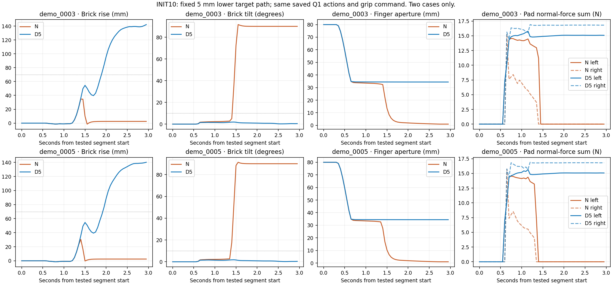
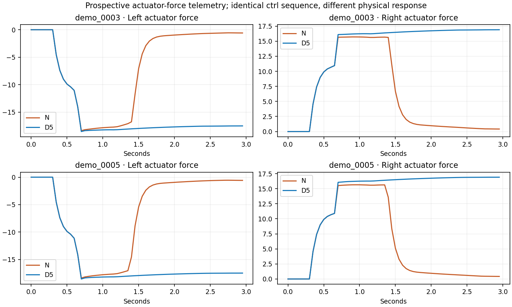
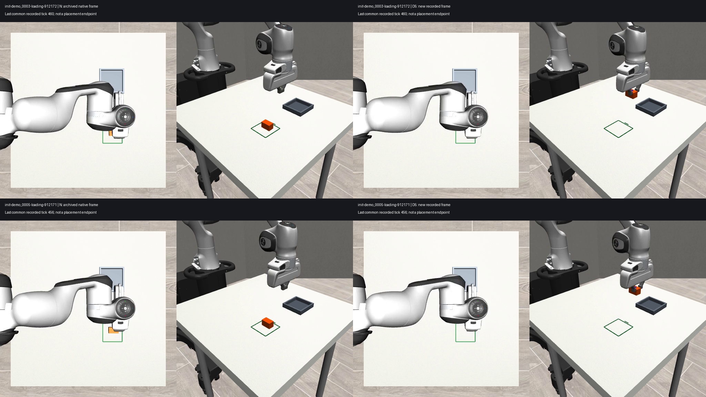

# INIT10 — A 5 mm lower wrist target retained the brick in two failed Q1 pickups

The unchanged Q1 action replay lost the brick in both selected loading cases. Subtracting 5 mm from the active-arm world-Z targets, with the same grasp commands and remaining targets, produced deeper pad contact and kept both bricks upright through a roughly 140 mm lift. This is a useful local acquisition intervention, **not a completed loading task or a newly trained policy**.

## Fixed comparison and outcomes

Four executions were run: two preselected INIT07-Q1 failures, each with unchanged targets (N) and the predetermined lower path (D5). Both conditions start from byte-identical semantic branch states. Each tests exactly 60 actions at 20 Hz and stops immediately before the original first opening. No subsequent policy query, transport correction, release, settling extension or outcome retry was executed.

| Case | Condition | Bilateral contact samples /60 | Supported rise ≥10 mm for 3 samples | Upright supported rise ≥70 mm for 3 samples + held at end | Peak rise | Final tilt |
|---|---|---:|---|---|---:|---:|
| demo_0003, seed912172 | N | 15 | Fail | Fail | 34.70 mm | 90.00° |
| demo_0003, seed912172 | D5 | 47 | Pass | Pass | 142.12 mm | 0.46° |
| demo_0005, seed912171 | N | 15 | Fail | Fail | 30.44 mm | 90.00° |
| demo_0005, seed912171 | D5 | 47 | Pass | Pass | 140.15 mm | 0.40° |

The end-held requirement means bilateral pad contact and tilt ≤10° at the final tested sample. No forbidden gripper–table or gripper–fixture contact was recorded. Full-task success is explicitly **null**, not pass or fail, because this experiment stops before release and placement. These two deliberately selected failures are not a statistical reliability estimate.

## What physically changed

| Measurement at first bilateral contact | 0003 N | 0003 D5 | 0005 N | 0005 D5 |
|---|---:|---:|---:|---:|
| Contact tick | 417 | 417 | 410 | 410 |
| Actual wrist Z above object centre | 18.169 mm | 13.224 mm | 18.191 mm | 13.249 mm |
| Lowest pad contact point in object-local Z | 13.365 mm | 8.503 mm | 13.390 mm | 8.531 mm |
| Highest pad contact point in object-local Z | 15.000 mm | 15.000 mm | 15.000 mm | 15.000 mm |
| Finger aperture | 34.811 mm | 34.823 mm | 34.810 mm | 34.844 mm |

The achieved wrist offset was 4.945/4.943 mm lower. Pad contact extended further down the side of the block instead of remaining near its top edge. The listed contact-point span is **not contact area**.

The actual gripper actuator ctrl sequence is byte-identical between conditions in both cases. Force was not strengthened in configuration. The first bilateral actuator forces are approximately −14.02/+10.96 and −14.05/+10.94 for 0003 N/D5; approximately −14.10/+10.90 and −14.14/+10.90 for 0005. Later contact-force distribution and retention differ as the physical state diverges. The force plots show that divergence; they do not establish inadequate friction or a unique force-based cause.

Call this a **vertical target-offset package**. Lowering all 60 targets can jointly alter enclosure, transient motion and force distribution. It is not an isolated experiment on friction or contact depth alone.

## Qualification and intervention isolation

- Both native 60-sample rich controller/physics traces reproduce the archived INIT07-Q1 traces with maximum numeric error **0**. Their preceding 60-action prefixes also match with error0.
- N and D5 branch-state serialized bytes match for each case. No new model weights are loaded and no model inference or training occurs.
- Saved Q1 model SHA-256: 26d573eb90f791d9af86bbff30e138f51c5aa658ac7abefe76787ba352363a7a.
- D5 differs from the original target vector only at active-arm absolute world-Z: exactly −0.005m. The other19 coordinates are unchanged. Targets are converted using each live robot pose through the original qualified absolute-to-OSC converter.
- Actuator gains, closure timing, friction, solver settings, controller bounds and timestep remain unchanged. A declared runtime abort covers gripper contact with the table or fixture.
- The discrete collision-geometry screen uses compiled mesh vertices and obstacle bounds. Its minimum gripper-to-table vertical clearance is 9.929/9.933mm. It does not certify a continuous motion path.
- Independent offline checks recompute gates, target differences, native equality, actuator commands and contact-frame transformations. All pass. Seven key tables/figures regenerate byte-identically from the self-contained reference inputs.
- Original INIT07 inputs were SHA-verified unchanged. M0/M1/M1.5 and earlier experiment outputs were not modified.

The active collision geometry remains the inherited provisional 50×35×30mm, 0.08kg object. Catalogued dimensions in provenance metadata do not make this simulated proxy a measured physical replica.

## Force recording contract

This is new prospective logging from the four executions, not reconstructed historical force data. Compiled-model mapping identifies gripper joints7/8 and actuators7/8, joint transmissions, qpos/dof indices and unit gear. The model has zero activation states.

Every natural control sample stores gripper ctrl, scalar actuator forces, generalized finger actuator forces, individual positions/velocities, complete contact records, contact-frame force/torque, and world-rotated components. Logging is asserted not to change the serialized physical/controller state; no extra forward call is made.

MuJoCo's mj_contactForce supplies a contact-frame wrench. The stored world vectors rotate those components and are not asserted to be the net force on the object. Plotted pad values sum nonnegative normal components per pad; they do not infer friction coefficients. [MuJoCo 2.3.7 API](https://mujoco.readthedocs.io/en/2.3.7/APIreference/APIfunctions.html#mj-contactforce)

Samples are at20Hz after the natural control step. Derived contacts and integrated positions have their native computation timing; intervening physics-substep force peaks remain unknown. [MuJoCo simulation timing](https://mujoco.readthedocs.io/en/2.3.7/programming/simulation.html)

## Visual QA and an explicitly preserved media defect

Visual inspection caught a defect in the **new case0005 N recording**: its final image shows a held brick and duplicates the oblique view despite the exact native physics trace showing a released, 90°-tilted brick. Multiple simultaneously live rendering contexts are a suspected cause; that root cause has not been proven. No policy consumed the newly rendered images because this was target replay.

All original recordings and the first failed presentation are retained in the raw archive. They are not silently overwritten or accepted as visual evidence.

The qualified comparison videos explicitly pair **archived INIT07 native footage** with newly recorded D5 footage at identical capture ticks. The complete first120 native physical samples match the new N replay exactly; the source video SHA and each frame tick are recorded in media-provenance.json. No new simulation or rendering was used to repair the presentation.

The contact sheet uses the last common recorded tick460/456, not an invented placement endpoint. Representative videos, in the verified raw archive under analysis-qualified/:

- init-demo_0003-loading-912172-historical-N-vs-D5.mp4
- init-demo_0005-loading-912171-historical-N-vs-D5.mp4

## Reproduction and preservation

Private code branch: research/init10-lower-path. Base commit: dcd8793d0a16c231b537678d3afaaeba817341e4; executed implementation commit: c9ee837a9661e32f82c3517743621211853a07b4. INIT09's prerequisite analysis is separately preserved on research/init09-contact-retry at 9124ce11186fe9ad889e712f0a5c267aa8bab07b.

Raw archive destination:
/media/nm/Fast Drive/Typhon/research-20261015/init10-lower-path

It includes four branch recordings/states/force traces, original source copies, scripts, clocks, planner protocol, every analysis revision, manifests and reproduction receipts. raw-verification.json records the actual destination readback rather than relying on transfer exit status. The private Git branch contains code, compact evidence and reports; bulk videos remain on Mint.

Original physical execution:
~~~sh
cd /var/tmp/typhon-worktrees-20261015/init10
.venv-sim/bin/python scripts/init10.py
~~~

The original script deliberately retains its expired fixed clock and fixed output directory. Do not reset it or overwrite this experiment to rerun physics. A future physical test needs a new declared experiment/run directory.

Read-only reproduction, using the archived source with its reference-inputs/ directory:
~~~sh
PYTHONPATH=/var/tmp/typhon-init08-analysis-deps \
  /var/tmp/typhon-worktrees-20261015/init10/.venv-sim/bin/python \
  source/init10_analyse.py \
  --source /media/nm/Fast\ Drive/Typhon/research-20261015/init10-lower-path \
  --output /path/to/fresh-analysis-directory
~~~

Run with the saved dependency versions from analysis-dependencies.json; paths may be relocated. Analysis uses NumPy, matplotlib, Pillow, imageio and its existing FFmpeg backend. It does not import the simulator or policy. Results are independently recalculated from saved traces; media are repackaged from saved videos.

Fixed experiment start23:38:48UTC; feasibility passed23:43:10; physics finished23:43:19. Archive deadline00:23:48UTC, before the conservative01:00UTC workstation cutoff. No paid pods or subagents were used.

## Decision

Proceed with the acquisition-depth hypothesis as a **local lead**, while preserving the negative INIT07 repair result. Q1 itself has not been retrained or qualified as repaired. A future test must separately establish complete transport, orientation, release and seating, cover other starts, and check that any depth rule remains compatible with obstacles and the existing successful cases.

Do not promote the fixed −5mm offset to a general runtime controller rule, add these diagnostic trajectories to training, or claim that the robot recognises the numeral better. No automatic second depth, stronger grip or training run follows this result.
