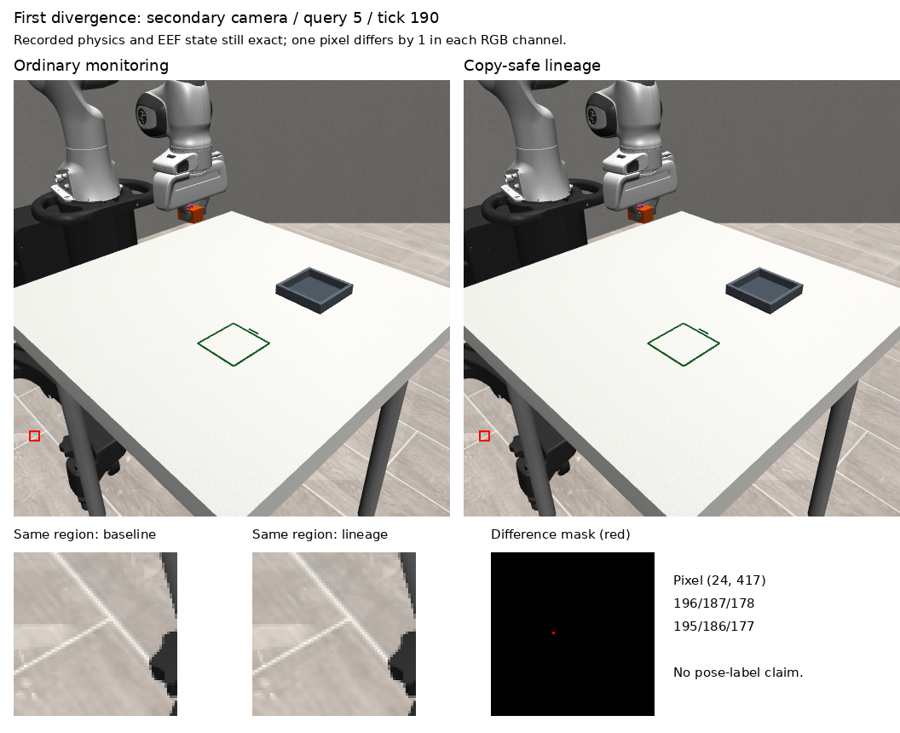

# LIVE01-P — Copy-safe camera lineage; live parity remains unqualified

The metadata fix resolves every eligible RGB reference in the tested loading episode. The preregistered live comparison does **not** pass exact behavioural parity: a one-level difference in one raw side-camera pixel precedes different model actions. Both episodes nevertheless satisfy all original strict task criteria. This is a completed diagnostic, not permission to grant the observer control authority.

## Frozen test

- LOAD04 B full-weight Pt checkpoint `de861da493be2a851e2fae5289f798cd34ff714e120f974f9c2197847732e379`, 3,000-step model, unchanged O2/current-image actor, domain29 and existing rotation contract.
- Loading training family `demo_0002`, simulation seed131902, policy seed912171. Original 1,500-tick horizon:40 reset +1,436 policy +24 passive settle, H30 at20Hz, 10 denoising refinements.
- Two actual inference runs, ordinary monitoring then lineage-enabled monitoring, no retries or additional physical episodes.
- Both use the same OBS06 passive observer and publisher on each existing actor-query observation. Final publication reuses the last pre-action observation. This fixed query cadence is declared here; it is not the old LIVE01-T wall-clock publisher cadence.
- No training, holdout use, simulator-truth control, added render/forward calls, altered motor policy, gains, termination or model inputs. Observer outputs are discarded. Monitoring is checked for changes to physics/controller/Python/NumPy state.

## What changed

`RGBLineage` assigns an explicit run/camera/capture-sequence/control-tick ID at the original render call. An observation-call scope links the actual camera capture to the array produced by the real `policy_observation` copy. Pixels are checked for integrity but never used as acquisition identity. A weak-reference registry avoids retaining discarded camera arrays.

The worker records the **actual** O2 crop and processor resize operations and ties each prepared tensor slot to its capture. Capture time stays unchanged through history copies and republication; publication has its own event/time. Unregistered or mutated arrays remain unknown. No metadata is passed as a model input.

The existing publisher gains only its previously tested optional `metadata_provider` argument. Original dataset, frozen reports and old branches remain unchanged. The worker is the unchanged native LOAD04 worker plus an optional preprocessing observer; both live modes use the same worker source.

## Results

| Measure | Ordinary monitoring | Copy-safe lineage |
|---|---:|---:|
| Strict task success | yes | yes |
| Position error |10.885264mm|10.909314mm|
| Directed yaw error |0.708248°|0.709738°|
| Actual model queries |48|48|
| Executed control ticks after reset |1,460|1,460|
| Wall time for episode |18.96s|24.59s|

Both pass position, orientation, marked-face-up, footprint containment, placement height, release, stability and seated criteria. The extra wall time is one paired observation, not a performance benchmark.

**Lineage qualification passes:**3,704 distinct captures;6,365/6,365 eligible references resolved with0 unknown. Counts include2,968 copied-image references,2,968 observation references,96 actor-query references,96 observer references,98 publication references and139 valid prepared tensor slots. Five padded tensor slots are explicitly generated zeros, not camera captures. The final published images correctly retain a capture age of25 control ticks.

**Live parity fails:** first150 executed states and first five action chunks are exact. At query index5, tick190, the side view differs at one pixel `(x=24,y=417)`: RGB196/187/178 versus195/186/177. The primary view and recorded physics/EEF state are still identical. Image preprocessing therefore receives different input; predicted actions differ from query5, physics from tick191. All48 generated-noise sets and all144 saved RNG/noise arrays match exactly. The rendering/timing cause is unresolved.

**Offline isolation passes:** processing all48 saved candidate observations with and without the crop/resize observer reproduces the same prepared tensors and their saved live hashes. No additional physics or model forward calls were made.

**Archival counter-evidence:** the new lineage run exactly matches the earlier frozen DATA07-R native B run: all48 camera/proprio/action arrays, all1,460 rich controller rows, all1,460 trajectory rows, and final truth. The new ordinary-monitoring run differs from that archive at the same sixth query. This supports investigating capture repeatability; it does not retroactively replace the failed preregistered comparison.



The marked pixel is on the background floor. This visual localisation does not explain its numerical change.

## Fixture coverage and limitations

Eight checks pass: actual observation copy; identical pixels at different capture ticks remain distinct; history preserves capture time; actual O2 crop and CLIP resize retain source lineage; republication changes publication metadata only; unregistered arrays stay unknown; mutated registered arrays stay unknown; prepared tensors remain exact for identical input.

Native LOAD04 B has no RGB history. History handling is qualified by a component fixture only. This is one training scene with one checkpoint, not evidence of generalisation, observer accuracy or safe control authority. Pose/proprio timing and control telemetry remain separate from RGB provenance; metadata cannot turn their existing derived-state timing into a newly measured sensor sample.

## Reproduce and inspect

Run from this branch/worktree on Powerglide using the existing environment aliases and cached model files:

```bash
.venv-xvla/bin/python scripts/live01_p_fixtures.py
# prepare requires a fresh output namespace; it refuses to replace protocol.json
.venv-sim/bin/python scripts/live01_p_run.py prepare
.venv-sim/bin/python scripts/live01_p_run.py run
.venv-sim/bin/python scripts/live01_p_analyse.py
.venv-xvla/bin/python scripts/live01_p_offline.py
.venv-sim/bin/python scripts/live01_p_archive_compare.py
```

The frozen output namespace is `/var/tmp/typhon-live01-p-20261015`. Do not rerun into it. The original simulator interpreter alias used for execution is recorded in `launch.json`; preserve that alias when matching model asset paths. For a new replication, select a new namespace and freeze a new clock/protocol before execution.

Saved raw evidence includes both videos, original/final PNGs, all raw model actions and actor RGB, per-query prepared tensor hashes, initial prepared tensors, actual noise/RNG arrays, full physics/controller snapshots, traces, observer/publication events and complete camera lineage. Reports and small summaries are in this branch; bulk evidence is mirrored with SHA-256 verification to Mint.

Preflight: the first prepare import found the legacy observer's `video06_motion` dependency missing; its unchanged source was copied before protocol freeze or any physical execution. The first strict analyser stopped on tick191; its failed log is retained, then the analyser was extended to report all comparison failures without changing their criteria. An initial offline reader inefficiently re-expanded compressed arrays and timed out; it was replaced with one read per array. No rollout was restarted.

## Decision

Keep the component fix in its isolated research branch. Do not promote live equivalence or grant control authority. Next investigate capture repeatability at the first divergent image, using saved state and images where possible, before spending more physical rollouts. AlphaNIST remains parked.
