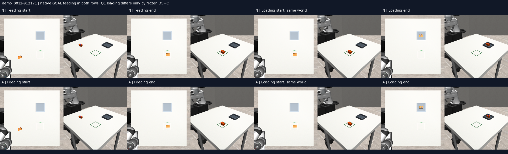
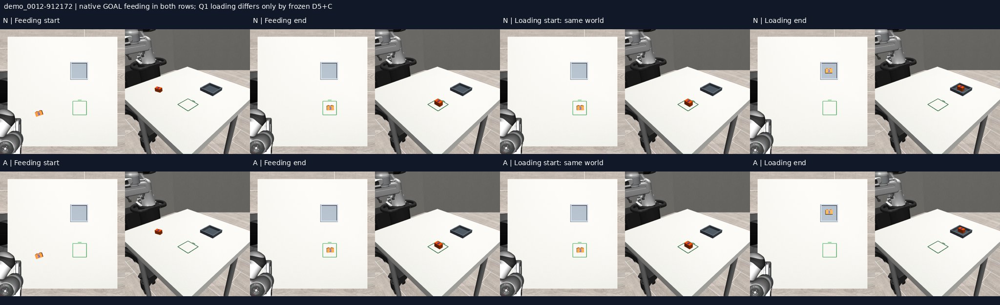
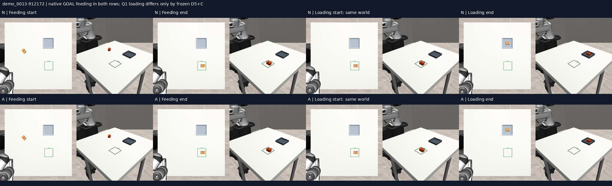

# HIER02-LIVE-R1: feeding and loading in one continuous simulation

Native GOAL feeding followed by native Q1 loading completed all four fixed workflows. Adding frozen D5 acquisition assistance and open-gripper clearance also completed all four, with no additional strict successes or forbidden-contact reductions. Both conditions had zero recorded forbidden contacts and no joint-limit violation on this panel.

This establishes local composition of two existing policies across four inspected handover endpoints. It does not establish broad task transfer, autonomous completion detection, or recognition of the blue numeral. Two personally derived scenario families and two seeds provide four matched cases, not eight independent recordings.

| Outcome | Native loading | Assisted loading |
|---|---:|---:|
| Complete feeding→loading workflows | 4/4 | 4/4 |
| Feeding strict success / supported pickup | 4/4 / 4/4 | 4/4 / 4/4 |
| Loading strict success / supported pickup | 4/4 / 4/4 | 4/4 / 4/4 |
| Forbidden-contact stages | 0/8 | 0/8 |
| Joint-limit violation stages | 0/8 | 0/8 |
| Primitive failures/timeouts | 0 | 0 |
| Gained / lost complete workflows relative to native | — | 0 / 0 |

## What actually ran

The unchanged physical scenes are HIER01-DEV demo0012 and demo0013, each with simulation and policy seeds 912171/912172. Both stations are present throughout. GOAL-varied moves the brick from the personally derived start to the outlined staging square. Q1 then moves it from the actual resulting state into the shallow fixture.

Each workflow has one initial 40-tick reset, followed by 1,436 policy actions and 24 passive scoring ticks per task. The switch is at the fixed horizon, regardless of scientific success. There is no world reset, robot home, archived-action prefix, state injection or extra settling at handover. Simulator, controller, solver and contact state stay live. The first loading proprioceptive input is measured at handover; subsequent history uses the actual issued first 9 float32 values plus 11 zeros. Actual previous OPEN is required by the unchanged instrument; all eight handovers met it.

Native GOAL feeding is identical in both conditions. Only loading may receive frozen INIT14 D5+C. D5 retains the native gripper command while changing the acquisition-height path for 60 actions; the clearance primitive then issued 5 open-gripper actions in each assisted loading execution. Neither primitive activated during feeding. There was no new training, candidate search, TTC or outcome-based retry.

## Models and source identity

| Component | Identity |
|---|---|
| Scientific runner parent |55ff6aeba5ff371d3df170aece2a431e9289b440|
| Prepared runtime/scorer source |5abad631234fb28d15deb7111d94b0aedc4963bb|
| GOAL-varied feeding weights |d5449244d96e55e60c3342af9fffe2ae64362b74cdf9c3d41e39b74995c9bcdb|
| Q1 loading weights |26d573eb90f791d9af86bbff30e138f51c5aa658ac7abefe76787ba352363a7a|
| Media-only encoder repair source SHA |ac39f5cf841237fb7f3d77b8fa7b92e7423c0b1e4a96ecc3625812898e4245a1|

The complete configuration is in [protocol.json](protocol.json). This retained the prior canonical M2 solid-body surrogate: 50×35×30mm and 80 g, with visual version duplo_31110pb074_v2. Those values are provisional simulation settings; inherited catalogue metadata also contains a different physical estimate. Neither physical scale nor the user piece was newly calibrated or measured here. Personal observations define the scenario starts under the declared virtual mapping; robot action supervision in these models came from simulator expert trajectories, not validated dense phone-frame/Panda-action labels.

## Position, orientation and grasp outcomes

Strict success requires position error ≤15 mm, directed yaw error ≤10°, marked face upward within 10°, complete footprint in the destination, correct placement height within 2 mm, release and stability. Stability thresholds and evaluator code remain unchanged. A supported pickup here additionally requires bilateral contact with a ≥10 mm lift for ≥3 consecutive samples; all 16 stages met that condition and had one evaluator-verified grasp.

Orientation improvement means initial angular error minus final angular error. Actual object rotation is reported separately; a turn can cross the ideal angle, so these quantities need not match.

| Scenario / seed | Feeding start error° | Feeding final error° | Error reduction° | Actual turn° | Final position error mm |
|---|---:|---:|---:|---:|---:|
|demo_0012-912171|18.414|1.428|16.986|16.986|4.553|
|demo_0012-912172|18.414|1.260|17.154|17.154|4.918|
|demo_0013-912171|52.981|1.760|51.221|54.740|10.947|
|demo_0013-912172|52.981|1.826|51.155|54.807|12.554|

Feeding outputs were exactly shared by the matched native/assisted pair. Loading began close to the correct yaw; this is primarily a second placement, not a large-angle repair test.

| Scenario / seed | Native position mm | Assisted position mm | Native yaw° | Assisted yaw° |
|---|---:|---:|---:|---:|
|demo_0012-912171|6.096|5.207|1.032|0.170|
|demo_0012-912172|3.225|7.784|1.019|0.249|
|demo_0013-912171|2.743|4.978|0.795|0.368|
|demo_0013-912172|4.803|7.250|0.982|0.626|

The assisted yaw error is lower in these four cases, while its position error is lower in only one. These are small, inspected, paired observations with a success ceiling. They do not support an assistance-superiority or generalisation claim. All per-stage values, including initial error, error reduction, physical turn and joint margin, are in [episodes.csv](results/episodes.csv).

## Integrity checks and limitations

- Both restored models passed exact fresh probes; four reset-only scene checks passed before evaluation.
- All 16 task scores were independently recomputed from saved artifacts; all 16 issued-history paths passed validation.
- All 8 full-state handover boundaries were verified byte-for-byte. No simulation state changed when constructing the next request.
- All 4 matched feeding runs were exact across raw camera frames, prepared inputs, noise, actions, history, controller trace and terminal state. Loading inputs/actions were exact before the assistance trigger in all 4 pairs.
- All four new native feeding endpoints matched their corresponding historical ledger in the inspected object/wrist/aperture values and final frame SHA. This descriptive check is not a claim that pose equality alone proves full historical simulator-state equality. The previous Q1 evidence still covered only one feeding prefix; this run actually executes loading after all four endpoints.
- This does not clear INIT14's broader failure: a prior loading case never emitted CLOSE and both variants failed with a joint excursion; fixture-free contexts were unsupported by that instrument. Those outcomes remain unchanged.
- Two inspected families are insufficient for an independent-session reliability estimate. No holdout was consumed, no failed case replaced, and no statistical superiority claim is made.
- The fixed task switch is supplied. A learned phase selector, qualified visual completion detector, recovery policy, and reverse workflow were not tested. Safe operation on hardware is not established.

## Saved visual evidence

All four fixed contact sheets were inspected by Codex and show the intended start→staging square→fixture sequence, matching the trace-based scores. The label overlay and gallery resizing affect presentation only. Seeing a numeral in a contact sheet does not show that the policy used it.








Two preselected native-versus-assisted videos are preserved in the full archive under visual-review/: demo_0012-912171-native-vs-assisted.mp4 and demo_0013-912171-native-vs-assisted.mp4. Each is H264, 1536×384, 734 frames at 5 fps. The stage boundary is 73.4 seconds in the saved comparison. Playback represents simulation time; model-load pauses are omitted. Original RGB sequences and sixteen per-stage videos remain in the archive.

The initial video export failed because /usr/bin/ffmpeg lacked libx264. That failure and the halted automatic archive attempt are preserved. A separate media-only revision uses the already-installed imageioFFmpeg encoder and a Pillow-generated caption. It rerendered no simulator frames and made no model calls. Both corrected outputs passed frame-count, codec and dimension checks.

## Timing, storage and reproduction

- Activation: 2026-10-16 05:21:33 UTC. Physical completion: 2026-10-16 05:30:07 UTC; elapsed 8.57 min.
- Median per-stage recorded execution time: 16.81s for 73 s of simulated control. Model reloads and preparation are outside that stage timer; no real-time claim.
- Verified full archive: 2,184files, 501,543,926bytes; zero SHA errors, completed 2026-10-16 05:34:02 UTC.
- Archive manifest SHA: 5bed1ee3787f8cc0a6b6a01886f0a23ff95f2c097dc2e36ded246accc3b9ecb9.
- Full archive: /media/nm/Fast Drive/Typhon/research-20261015/hier02-live-r1-20261016.
- Original HIER02 preparation failed before any model call or rollout. Its clock and zero-outcome record remain intact. RESTORE-GOAL then recovered the exact checkpoint in 46m55s, after which this separate R1 clock began.

Actual commands on Powerglide, with the existing environments, were:

```bash
cd /var/tmp/typhon-worktrees-20261016/hier02-live-r1
MUJOCO_GL=egl PYOPENGL_PLATFORM=egl .venv-sim/bin/python -u scripts/hier02_live_r1.py
.venv-sim/bin/python -u scripts/hier02_live_r1_analyse.py
.venv-sim/bin/python -u /var/tmp/typhon-hier02-live-r1-20261016/media-v2.py
```

The source-equivalent media repair is scripts/hier02_live_r1_media_v2.py. The one-shot activation script, fixed protocol, checkpoint receipts and saved command pipeline are included under evidence/. They intentionally refuse to reuse the recorded output namespace. Fresh physical replication needs a new namespace and activation clock while retaining the frozen scientific settings; never overwrite this execution.

For an independent saved-artifact reanalysis, use the pinned runtime environment and a new output path:

```bash
PYTHONPATH="$PWD/scripts:$PWD" .venv-sim/bin/python -c \
  "from pathlib import Path; import hier02_live_r1_analyse as a; a.O=Path('/var/tmp/typhon-hier02-live-r1-20261016'); a.OUT=Path('/var/tmp/hier02-r1-independent-review-new'); a.main()"
```

This reads saved model inputs, predictions, controller traces and full-state handover receipts. No model inference, rendering or physics is needed. The full archive must be mounted or copied to the declared source path. Prior M0/M1/M1.5, earlier training outputs and frozen evaluations remain unchanged.

## Decision

Keep native GOAL→Q1 as the reference for this local continuous workflow. Preserve D5+C as a separately identified assistance variant, because this panel provides no added task-success benefit. The next experiment should target a specific unresolved transition, observation or prior-context failure rather than repeat these already-solved starts or train indiscriminately. The OST research programme remains active.
