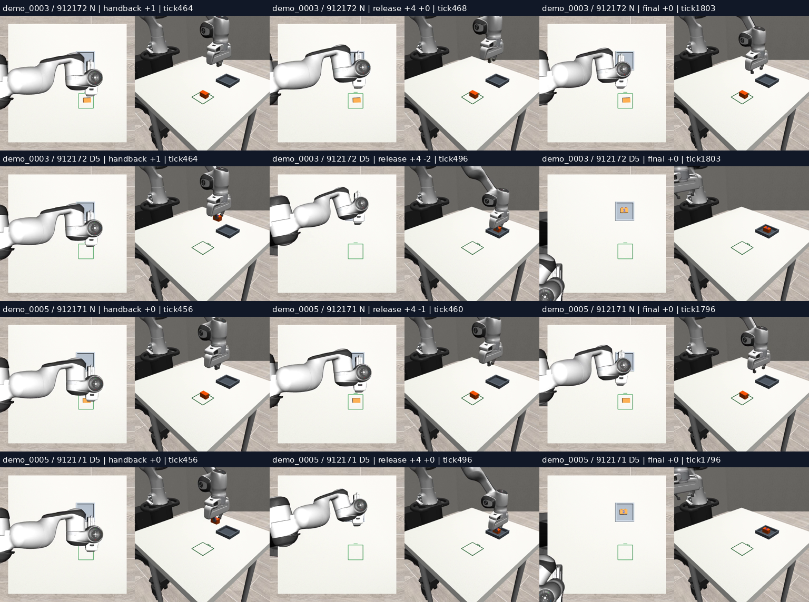

# INIT11-R — assisted acquisition followed by unchanged Q1

A fixed 5 mm lower acquisition path rescued both selected loading failures. After that 60-action segment, the unchanged Q1 model completed both tasks, including release and stable placement. Native controls failed both cases. This is a diagnostic on two previously inspected failures, not a population success estimate or a new trained policy.

| Selected loading case | Native strict success | D5 then Q1 strict success | Native position error | D5 position error | D5 yaw error |
|---|---:|---:|---:|---:|---:|
| demo0003 / seed912172 | 0/1 | 1/1 | 263.07 mm | 7.84 mm | 1.045° |
| demo0005 / seed912171 | 0/1 | 1/1 | 258.53 mm | 9.38 mm | 0.916° |

The D5 runs each recorded one successful grasp and no retries. Native runs recorded no verified successful grasp; the brick ended on its side outside the loading target. Position, yaw, marked-face-up, footprint containment, height, release, stability and seating all passed in the two assisted continuations. The independent scorer reproduced every saved criterion with floating-point differences below the existing 1e-12 comparison allowance.

## Interpretation

The learned policy can finish these loading episodes once acquisition leaves an upright held brick. The 5 mm segment changes the reached state; it does not improve the learned weights or establish that the policy can choose the adjustment itself. This supports testing acquisition-specific repair, with a prospective preservation check, rather than assuming the whole loading skill is absent.

The intervention timing and depth were fixed from earlier inspected diagnostic cases. They are not a generally deployable grasp rule. No claim follows about unseen objects, new layouts, blue-numeral recognition, calibrated real-world grasp depth, or general task transfer.

## Runtime restoration

The first INIT11 attempt produced no physics: it failed its strict reload probe because the restored worktree selected an older executable model/cache package. INIT11-Q retained all six prespecified comparisons, showing four stable mismatches in the wrong context and two exact matches in the original Q1 context.

This new attempt restores the entire original cache, freezes its resolved path and 13 code/configuration file hashes, and preserves the failed attempt. Both fresh worker probes passed exactly. All 88 archived input/noise/action comparisons passed exactly before physics. Checkpoint SHA256: 26d573eb90f791d9af86bbff30e138f51c5aa658ac7abefe76787ba352363a7a. Probe SHA256: 9ddf8971546fd494bfc56b53586e091e039a2c809e012931d21e5be519f552e5.

The complete resolved module/class and parameter-identity audit is retained in INIT11-Q context C. INIT11-R pins that cache and unchanged source, and requalifies its execution; it does not duplicate the full module-class inventory inside each R actor process. Original-context EE6DActionSpace is selected by the pinned ee6d registry. The differing XYZ_SCALE constant appears in compute_loss; no training or compute_loss call occurs in this inference experiment. The context discrepancy is not attributed solely to attention or that constant.

## Fixed execution contract

- Four serial branches: native and D5 on each of the same two loading cases.
- The original simulator/controller, preceding state and 60-action prefix are retained. Every INIT10 branch and segment comparison passed with maximum rich-state/force difference 0.
- D5 subtracts exactly 0.005 m from Z for the predeclared 60 issued targets. Other action channels remain unchanged.
- Native Q1 resumes at query 4, state tick 463 or 456, next action 464 or 457.
- Native history contains the first nine values of the last actually issued target, cast to float32, and eleven zeros. D5 history includes its issued Z.
- Exactly 1,316 predicted policy actions and 24 passive scoring ticks remain. No extra horizon, forced release, compensating movement or new guard is introduced.
- Each continuation query receives current branch RGB and its own previous target history. Archived future images are used only for the offline 88-query qualification.
- Each generation restores its predeclared saved CPU/CUDA RNG packet and checks the actual noise arrays. Qualification has no live query counter; native query 4 input and action are independently exact.
- No simulator truth is fed to Q1. Truth supports independent scoring, physical prefix equality and the declared intervention safety screen.
- No training, parameter change, outcome retry or inclusion of these diagnostic trajectories as training labels.

D5 handback retains bilateral support. In demo0003 the first opening target is tick 494 and bilateral contact disappears at 498; in demo0005 those ticks are 492 and 496. Both release inside the target and remain stable. Native hands open immediately at handback with the unsupported brick left at the source.

## Artifacts and reproduction

Private execution commit: ce8fe81aa966bb9d2fbcf651950dd84b91905687, branch research/init11r-restored-handback-20261016. The runner calls the unchanged INIT11 comparison/scorer after its restoration gates.

~~~bash
.venv-sim/bin/python scripts/init11r.py
python3 scripts/init11_analyse.py /var/tmp/typhon-init11r-20261016 /var/tmp/typhon-init07-20261015
~~~

A new reproduction requires a fresh output namespace and explicit approved-runtime clock; never reuse or overwrite these frozen outputs. The input/source manifests and approved booking are saved alongside clock.json and execution-freeze.json.

Each branch retains rollout.mp4, full trajectory and continuation traces, predicted chunks/history, RGB policy inputs, noise/input audits, handback snapshots and all scoring evidence. Videos are1024 × 512 with both camera views; frame counts match the recorded simulation-tick mapping. The contact sheet uses actual saved video frames, with a separate provenance record.

Original INIT07, INIT10, INIT11 and INIT11-Q results remain unchanged. The stored episode experiment label remains INIT11 because the scientific comparison is unchanged; the INIT11-R output directory and launch manifest identify the corrected attempt.

## Reviewed media and backup

The second and fourth rows show the D5 brick retained in the gripper, then placed upright inside the loading fixture. Native controls leave it tipped at the source. These are saved rollout frames, not synthesized predictions. The corrected v2 labels identify each source case/seed and the offset from the requested event tick; the original v1 figure is retained in the archive.

The primary archive contains 646 files / 116,877,447 bytes with zero SHA-256 mismatches, including all four videos and the full model-input/action traces. The small v2 media addendum is separately verified. No model or dataset is stored on the Mac.
