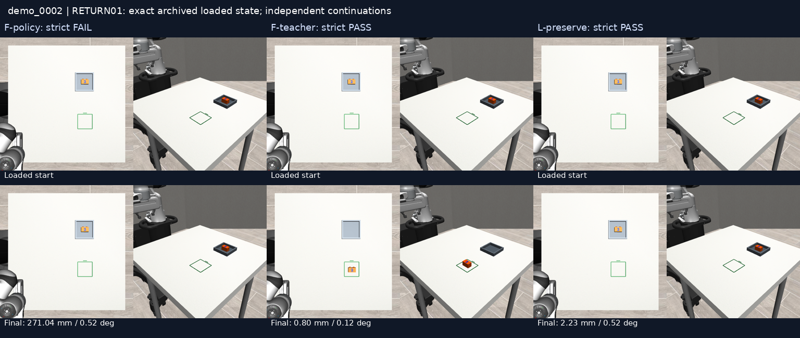

# RETURN01: can a loaded fixture state initiate feeding?

The native GOAL-varied policy returned the brick to the feeding square in **0/2** cases. The unchanged expert achieved strict feeding endpoints in **2/2**, but both traces touched a fixture wall during descent, so **0/2 qualify as positive extraction demonstrations** under the frozen zero-contact rule. Both 60-tick loading-preservation references qualified.

The learned policy did not initiate the reverse task. The existing expert can finish it but needs a separately qualified descent before its extraction labels are admitted. No training ran and no active training manifest changed.

## Fixed comparison

Two original strict-qualified LOAD04 loading trajectories were replayed in full: training parents `demo_0002` and `demo_0005`, with 303 and 295 archived commands respectively. Release, retreat, parking and settling were included. Per-step truth, measured joints and terminal simulator/controller state matched the archive. Each continuation independently reconstructed that state. These are expert-derived training-family states, not learner-visited DAgger states or new held-out trials.

The two loaded block positions are only **0.09784 mm apart**. They represent one narrow initiation region, despite originating from different source parents. The original M2 physical proxy, fixture, staging square, cameras and controller remained unchanged; this is the existing engineering layout, not newly calibrated human dimensions.

| Parent | Continuation | Supported pickup | Inside requested target | Final yaw error | Position error | Strict endpoint | Forbidden-contact samples | Candidate gate |
|---|---|---:|---:|---:|---:|---:|---:|---|
| demo_0002 | F-policy | no | no | 0.516° | 271.036 mm | fail | 0 | not applicable |
| demo_0002 | F-teacher | yes | yes | 0.120° | 0.804 mm | pass | 1 | rejected |
| demo_0002 | L-preserve | no | yes | 0.516° | 2.229 mm | pass | 0 | preservation qualified |
| demo_0005 | F-policy | no | no | 0.496° | 271.033 mm | fail | 0 | not applicable |
| demo_0005 | F-teacher | yes | yes | 0.120° | 0.800 mm | pass | 4 | rejected |
| demo_0005 | L-preserve | no | yes | 0.496° | 2.140 mm | pass | 0 | preservation qualified |

Supported pickup requires bilateral contact, an upright brick and at least 70 mm lift for three consecutive 20 Hz samples. Strict endpoint success requires position, directed yaw, upright face, footprint containment, placement height, release and measured post-release stability. Contact and joint-limit checks are additional engineering gates: an endpoint pass does not establish a qualified teaching trace.

Native checkpoint SHA-256: `d5449244d96e55e60c3342af9fffe2ae64362b74cdf9c3d41e39b74995c9bcdb`. Its fresh-process probe matched exactly. O2, domain29, bf16, H30, 10 refinement steps, seed912171 and the full feeding instruction were fixed. Each native continuation executed 1,436 predicted actions and 24 settling ticks. First-query proprioception was measured; subsequent queries used the previous issued target history. Actual raw images, prepared tensors, noise, predictions and controller traces are retained.

The teacher reused unchanged `scripted_attempt` with its original two-attempt allowance, parking and 24-tick tail. Each succeeded on its first attempt in 246 total actions. Preservation used the existing measured-pose/open hold for 60 actual ticks. Model history was fresh while the physical world and controller state were preserved. Changing the request did not change the scene geometry or physical state.

## Failure diagnosis

Neither native continuation approached or touched the block: closest measured end-effector distance was 568.287 mm and 561.928 mm; the gripper never became closed; block displacement and lift were zero. Both kept the nearly upright brick in the fixture, approximately 271 mm from the requested feeding destination. A low final yaw error here is not task completion. This experiment does not establish whether the model recognised the numeral 2.

Both teachers produced 75 bilateral-contact samples, including 44 consecutive upright samples with at least 70 mm lift. Maximum lift was about 148.44 mm. All approach, descent, lift, transfer, placement, retreat and parking checks converged. All six continuations avoided joint-limit excursions; minimum joint margin was 0.302 rad.

The disqualifying contact was `fixture_wall_1` against `gripper0_finger2_collision` while the gripper command remained open. It occurred at zero-based continuation sample66 for parent0002 and samples64–67 for parent0005, during the 16-step descent after the 52-step approach and before closure. Signed contact distances ranged from −4.176 to −9.454 micrometres. These are shallow simulator contacts; force magnitude was not logged, so impact severity is unestablished. The predeclared zero-contact rule remains unchanged.

This saved-trace diagnosis added no physics, proposals, tuning or fitting. Both preservation traces maintained loading success with zero measured block displacement and zero object or forbidden contacts.

## Data qualification

Each teacher candidate contains 246 aligned absolute-action targets, 62 pre-action image pairs and 55 complete 30-action windows. Both remain rejected extraction candidates. Each preservation candidate contains 60 actions, 15 standard image-pair samples, eight full 30-action windows and a separate dense archive of all60 raw pre-action observations. Only the two preservation candidates qualified.

Personal observations supplied the original scenario provenance. Robot commands and camera sequences came from simulation and the expert; these are not aligned human-video motor labels. No candidate entered a training bank.

## Visual evidence

“Strict PASS” on these sheets refers to endpoint scoring only. Both teacher columns fail the separate zero-contact qualification gate.




Two native-versus-expert videos are in the Mint archive at `visual-review/demo_0002-policy-vs-expert.mp4` and `visual-review/demo_0005-policy-vs-expert.mp4`. They show simulation time at1×, freeze the shorter clip at its recorded endpoint and exclude model-loading pauses. All original per-branch videos remain available.

## Verification and reproduction

- Activated 05:45:09 UTC; qualification passed 05:55:11 UTC, inside the15-minute limit.
- All six continuations finished 05:57:19 UTC; no technical failures or outcome retries.
- Mint backup verified 06:01:02 UTC: 423 files, 307,435,338 bytes, zero SHA errors.
- Archive manifest SHA-256: `f2bba60f556413df2101b22371f7eeac6e5fecae8eee13bf8d504e5af4c6600b`.
- Runtime source: `9a2b26030d890a2c75294e5393856347d3ceeef4`; private branch `research/return01-fixture-extraction-20261016`.
- Analysisv1 stopped on NumPy scalar JSON serialization. V2 fixes serialization only; original code and failed log remain. No physics or model execution repeated.

Recorded commands:

```sh
cd /var/tmp/typhon-worktrees-20261016/return01
.venv-sim/bin/python -u scripts/return01.py
.venv-sim/bin/python scripts/return01_analyse_v2.py
.venv-sim/bin/python scripts/return01_media.py
```

The archived protocol, clock, execution freeze, source hashes, initial-state files and per-branch request files define the inputs. These commands were run against those precreated files. Existing outputs deliberately reject overwriting. A new replication requires restoring the exact sources/checkpoints/inputs and preregistering a new output directory and clock; do not run over this sealed experiment.

Full archive: `/media/nm/Fast Drive/Typhon/research-20261015/return01-20261016`. Small evidence and contact sheets are in the private branch; bulk arrays and videos stay on Mint. Frozen M0–M7, earlier evaluations, holdouts and HIER02 results are unchanged.

## Decision

Do not train the rejected extraction candidates. The next experiment should diagnose contact/clearance or test a prospectively fixed teacher-descent repair while retaining the original success and contact gates. A later learning experiment may use qualified extraction and preservation examples; these results do not establish that such training will succeed.
