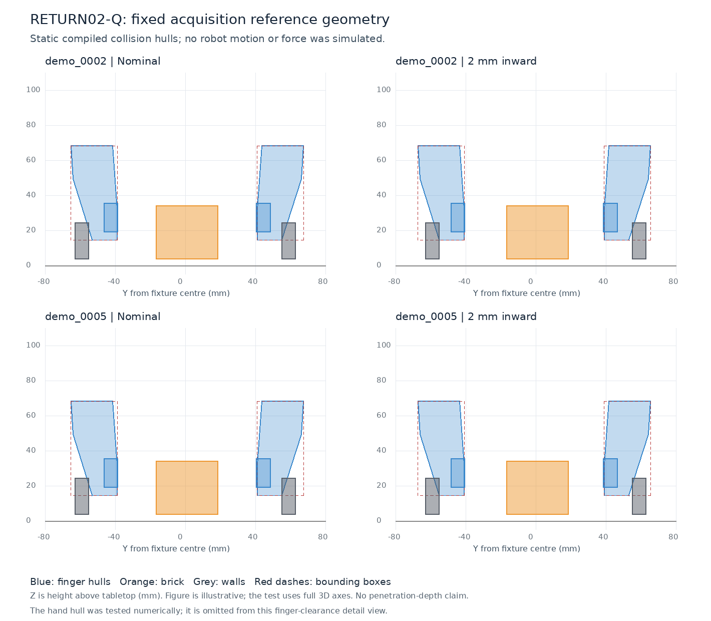

# RETURN02-Q — fixed-corridor collision screen

The fixed 2 mm shift remains rejected: the detailed convex-hull test confirms overlap at the sampled low acquisition references. The original bounding-box screen was overconservative for one pair, but this did not change the candidate's eligibility. No robot continuation, policy inference, training or force simulation ran.

## Results

Each reference checks five gripper collision geometries against seven obstacle geometries. These are geometry comparisons, not independent trials or success-rate denominators.

| Source parent | Frozen references | Nominal overlap checks / total | Inward overlap checks / total |
|---|---:|---:|---:|
| demo_0002 | 3 | 4 / 105 | 4 / 105 |
| demo_0005 | 6 | 9 / 210 | 9 / 210 |
| Total | 9 | 13 / 315 | 13 / 315 |

The nine references include two pregrasp references and seven low references. Each condition has 302 certified separations and 13 convex overlaps; none is numerically unresolved. Thirteen of the inward candidate's fourteen AABB warnings survive the detailed test. The remaining warning has a 0.145 mm separating-axis gap. Relevant contact masks allow all overlapping pairs; their bodies are distinct.

The shift improves the finger-2/wall-1 gap while worsening finger-1/wall-0. It does not create a clear acquisition corridor. Negative projection gaps in the tables are **not measured penetration depths**. These are nominal reference configurations; the earlier teacher's realized wrist poses differed. Therefore this result neither erases its endpoint success nor upgrades it to clean execution.



The figure shows Y–Z projections at each parent's lowest frozen reference. The numerical test uses the full 3D convex geometry. The hand hull is included in the numerical checks and omitted from the finger detail figure.

## Qualified method

The existing CTRL03 convex-hull / oriented-box separating-axis implementation was reused. Its axes include both polyhedra's face normals and gripper-hull edge × box-axis cross products. Read-only instrumentation exports the maximizing axis and both projection intervals. Existing float64 calculations and the 1e-10 edge-cross cutoff are unchanged. A predeclared 1 nm classification guard keeps near-zero values unresolved; no tolerance was tuned to these outcomes.

Three analytic controls passed: identical intersecting boxes, a known 50 mm separation, and oriented shapes whose AABBs overlap despite a known 20 mm separation. The independent saved-array audit recomputed all 630 exported certificates, with a maximum interval/gap difference of 3.33e-16 m. A portable replay of the full existing SAT helper reproduced all 630 outcomes with zero numerical difference.

The audit compiles an existing Panda model snapshot and uses the exact archived RETURN02 body and site poses. This avoids the small one-substep discrepancy from recomputing forward kinematics. All saved collision-geom bounds and all original AABB warning pairs were reproduced. Compiled vertices, effective geom-local and world transforms, source XML and collision mesh hashes are retained. RETURN02 had not saved a separate compiled-vertex snapshot; provenance is reconciled through the installed model assets, compatible compiled geometry and exact saved-bound checks.

MuJoCo 2.3.7 does not expose separate mesh_pos/mesh_quat arrays through this Python model object. The effective compiled geom transforms are authoritative; no extra mesh transform was applied. MuJoCo uses convex hulls for mesh collision, so rendered hollows or apparent taper alone cannot establish clearance. [MuJoCo computation documentation](https://mujoco.readthedocs.io/en/2.3.7/computation.html).

All relevant configured margins and gaps are zero, with no explicit contact-pair or exclusion overrides. A positive geometric gap is interpreted against the contact threshold; contact-list inclusion and force activation are different concepts. [MuJoCo geometry reference](https://mujoco.readthedocs.io/en/2.3.7/XMLreference.html#body-geom).

The fixed canonical simulator proxy remains 50 × 35 × 30 mm, 0.08 kg, as in these frozen experiments. This audit does not replace it with a measured physical DUPLO model or change any prior configuration.

## Disposition and limits

Keep RETURN02 rejected and park this local offset-repair branch. No further aperture, wrist, height or offset search is authorized by this result. The unchanged four E0/E2 continuations remain unexecuted. RETURN01's two extraction candidates remain rejected for recorded forbidden contacts; its two preservation candidates remain separately recorded. No candidate entered an active training bank.

This establishes a reference-geometry limitation, not continuous dynamic safety, impact severity, visual recognition, human-video action recovery or task generalization. The two source terminal states are only about 0.098 mm apart and are not independent holdouts.

## Reproduce from the small exported arrays

From this branch's repository root:

```bash
.venv-sim/bin/python scripts/return02q_reproduce.py \
  experiment-history/2026-10-16-return02q/reproduction \
  /tmp/return02q-reproduced.json
```

The replay requires Python, NumPy and SciPy; it needs neither MuJoCo nor a GPU. It uses the existing archived SAT function and geometry arrays and writes a separate validation file. The original clock-gated simulator-side audit is retained in scripts/return02q.py, with its historical inputs and execution freeze; do not reset its clock to manufacture another experiment.

## Execution and preservation

- Runtime source: 19aa68a5a553b75302b052dd28b6106fdeacce3a, private branch research/return02q-collision-screen-20261016.
- Clock began 06:35:03 UTC; helper/input qualification passed 06:43:12; all comparisons finished 06:43:23.
- Independent projection audit finished 06:45:20. The portable complete-SAT replay also passed.
- Verified Mint archive v2: 48 files, 1,086,981 bytes, zero hash errors.
- Archive manifest SHA-256: 5b6959b64fc5e3c7afaa39a5961fb6d29b3f49a2efe1fde0c5c6d3fe3a74cfda.
- Raw archive: /media/nm/Fast Drive/Typhon/research-20261015/return02q-20261016.
- Ticket: 11097. Original M0/M1/M1.5, RETURN01, RETURN02, checkpoints and holdouts unchanged.

Implementation failures are preserved: an inspection filename shadowed Python's inspect module and was renamed; the initial runner requested unavailable optional MuJoCo mesh-offset metadata and was repaired without altering geometry or clock; Matplotlib was unavailable, so the final figure uses installed Pillow. The first Pillow layout allowed the hand hull to overlap labels; the corrected finger-detail figure was visually inspected by Codex. That is a technical visual review, not a separate human annotation.
