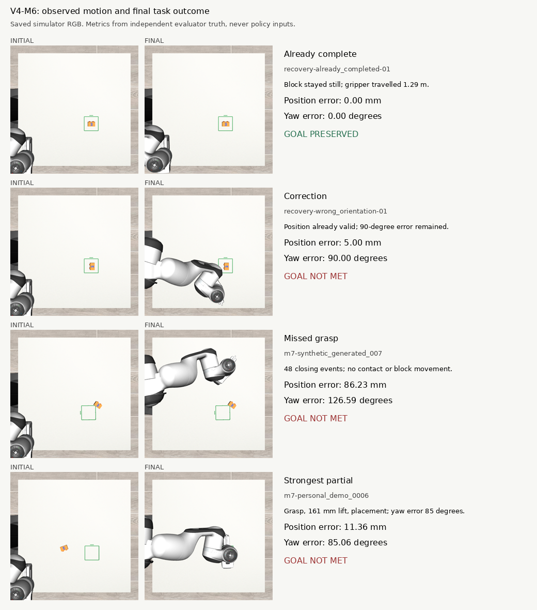

# Powerglide recovery, motion audit and live Typhon verification

10 October 2026. This is a new evaluation record. Frozen M0–M7 artifacts and their scores were not overwritten. No new policy training was performed.

The live harness correctly stopped on the tested already-completed scenes, without issuing learned manipulation actions. It did not make the learned policy solve unfinished tasks. A separately labelled geometric expert completed all three reachability checks. The next useful work is an action/data-contract audit and targeted grasp/reorientation validation, rather than another broad training run.

## What was recovered

Powerglide's workstation-local `/var/tmp` files survived the reboot. All 64 finalized M7 videos matched their frozen checksums, including the 15 absent from the public video export. Ten cached final checkpoints passed checksum checks; four more (V1 and V2 M5/M6) were recovered and verified. Thus 14 of 16 final checkpoints are on Powerglide. V4 M5/M6 remain on stopped RunPod `9outqvjcpp9dmp`; its host rejected GPU resumes and a CPU-only recovery resume for lack of host resources. These two files are not confirmed lost. The retained volume was not deleted.

RunPod compute is stopped. Recovery and new evaluation use Powerglide's RTX 4090. Mint is used only for archive storage. The GitHub repository remains private; no public dashboard snapshot was replaced.

UCL shared home has a **100 GiB hard quota**. It used 99,038 MiB before offloading and 94,968 MiB after the unused Qwen3-VL-2B-Instruct directory was moved: about **92.7 GiB used, 7.3 GiB available**. Workstation-local `/var/tmp` is a separate 300 GiB filesystem, outside this shared-home quota.

The 4,266,731,520-byte Qwen archive is SHA-256 verified on Mint's `/media/nm/Fast Drive/Typhon/archives/powerglide-20261010/`; its unused UCL copy was then removed. Two cold RunPod archives (19,254,312,960 and 25,617,039,360 bytes) are being copied directly there. Each source archive is deleted only after the destination hash agrees. Consult `offload.log`, each `verified.json`, and finally `completed.json` on Mint for actual completion. Current archive transfers run directly between Mint and Powerglide, without using the Mac for storage.

## Outcomes and interpretation

| Newly recovered checkpoint, common 1.5 s protocol | Unfinished tasks completed | Initially completed scenes passing all terminal conditions | Execution errors |
|---|---:|---:|---:|
| V1 M5 | 0/6 | 2/2 | 0 |
| V1 M6 | 0/6 | 2/2 | 0 |
| V2 M5 | 0/6 | 0/2 | 0 |
| V2 M6 | 0/6 | 0/2 | 0 |

These 32 episodes fill the four missing panels in the previous 128-episode ledger. The original common-protocol panels were 0/72 unfinished and 13/24 completed-condition successes. Adding these four panels gives **0/96 unfinished and 17/32 completed-condition successes** for the common protocol. The original separate four-second diagnostics remain **0/24 unfinished and 3/8 completed-condition successes**. Do not pool the two requested-horizon protocols as independent tasks or rank variants causally from these small panels. In particular, the common full-intent request at 1.5 seconds differs from parts of the training request distribution.

A failed terminal score does not necessarily mean the brick moved. In the new V2 completed cases, the brick position and yaw stayed effectively unchanged, with no object contact. V2-M5 ended with closed fingers; V2-M6 failed the requirement for open fingers throughout the stability window. Their arm paths were nevertheless unnecessary: **5.44–5.77 m for V2-M5 and 11.63–12.07 m for V2-M6**. The original evaluation definition is retained: it includes gripper opening in both release and stability checks, even if the hand is away from the brick.

| Live supervised configuration | Unfinished successes | Completed-condition successes | Learned manipulation actions in completed cases | False completion claims |
|---|---:|---:|---:|---:|
| V3 M6, 4 s; three candidates, prefix 3, 0.12 m target-step bound | 0/3 | 1/1 | 0 | 0/4 |
| V3 M6, 4 s; one candidate, prefix 20, 0.20 m target-step bound | 0/3 | 1/1 | 0 | 0/4 |
| V2 M6, 1.5 s; three candidates, prefix 3, 0.12 m bound | 0/2 | 2/2 | 0 | 0/4 |

The four completed trials cover **two unique completed scenes**, with repeated configurations; they are not four independent geometries. Holds and re-observation still issue stationary controller commands. All twelve main supervised cases completed without runtime errors. The tuned V3 run changes three execution settings together, so it is a diagnostic, not an isolated causal ablation. It increased executed actions but did not solve the task. Separate completed-scene UI smoke checks verify final observer publication; they are not included in this table.

The privileged geometric expert completed the source, held-out personal and correction checks: final position errors **11.58, 5.61 and 2.96 mm**, with yaw errors **0.267°, 0.004° and 0.313°** respectively. This establishes reachability with the existing scene/controller. These are expert successes, never learned-policy successes.

## What the movements actually show



The frozen V4-M6 personal case `m7-personal_demo_0006` remains the strongest partial execution inspected: bilateral grasp contact, 161 mm peak lift, transport and stable release to 11.36 mm position error, but **85.06° yaw error**. It failed the full task. The original camera view can obscure the brick near the arm; contact, lift and final errors here come from explicitly evaluator-only simulator measurements.

In contrast, the V4-M6 synthetic case `007` made 48 gripper-closing events without object contact or block motion. Closing commands are attempts, not successful grasps. In an already-completed V4-M6 case, 1,436 learned commands produced 1.293 m of end-effector travel while the block stayed put. Other original models really displaced completed bricks; the motion CSV separates placement-criterion violations from retained placement with failed release/stability conditions.

The analysis retains every scored outcome. Preliminary motion-review versions are preserved on disk; **motion-review-v3** is the corrected classification. Integration attempts that failed before valid execution (PEFT import/version mismatch, reset clock, and terminal budget handling) are listed separately in the validation JSON and excluded from policy-success counts.

## Harness implementation

The path is simulator RGB and measured robot state → stateful supervisor with CPU image-completion check → frozen X-VLA proposal(s) → workspace, joint and end-effector no-go checks → bounded controller prefix → fresh observation. The observer publishes actual joint positions, velocities, simulated actuator torques, applied commands, camera frames and the supervisor decision. Finished or stale samples are labelled accordingly. The dashboard is an observer, not a remote robot-control surface.

M7 integration preserves causal history after every actual control step, including holds. Rejected candidates do not commit target history. The reset's 40 settling steps are accounted for. Four-second requests reconstruct 80 controller steps, and guards inspect the whole proposed horizon. Terminal scoring has reserved control steps. The dependency version is PEFT **0.14.0**, matching these checkpoint keys; strict loading with the old 0.15.2 environment was rejected rather than partially accepted. Existing environments and original artifacts were preserved.

Completion requires the classifier's directed-numeral/position check, measured open fingers, five fresh qualifying images spanning at least 0.4 seconds, and limited image-position drift. Confidence is an uncalibrated classifier score, not a probability of success. Unknown orientation currently causes a conservative hold; sustained occlusion can therefore stall progress.

Candidate sampling is limited test-time compute: sample frozen-policy proposals, reject inadmissible ones, rank remaining paths by length/smoothness and execute a short prefix. It is **not** a learned value function, Q-learning, PPO, world-model search or an expert rescue. Qwen is not on the critical path. The no-go check concerns swept end-effector segments; it does not predict collisions for the entire arm. Simulation pauses during inference, so these timings do not establish real-time response in an independently moving world.

V2/V3 runs explicitly enable the same privileged causal held-state label used in their training data. It is recorded in manifests and telemetry. The classifier receives images, and the policy receives no object poses, future states or teacher actions. These annotation-conditioned variants should not be described as purely image-only deployment.

Personal recordings contribute observed scenario initial/goal conditions. The action-supervised RGB sequences are **robot simulation paired with geometric-expert actions**, not direct frame-aligned phone-video-to-robot-action training.

## Recommended next work

1. Keep the explicit completion latch and its fresh-observation check. It already prevents unnecessary learned commands on the two tested completed scenes.
2. Audit a tiny source episode end to end before renting more training GPUs: camera/crop orientation, requested intent and horizon, world frame, action normalization, 6D rotation columns, gripper polarity, and previous-command versus measured proprioception. Prove a one-source memorization/replay diagnostic can grasp and place with the exact deployed contract.
3. Then add targeted robot/expert supervision for missed-grasp approach, post-lift yaw correction, release and retreat. Include correctly labelled already-completed and failed-grasp states. Preserve the personal-scenario provenance and independent development/test splits.
4. Separate brick displacement, final placement geometry, contact/release, finger state and unnecessary arm motion in future evaluation. The current frozen terminal scores remain unchanged. A closed but empty hand away from a placed brick should not be narrated as having moved the brick.
5. Improve occlusion handling with bounded reacquisition and explicit uncertainty state; avoid treating an unobservable numeral as a new grasp target or as completion. More candidate sampling is useful only once admissibility and task progress can both be judged. A larger language model does not by itself repair the present action failures.

## Reproduction and evidence

Working checkout: `~/Projects/typhon-harness-20261010`, branch `work/recovery-harness-20261010`. Its local links reuse the already-installed simulator, X-VLA environments and frozen input data. Runtime versions include Torch 2.5.1+cu121, Transformers 4.51.3 and PEFT 0.14.0. Private model weights and frozen protocol source files are prerequisites; this report is not a bundled model download.

```bash
cd ~/Projects/typhon-harness-20261010
.venv-sim/bin/python -m unittest tests.test_m7_service tests.test_typhon_service tests.test_typhon_m7 tests.test_m7_telemetry tests.test_m7_variable_horizon

# A fresh output directory is mandatory; prior results cannot be overwritten.
run_dir=/var/tmp/typhon-harness-20261010/reproduce-v2-m6
.venv-sim/bin/python scripts/typhon_harness.py \
  --policy m7 --checkpoint /var/tmp/humanoid-m7-checkpoints-20261009/v2-m6.pt \
  --protocol /var/tmp/humanoid-m7-live-evaluation-20261009/preflight/protocol.json \
  --annotation-conditioned-v2 --output "$run_dir" \
  --cases recovery-already_completed-01 recovery-already_completed-03 \
          recovery-wrong_orientation-01 m7-personal_demo_0001 \
  --source-decisions 150 --source-wall-s 90 --decision-budget-s 8

# Rebuild the machine-readable report into another new directory.
python3 scripts/typhon_recovery_summary.py \
  --evidence /var/tmp/typhon-harness-20261010 \
  --output /var/tmp/typhon-harness-20261010/reproduced-review
python3 dashboard/check_http.py http://127.0.0.1:8766
```

The individual native panels use `scripts/m7_evaluate.py`, the same checkpoint/protocol paths and a fresh output directory; V2 also requires `--annotation-conditioned-v2`. The motion audit is reproducible with `scripts/typhon_motion_review.py --ledger <original deadline_evaluation_summary.json> --output <fresh directory>`. The expert diagnostic uses `scripts/typhon_expert_check.py --protocol <same protocol> --output <fresh directory>`.

Full evidence is at `/var/tmp/typhon-harness-20261010/`: RGB videos, scenario configs, actions, measured telemetry, candidate decisions, independent evaluator trajectories, manifests and source hashes. Compact records are [episodes.csv](episodes.csv), [validation_summary.json](validation_summary.json) and [frozen-motion-audit.csv](frozen-motion-audit.csv). The latest report generator preserves requested-horizon identity explicitly.

On the Powerglide desktop, open **http://127.0.0.1:8766/**. On Nat's Mac the existing SSH tunnel exposes **http://127.0.0.1:18766/**. After a run ends the observer intentionally shows its last frame as stale/finished; replay and scores remain available. No result is made live merely by replaying its video.

Validation: 32 focused unit checks passed, Python compilation passed, and the dashboard HTTP checks passed for grouped outcomes, evidence/trajectory retrieval, video byte ranges, path containment, read-only methods and finished observer state. The signed-in Mac browser was also used to inspect the live RGB feed and measured joint telemetry. Runtime versions are saved in [runtime.json](runtime.json).
